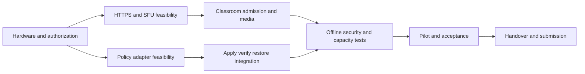

# Timeline and milestones

> **9 November planning update:** Latest user-provided site screenshots show three development sprints starting November 30, different task allocations, and release/presentation dates through February 3. Earlier dates/allocations below are historical proposals, not the current meeting commitment. Use the [November 10 meeting package](../meeting-2026-11-10/README.md) to review the new baseline and January 25 editing-cutoff question. Approval remains pending.

**Version:** 0.1 · **Prepared:** 9 November 2026 · **Status:** Proposed review draft; no teacher approval or product test execution claimed.

## 1. Planning basis

The following dates are retained from the prior plan, not claims of work completed. On 9 November 2026 Sprint 1 is already partly elapsed. Confirm actual work, remaining hours and calendars immediately; a newly written plan cannot retroactively supply November 2–8 capacity. Planning timezone: Asia/Phnom_Penh; verify course website deadline timezone.

| Sprint | Dates | Goal / review evidence |
|---|---|---|
| 1 | 2–15 Nov 2026 | Feasibility and two-viewer local demonstration; G1 |
| 2 | 16–29 Nov | Class permissions, controls, audio and reconnect |
| 3 | 30 Nov–13 Dec | Profiles, verified apply and restoration; G2 |
| 4 | 14–27 Dec | Remaining required behavior, failure recovery and both deployment modes |
| 5 | 28 Dec–10 Jan 2027 | Capacity/offline/security evidence; G3 release candidate |
| 6 | 11–24 Jan | Pilot, corrections, acceptance, documentation and demo; G4 readiness Jan 22 |

Final course editing deadline: **25 January 2027, 23:59**. Use Jan 25 as submission contingency, not planned core implementation time. Proposed physical pilot Jan 11–15 requires booking and participants.

## 2. Dependencies

## 3. Milestone exit criteria

G1: access/trust/media feasibility and unresolved scope recorded. G2: core classroom plus actual policy verification/restoration demonstrated. G3: required tests executed, defects triaged, physical/simulated scale limitations explicit. G4: acceptance decision, guides, reproducible demo and source links ready. Gates are **Pending**.

## 4. Forecast control

Track actual hours and remaining estimates by WBS; confirm individual calendars each sprint. Move lower-priority scope first; seek teacher decisions for Must scope/deadline trade-offs. No mathematical critical path is claimed without resource calendars and refined activity durations.
