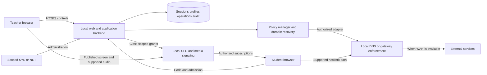

# System architecture

**Version:** 0.1 · **Prepared:** 9 November 2026 · **Status:** Proposed review draft; no teacher approval or product test execution claimed.

## 1. Required boundaries and proposed technology

The source requires local services, SFU media delivery, secure browser capture, server-side secrets, actual enforcement verification and recovery. The v1 proposal selects React/Vite/TypeScript, NestJS, SQLite initially, self-hosted LiveKit, AdGuard Home, Caddy and Docker Compose. These are **Proposed**, not newly selected or approved here. Confirm selected versions, compatibility, licenses and operational support through D19. Hosting on the existing school Ubuntu/Linux server is user-stated context; suitability is not established.

## 2. Component diagram

## 3. Responsibility and communication

Backend owns user/resource authorization and class admission. SFU handles publication and subscriptions; media signaling establishes those connections. Application roster/status events are distinct from media signaling. Policy manager persists operations and requests approved enforcement; it is not itself a guarantee that a client uses that path. Database stores metadata and recovery records, not live video streams.

## 4. State and failure boundaries

Maintain separate class, publication and policy status as defined in [business rules](../01-requirements/07-business-rules.md). Class end revokes grants and media; network restoration may remain unresolved. SFU failure alone does not restore network rules. WAN loss differs from LAN loss. Reject stale publication actions and do not claim success from an adapter acknowledgment alone.

## 5. Architecture review

Confirm trust provisioning, server capacity, adapter capabilities, network authorization, role boundaries, durable recovery and source-derived tests before acceptance. See [ARCHITECTURE-AND-FLOWS.md](../../../classroomcast_v1/ARCHITECTURE-AND-FLOWS.md) for original proposal provenance; its coupled class/media state names and fixed retention/pause suggestions are not adopted as confirmed decisions.
