# System workflows F01–F18

**Version:** 0.1 · **Prepared:** 9 November 2026 · **Status:** Proposed review draft; no teacher approval or product test execution claimed.

## 1. Diagram authority and reading order

These are compact **proposed process overviews**, not executable code or proof that every concurrency path has been implemented. The original detailed Mermaid remains in [REQUIREMENTS-AND-ACTIVITIES.md](../../../classroomcast_v1/REQUIREMENTS-AND-ACTIVITIES.md) and the corrected F01 source in [board/row-3/F01-CLASSROOM-LIFECYCLE.mmd](../../../classroomcast_v1/board/row-3/F01-CLASSROOM-LIFECYCLE.mmd). The business rules in this package capture the later reviewed separation of authorization, stale operations, closure and restoration. Do not reproduce a generated image as an exact rendering unless generated from the checked code.

Suggested board review order: F01 → F05 → F06 → F10 → F13 → F08 → F07 → F12 → F15 → F14, then F04/F09/F11, deployment F02/F03 and selected F16–F18. This is a documentation review order, **not** mandatory runtime execution.

Green = Must; yellow = Should; gray = Could; red = proposed Won't; white = context/decision. CN/OR steps use proposed Must* classification. Exceptions remain mandatory when an optional capability is selected.

## 2. F01 — Entire classroom lifecycle

**Trigger / actor:** Prepared classroom; operator and teacher.  
**References:** F04/F05/F06/F08/F10/F13; D05.

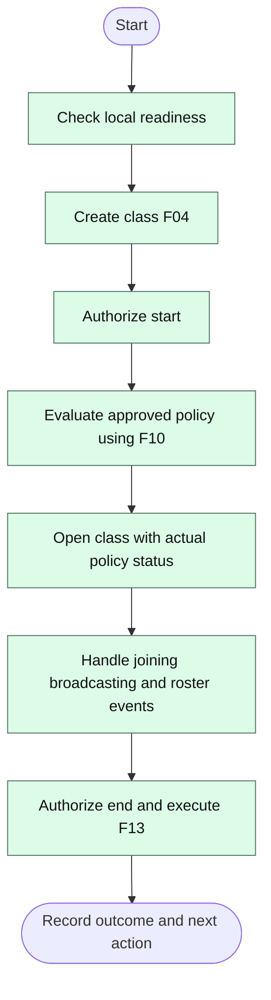

**Exception and recovery:** Unverified restrictions require the D05 agreed rule; aborted startup restores owned changes. Individual rejected joins do not end class.

**Postcondition / next action:** Class ended only after access/media closure verified; restoration is separate; F15 handles unresolved cleanup.

## 3. F02 — Prepare campus deployment

**Trigger / actor:** Authorized campus installer; before class.  
**References:** CN01–CN10; D10/D12/D18.

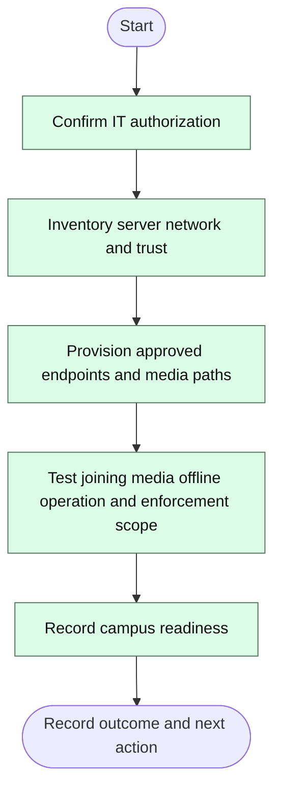

**Exception and recovery:** Missing permission, trust or media reachability prevents readiness; fix and retest.

**Postcondition / next action:** Prepared campus environment for F01; retain measured capacity and unverified integration gaps.

## 4. F03 — Prepare portable deployment

**Trigger / actor:** Authorized portable installer; before class.  
**References:** OR01–OR12; D12/D18.

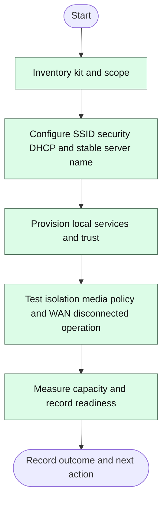

**Exception and recovery:** Insufficient AP capacity or unsupported adapter stays a documented gap; no per-class manual router-edit workaround counted as automation.

**Postcondition / next action:** Prepared portable environment for F01; equipment and recovery record retained.

## 5. F04 — Create classroom

**Trigger / actor:** Teacher requests new classroom.  
**References:** T01/T08; D04.

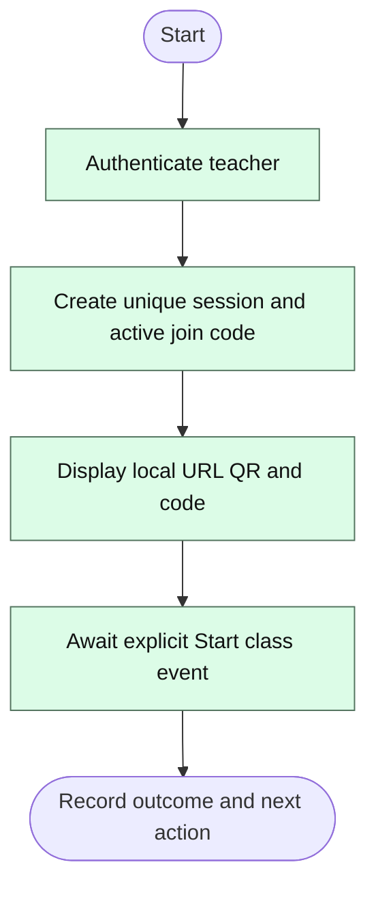

**Exception and recovery:** Unauthorized request creates no class; conflicting active code is regenerated safely.

**Postcondition / next action:** Created class; policy application and screen capture have not automatically happened.

## 6. F05 — Student joining and admission

**Trigger / actor:** Student opens local URL on classroom network.  
**References:** S01/S02/S07/T05/T06; D02/D03.

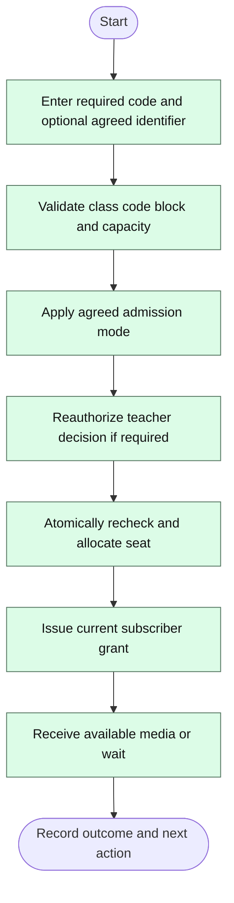

**Exception and recovery:** Pending/rejected/full/closed requests have no viewing grant. Recheck capacity at commit; rejected unauthorized teacher action does not reject the student.

**Postcondition / next action:** Admitted waiting or viewing; F12 reconnects, F08 manages access, F13 ends class.

## 7. F06 — Start screen and audio broadcasting

**Trigger / actor:** Authorized teacher starts or retries publication.  
**References:** T02/T03/T04/T07/S03/S04; D09.

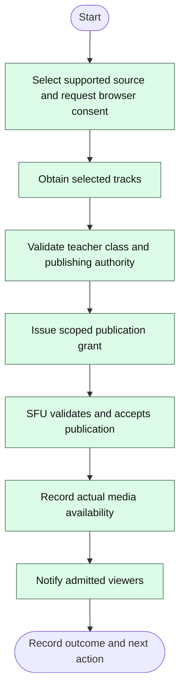

**Exception and recovery:** Capture refusal produces no publication. Missing optional mic must not be reported as captured. Service/authorization failure stays not publishing; release captured tracks when denied.

**Postcondition / next action:** Broadcast available even with zero viewers; F07 controls publication; F13 closes class.

## 8. F07 — Pause resume and stop broadcasting

**Trigger / actor:** Teacher controls current publication.  
**References:** T02/T07/S03/S04/S05; D08.

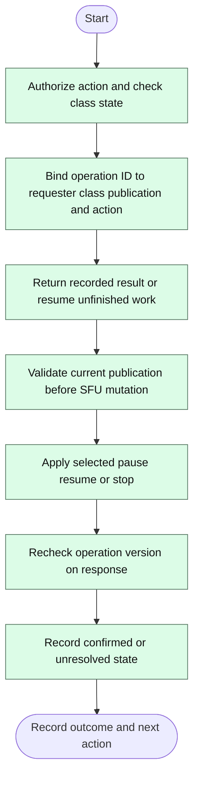

**Exception and recovery:** Closure takes precedence via F13; stale publication response cannot mutate new stream. Resume with ended capture goes to F06; failures route F12/F15.

**Postcondition / next action:** Pause/resume/stop leave admission intact. Stop ends publication, not class. D08 pause/audio semantics remain pending.

## 9. F08 — Participant management

**Trigger / actor:** Teacher opens roster and selects an action.  
**References:** T05/T06; D02/D03.

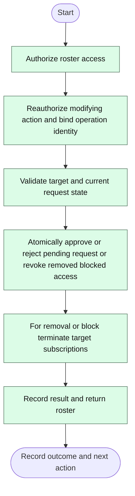

**Exception and recovery:** Approve rechecks final seat; rejected action changes nothing. SFU failure means removal recorded but media cleanup unresolved; schedule F15.

**Postcondition / next action:** Class stays open and teacher publication continues. Approved student continues F05; display names are not durable block identities.

## 10. F09 — Create or edit restriction profile

**Trigger / actor:** Scoped SYS or NET edits configuration.  
**References:** NAC02/03/04/07/08/16/17/18; D07/D15.

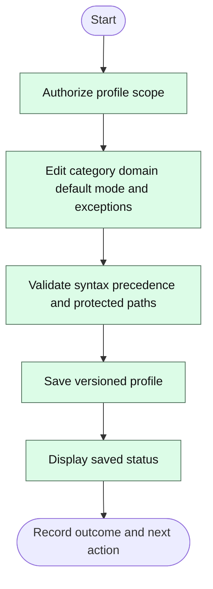

**Exception and recovery:** Invalid or out-of-scope edit is denied; no network mutation from save.

**Postcondition / next action:** Saved profile eligible for separately authorized F10 application.

## 11. F10 — Apply and verify restrictions

**Trigger / actor:** Authorized manual request or approved class-start automation.  
**References:** NAC01/05/10/11/16/17/18/19; D05/D06/D07/D15.

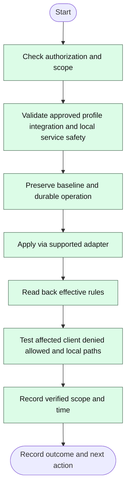

**Exception and recovery:** Rejected/partial/unknown result requires inspect/reconcile. Restore owned changes if needed; verified restoration or unresolved recovery is recorded.

**Postcondition / next action:** Return actual result to F01; F10 does not decide whether class may continue under D05.

## 12. F11 — Public website request

**Trigger / actor:** Student device requests an external domain.  
**References:** NAC02/03/04/08/18; D07.

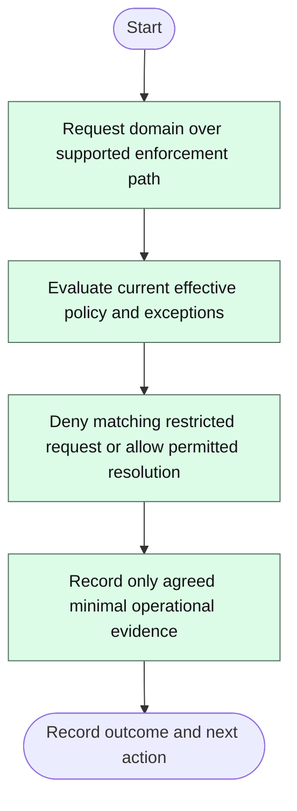

**Exception and recovery:** Alternate DNS/VPN/direct IP may bypass domain-only controls; WAN outage is not proof of selective denial.

**Postcondition / next action:** Local classroom remains available; show restrictions only for tested supported scope.

## 13. F12 — Connection loss and reconnection

**Trigger / actor:** Student or teacher media connection is interrupted.  
**References:** S06/S07; D11.

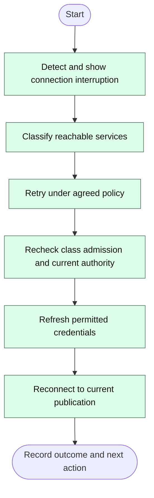

**Exception and recovery:** Ended class or revoked admission denies reconnect; lost capture requires explicit F06 consent. Persistent service failure routes F15.

**Postcondition / next action:** Same authorized class resumes or waiting/unresolved/denied status is shown; no automatic re-admission.

## 14. F13 — End class and restore policy

**Trigger / actor:** Teacher requests End class.  
**References:** NAC06/10/11; D11.

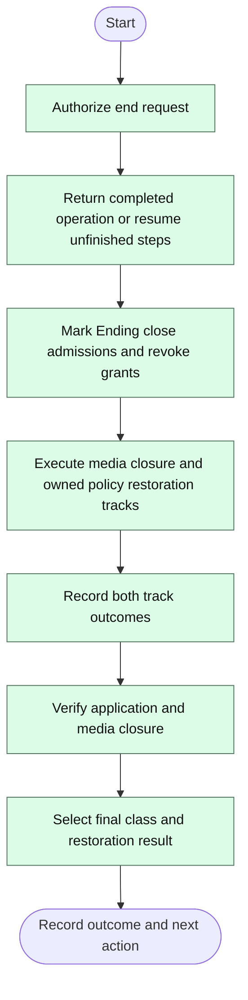

**Exception and recovery:** Unauthorized request leaves class unchanged. Closure unverified means Class ending; verified closure can coexist with pending restoration. Conflicting external network changes require reconciliation.

**Postcondition / next action:** Class ended with restoration not required verified or pending; otherwise Class ending cleanup unresolved. F15 continues recovery.

## 15. F14 — Temporary expiry and emergency disable

**Trigger / actor:** Durable expiry trigger or scoped authorized emergency action.  
**References:** NAC12/NAC13; D11/D15.

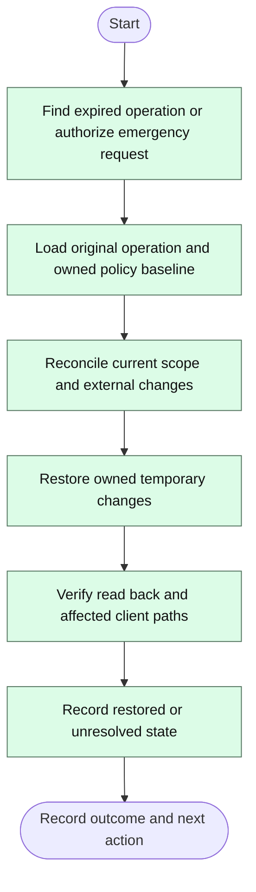

**Exception and recovery:** Unreachable or conflicting state is persistent unresolved recovery, not disabled/restored; repeated trigger is idempotent.

**Postcondition / next action:** Return status to active classroom/operator; F15 handles unresolved recovery; emergency policy action does not itself end class.

## 16. F15 — Diagnostics and recovery

**Trigger / actor:** Authorized operator or durable unresolved operation.  
**References:** Shared operational obligations; T09 Should; D11.

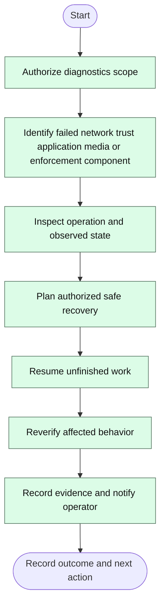

**Exception and recovery:** Never replay completed mutation or overwrite unrelated network changes; persistent fault remains unresolved and visible.

**Postcondition / next action:** Return verified result to originating flow or durable unresolved record with next operator action.

## 17. F16 — Share and download materials

**Trigger / actor:** Teacher shares approved materials; admitted student requests them.  
**References:** T10/S09 Should; D16.

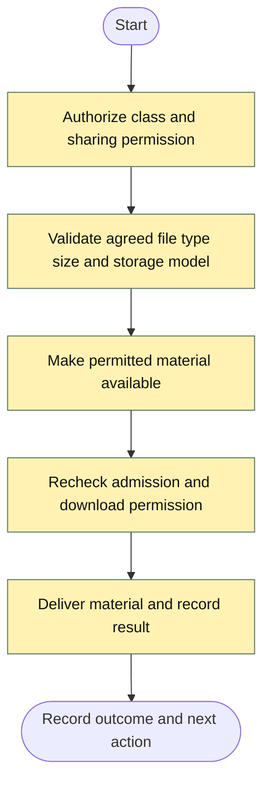

**Exception and recovery:** Reject forbidden type/size or revoked access; direct file route cannot bypass authorization.

**Postcondition / next action:** Material accessed or clear denial; class remains open; content handling details await D16.

## 18. F17 — Schedules and configuration transfer

**Trigger / actor:** Scoped administrator manages policy tools.  
**References:** NAC09/14/20 Should; D11.

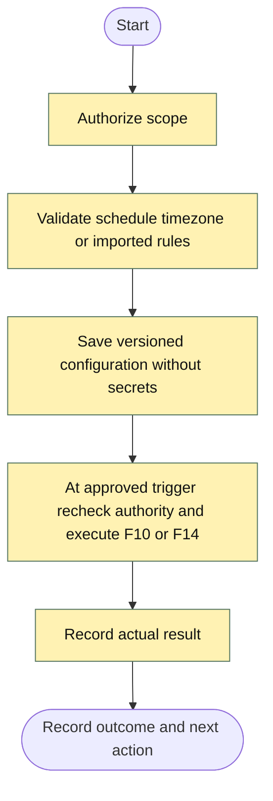

**Exception and recovery:** Malformed import changes nothing; missed schedule/retry behavior needs D11. Required offline runtime remains mandatory.

**Postcondition / next action:** Configuration saved or scheduled operation recorded; applying and verification remain separate.

## 19. F18 — Optional participation history and group policy

**Trigger / actor:** Actor uses an explicitly selected optional feature.  
**References:** S10/T11/NAC15 Could; D17.

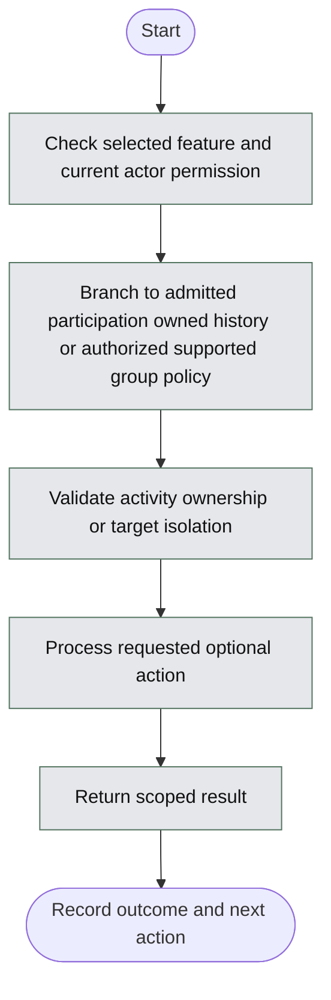

**Exception and recovery:** Unselected feature is not required; unauthorized submissions/history access denied; unsupported group identity cannot be claimed enforced.

**Postcondition / next action:** Return to class or admin view; no implied recording or remote student monitoring.

## 20. Mandatory branch diagrams for high-risk transitions

The overviews above show the principal sequence; the following diamonds define essential branching that must not be lost in a presentation.

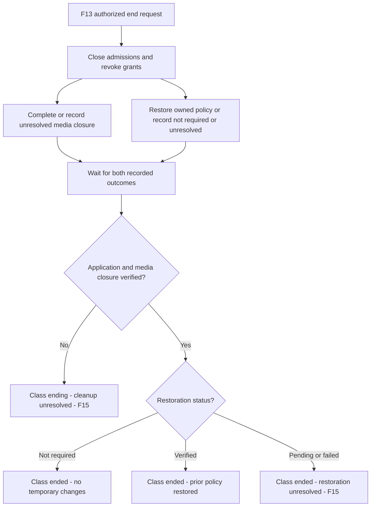

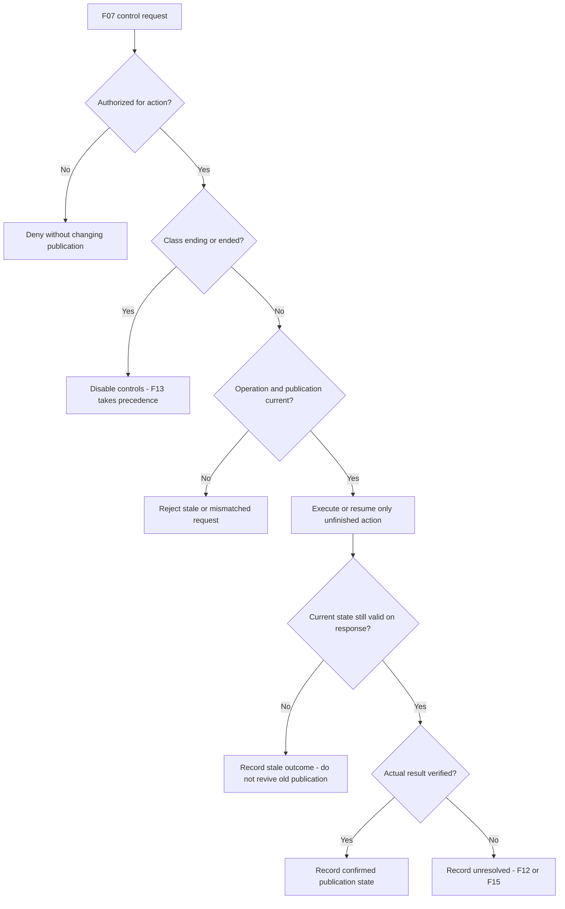
