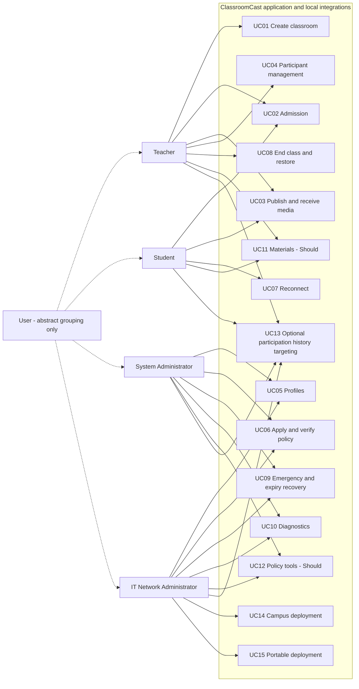

# Role-to-use-case diagram

**Version:** 0.1 · **Prepared:** 9 November 2026 · **Status:** Proposed review draft; no teacher approval or product test execution claimed.

## 1. Interpretation

This Mermaid flowchart is an actor-goal map, not a claim of formal UML use-case notation. Human roles are external to the application; automation is an internal mechanism. The optional abstract User parent conveys common access only and grants no inherited permissions. UC identifiers match the canonical catalogue.

## 2. Permission caveats

Every edge is subject to the [permission matrix](../01-requirements/06-user-roles-and-permissions.md). SYS/NET policy actions require assigned scope; diagnostic access is limited. Optional group targeting requires supported network identity. Teacher approval concerns only owned classes. No edge grants SYS/NET classroom media access. Automatic expiry and approved class-start policy actions act under recorded authority.
