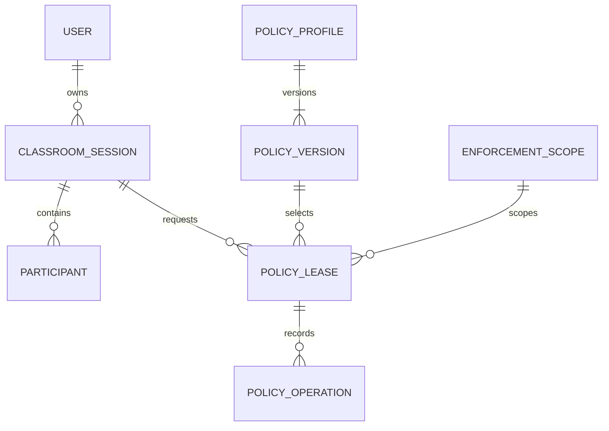

# Conceptual database design

**Version:** 0.1 · **Prepared:** 9 November 2026 · **Status:** Proposed review draft; no teacher approval or product test execution claimed.

## 1. Design status

The existing v1 data-model sketch is the basis below. This is a proposed logical model, not migrations or an approved physical schema. SQLite was previously proposed initially; PostgreSQL remains an existing alternative. Final engine, constraints and transaction behavior require feasibility review. Student identity need not be a permanent account (D03).

## 2. Entity catalogue

| Entity | Key fields / rule |
|---|---|
| User | id, role(s), credential hash; teacher/admin provisioning is authorized |
| ClassroomSession | id, teacherId, joinCodeHash, state, openedAt, endedAt, mediaRoomId |
| Participant | id, sessionId, admitted identity/token reference, admissionState, lastSeenAt |
| PolicyProfile / PolicyVersion | id, version, defaultAction, categories, domain rules, allow exceptions |
| EnforcementScope | id, adapter type, authorized network selector, capability flags, secret reference |
| PolicyLease | scopeId, sessionId, prior version/snapshot, desired version, expiry, state; at most one active per scope |
| PolicyOperation | idempotency key, leaseId, requested action, retries, result and verification timestamp |
| AuditEvent | actor, action, scope/session, timestamp, outcome; exclude credentials and browsing history |

## 3. Conceptual relationships

## 4. Integrity and transaction requirements

- Enforce unique active class codes and stable session identity; protect join secrets according to the finalized design.
- Admission final checks and seat allocation occur atomically. Concurrent final-seat approvals cannot both succeed. Rejection updates only a still-pending request.
- Operation identity binds requester/service, action, class, target/publication version or scope. Reused IDs with different intent are rejected; completed results are returned without mutation.
- Persist policy baseline, owned changes and operation intent before network mutation. Scope conflict handling is proposed under D06, not a license to overwrite other classes or campus IT.
- Closure stores independent application/media and policy-restoration outcomes. Recovery resumes unfinished work without repeating completed changes.
- Audit actor, scope, action, time and outcome; exclude raw secrets and unnecessary browsing histories. Retention and deletion await D13.

## 5. Proposed extensions requiring schema review

Role/scope grants, media publication versions, participant blocks and generic operation records support the reviewed workflows. Their precise tables/columns are **Proposed**; the original PolicyOperation entity alone does not define all media/control idempotency needs. Material metadata, schedules and history are included only for selected lower-priority scope.

## 6. Backup and restore verification

Inventory database, policy baselines, configuration and protected secret/certificate references. Restore a consistent test copy, reconcile pending operations against actual network state, and verify ended/revoked clients cannot regain access. Recovery objectives, backup frequency, encryption and retention choices require owner agreement; no successful backup drill is claimed.
