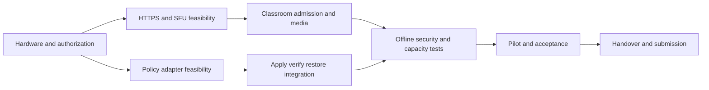

# 01 — Project Proposal

Prepared 9 November 2026 for teacher review on 10 November. **Draft; not approved or implemented.**

Use the meeting proposal PDF as the presentation summary. The detailed sections below are supporting evidence. The three-sprint meeting schedule supersedes older planning proposals for discussion; approval is pending.

---

Source: [01-project-proposal.md](../02-project-proposal/01-project-proposal.md)

# Project proposal

> **9 November planning update:** Latest user-provided site screenshots show three development sprints starting November 30, different task allocations, and release/presentation dates through February 3. Earlier dates/allocations below are historical proposals, not the current meeting commitment. Use the [November 10 meeting package](../meeting-2026-11-10/README.md) to review the new baseline and January 25 editing-cutoff question. Approval remains pending.

**Version:** 0.1 · **Prepared:** 9 November 2026 · **Status:** Proposed review draft; no teacher approval or product test execution claimed.

## 1. Proposed project

Develop ClassroomCast for local classroom screen/audio delivery, participation control and administrator-managed website restriction profiles. The expected educational value is readable demonstrations and observable, recoverable classroom operations during WAN outages. The client problem and benefits require teacher validation rather than unsupported claims of measured improvement.

## 2. Deliverables and boundaries

Deliver reviewed requirements, reusable local application/media/enforcement integration, both source deployment-mode demonstrations unless scope is formally revised, acceptance evidence, operating guides, source/demo links and a final academic report. Reuse an existing SFU; custom SFU construction, video archive, LMS/ERP integration and remote student-screen control are proposed exclusions.

## 3. Method and governance

Use six proposed two-week Scrum sprints within course milestones. Perform trusted-HTTPS, SFU and authorized enforcement feasibility work early. Demonstrate increments against traceable tests; teacher approval of release scope and campus IT permission are separate from team estimates. Exact stack remains provisional.

## 4. Resources and cost

Five named members have previously reported about 10 hours per week each. The prior 420-hour work estimate plus 42-hour contingency and 18-hour management reserve gives a provisional 480-hour envelope. The 600-hour nominal twelve-week capacity includes elapsed time and is not remaining capacity on 9 November. Hardware, certificate provisioning and cash budget are unknown; no procurement is authorized by this proposal.

## 5. Approval requested

Resolve target capacity, portable deployment inclusion, stakeholder authority, browser matrix, enforcement scope/failure rule, acceptance targets and current calendar. See [teacher checklist](../07-teacher-review/02-teacher-approval-checklist.md). Approval name/date/evidence: **Pending**. No sponsor signature or funding commitment is inferred.

## 6. Supporting plan

Use [scope](../02-project-proposal/02-project-scope.md), [feasibility](../02-project-proposal/04-feasibility-study.md), [schedule](../02-project-proposal/05-project-timeline-and-milestones.md), [risks](../02-project-proposal/06-risks-and-mitigation.md), and the original [PROJECT-PLAN.md](../../../classroomcast_v1/PROJECT-PLAN.md) for detailed WBS/effort provenance.

---

Source: [02-project-scope.md](../02-project-proposal/02-project-scope.md)

# Project scope

**Version:** 0.1 · **Prepared:** 9 November 2026 · **Status:** Proposed review draft; no teacher approval or product test execution claimed.

## 1. Release scope

Retain all supplied Must capabilities, the individually unlabeled campus/portable obligations and shared architectural requirements. Source scope includes local screen/audio broadcasting, class admission and control, policy administration/apply/verification/restoration, offline operation, diagnostics and authorized network setup. The teacher-specified capacity is 50–150 students. D12 concerns test conditions and evidence.

## 2. Demonstrable MVP versus full release

An early feasibility increment is one teacher and two laptops using trusted local access, valid joining and SFU playback, plus a separate authorized policy apply/restore spike. It is an early demonstration, not acceptance of the full required release. The second gate integrates permissions, supported audio, reconnection, policy state and safe recovery. Scaling and both modes must later be measured or explicitly changed through approval.

## 3. Lower-priority work

Should: richer diagnostics, materials, optional identification/downloads, scheduling/import-export/local list maintenance. Could: history, participation and supported group targeting. Global offline obligations remain required even though extra list-management convenience has a Should label. Optional features still require authorization and tests if delivered.

## 4. Proposed exclusions — needs agreement

| ID | Proposed exclusion | Boundary |
|---|---|---|
| W01 | Custom SFU implementation | Reuse a tested local SFU and integrate its controls |
| W02 | Mandatory native student app | Preserve browser-only participation |
| W03 | Recording/archive of classroom video | History summaries do not imply recordings |
| W04 | LMS/ERP integration | No integration requirement supplied |
| W05 | Remote control or capture of student screens | Roster monitoring concerns participation/connectivity |

## 5. Change control

For every requested scope change record source IDs, new wording, justification, dependency, affected tests, hours/cash/schedule impact and approving authority. Do not remove Must requirements merely to fit a sprint. See [decision log](../07-teacher-review/03-feedback-and-decision-log.md).

---

Source: [03-project-objectives-and-expected-outcomes.md](../02-project-proposal/03-project-objectives-and-expected-outcomes.md)

# Objectives and expected outcomes

**Version:** 0.1 · **Prepared:** 9 November 2026 · **Status:** Proposed review draft; no teacher approval or product test execution claimed.

## 1. Measurable outcome candidates

| Objective | Required evidence | Proposed measure / gate |
|---|---|---|
| Make teacher content available locally | F04/F05/F06 demonstration and TC-T01/S02/S03 | Supported source displayed to admitted viewers |
| Preserve classroom control | Permission and admission tests | Denied cross-class/publish/rejoin attempts; TC-AUTH |
| Operate without WAN | Fresh-browser local test and dependency inventory | AT07; no required runtime cloud fetch |
| Apply only authorized restrictions | F10 read-back and affected-client evidence | Denied domain, allowed control, local classroom available |
| Recover temporary network changes safely | End/expiry/emergency/restart trials | AT05; visible unresolved result when unreachable |
| Support agreed scale and quality | Physical and simulated counts reported separately | AT02/03; capacity D12 pending |
| Enable teacher operation and handover | Observed tasks and runbook walkthrough | Prior proposed usability median 4/5; approval pending |

## 2. Deliverable evidence register

Each outcome needs build/configuration, topology, actor/tester, timestamp, expected/actual result, evidence link, defects and reviewer. Current evidence status: **Not run / not collected**. A diagram or presentation is design evidence, not a successful software test.

## 3. Benefit evaluation

Compare observed task completion and reported legibility before and after a pilot if the teacher approves the method. Avoid causal claims from a small uncontrolled pilot. Record participant numbers and limitations in the final report.

---

Source: [04-feasibility-study.md](../02-project-proposal/04-feasibility-study.md)

# Feasibility study

> **9 November planning update:** Latest user-provided site screenshots show three development sprints starting November 30, different task allocations, and release/presentation dates through February 3. Earlier dates/allocations below are historical proposals, not the current meeting commitment. Use the [November 10 meeting package](../meeting-2026-11-10/README.md) to review the new baseline and January 25 editing-cutoff question. Approval remains pending.

**Version:** 0.1 · **Prepared:** 9 November 2026 · **Status:** Proposed review draft; no teacher approval or product test execution claimed.

## 1. Current conclusion

Feasibility is **unproven**. The architecture is a plausible proposal based on local services and reuse, but no delivered benchmarks or approved campus integration establish success.

## 2. Feasibility experiments

| Spike | Setup and procedure | Pass evidence | Failure response / owner |
|---|---|---|---|
| SP01 trusted offline access | Provision approved name/cert; fresh browsers on two laptops; remove WAN | Capture and app/media connections without trust bypass | Resolve trust with NET; Mengkong |
| SP02 SFU publication | One teacher, two viewers; screen and supported audio; zero-viewer start | Authorized publish/subscribe and observed media; supported matrix | Check transport/source compatibility; Dyhengmesa |
| SP03 enforcement | Isolated authorized scope; preserve baseline; apply test profile | Read-back plus denied/allowed/local-path controls; prior policy restored | Unsupported scope stays unavailable; Mengkong/Mesa |
| SP04 resilience | Interrupt backend/SFU/enforcement independently; replay pending operation | Truthful separate status, no stale admission or unsafe restore | Open defects and recovery decision; Sengleang/Hour |
| SP05 staged capacity | Document hardware/APs; increase subscriptions and physical clients | Resource/quality results at each agreed stage | Resolve D12 or equipment need; Mengkong |

## 3. Operational and schedule feasibility

Confirm server access, Ubuntu version, resources, existing workloads, network owner, maintenance windows and pilot devices. Permission to host does not authorize DNS/firewall modification. Six-sprint dates are inherited planning dates; November 9 reforecast is required. Scope/hours cannot be validated from diagram completion alone.

## 4. Economic feasibility

Reuse existing proposed SFU/filtering components and inventory borrowed resources first. Costs and licenses for selected versions must be checked before adoption. Record quotes only if procurement is needed; do not present unknown expenses as zero. The 480-hour planning envelope is effort, not a monetary budget.

## 5. Gate result template

For each spike record hypothesis, authorization, configuration, observations, pass/fail against agreed criteria, limitations, decision and reviewer. All five spikes are **Not run in this package**. Proceed with full implementation commitments only after the relevant dependency is evidenced or explicitly accepted as a risk.

---

Source: [05-project-timeline-and-milestones.md](../02-project-proposal/05-project-timeline-and-milestones.md)

# Timeline and milestones

> **9 November planning update:** Latest user-provided site screenshots show three development sprints starting November 30, different task allocations, and release/presentation dates through February 3. Earlier dates/allocations below are historical proposals, not the current meeting commitment. Use the [November 10 meeting package](../meeting-2026-11-10/README.md) to review the new baseline and January 25 editing-cutoff question. Approval remains pending.

**Version:** 0.1 · **Prepared:** 9 November 2026 · **Status:** Proposed review draft; no teacher approval or product test execution claimed.

## 1. Planning basis

The following dates are retained from the prior plan, not claims of work completed. On 9 November 2026 Sprint 1 is already partly elapsed. Confirm actual work, remaining hours and calendars immediately; a newly written plan cannot retroactively supply November 2–8 capacity. Planning timezone: Asia/Phnom_Penh; verify course website deadline timezone.

| Sprint | Dates | Goal / review evidence |
|---|---|---|
| 1 | 2–15 Nov 2026 | Feasibility and two-viewer local demonstration; G1 |
| 2 | 16–29 Nov | Class permissions, controls, audio and reconnect |
| 3 | 30 Nov–13 Dec | Profiles, verified apply and restoration; G2 |
| 4 | 14–27 Dec | Remaining required behavior, failure recovery and both deployment modes |
| 5 | 28 Dec–10 Jan 2027 | Capacity/offline/security evidence; G3 release candidate |
| 6 | 11–24 Jan | Pilot, corrections, acceptance, documentation and demo; G4 readiness Jan 22 |

Final course editing deadline: **25 January 2027, 23:59**. Use Jan 25 as submission contingency, not planned core implementation time. Proposed physical pilot Jan 11–15 requires booking and participants.

## 2. Dependencies

## 3. Milestone exit criteria

G1: access/trust/media feasibility and unresolved scope recorded. G2: core classroom plus actual policy verification/restoration demonstrated. G3: required tests executed, defects triaged, physical/simulated scale limitations explicit. G4: acceptance decision, guides, reproducible demo and source links ready. Gates are **Pending**.

## 4. Forecast control

Track actual hours and remaining estimates by WBS; confirm individual calendars each sprint. Move lower-priority scope first; seek teacher decisions for Must scope/deadline trade-offs. No mathematical critical path is claimed without resource calendars and refined activity durations.

---

Source: [06-risks-and-mitigation.md](../02-project-proposal/06-risks-and-mitigation.md)

# Risks and mitigation

> **9 November planning update:** Latest user-provided site screenshots show three development sprints starting November 30, different task allocations, and release/presentation dates through February 3. Earlier dates/allocations below are historical proposals, not the current meeting commitment. Use the [November 10 meeting package](../meeting-2026-11-10/README.md) to review the new baseline and January 25 editing-cutoff question. Approval remains pending.

**Version:** 0.2 · **Prepared:** 9 November 2026 · **Status:** Proposed review draft; no teacher approval or product test execution claimed.

The team roster supplied by the user lists **HENG NGUON HOUR** (representative), **BUN SENGLEANG**, **CHANTHA MENGKONG**, **HAK SENGKEA**, and **HONG DYHENGMESA**. Full roster names are used below. Risk assignments remain proposed; this revision corrects naming without reallocating responsibilities.

## 1. Inherited risk register

Scores are provisional ordinal judgments (probability/impact 1–5), not measured probabilities. Review each sprint; score ≥12 or impact 5 merits active escalation. Historical response dates in the old plan need current follow-up.

| ID | Cause → event → effect | P/I | Proposed risk owner | Prevention, trigger and fallback |
|---|---|---|---|---|
| R01 | Campus control access unknown → integration unavailable → campus enforcement cannot be accepted | 4/5 | CHANTHA MENGKONG | Obtain IT decision in Sprint 1; trigger: no workable path by 13 Nov; use authorized portable network for development and escalate campus gap |
| R02 | High viewer density → Wi-Fi saturation → freezes and capacity failure | 4/5 | CHANTHA MENGKONG | Wired server, staged tests and measured AP placement; trigger: loss/delay above targets at next load stage; lower agreed media profile/add APs or seek scope decision |
| R03 | Laptop trust provisioning unknown → screen/SFU connection fails → offline demo blocked | 3/5 | CHANTHA MENGKONG | Two-laptop HTTPS test in Sprint 1; trigger: untrusted endpoint; obtain campus trusted cert/name or agreed trust provisioning and retest |
| R04 | Policies span sessions/process restarts → incomplete restore → network remains restricted | 3/5 | HONG DYHENGMESA | Durable lease/snapshot, idempotent recovery worker and restore drill; trigger: rules differ after end/expiry; emergency restore with visible failure and operator runbook |
| R05 | DNS bypass is possible → users reach restricted services → enforcement overstated | 4/4 | CHANTHA MENGKONG | Agree DNS scope/limitations; test alternate resolver/VPN cases on lab equipment; stronger authorized gateway/device controls or accepted limitation |
| R06 | Audio varies by platform → expected source unavailable → media acceptance fails | 3/3 | CHANTHA MENGKONG | Publish compatibility matrix early; trigger: missing required audio source; agree supported combination and explicit fallback |
| R07 | Initial work exceeds available hours → delivery slips → Must scope incomplete | 4/5 | HENG NGUON HOUR | Refine estimate and actual calendar by 15 Nov; trigger: forecast above remaining capacity; defer Should/Could and obtain explicit Must trade-off decision |
| R08 | Privileged credentials or tokens mishandled → unauthorized control → demo/data compromised | 2/5 | HENG NGUON HOUR | Server-only secrets, scoped tokens and permission tests; trigger: exposed credential or bypass; revoke/rotate and stop affected admin action until corrected |

## 2. Current additions

| ID | Cause / event / consequence | Proposed risk owner | Response and trigger |
|---|---|---|---|
| R09 | Insufficient physical devices or Wi-Fi evidence prevents demonstration of the specified 50–150 capacity | HENG NGUON HOUR | Agree D12 test conditions; plan 150-student capacity evidence and distinguish physical from simulated clients |
| R10 | School host chosen without inventory; deployment may conflict with existing workloads | CHANTHA MENGKONG | Inventory and maintenance authorization before installation |
| R11 | Repeated generated diagrams diverge from code; team implements wrong paths | BUN SENGLEANG | Review Mermaid as source; deterministic rendering; trace every failure outcome |
| R12 | Pending semantic decisions accumulate; late rework delays release | HENG NGUON HOUR / HONG DYHENGMESA | Assign D01–D20 owners; prioritize admission, authority and restoration before sprint commitment |

## 3. Issue and escalation template

Record ID, opened date, trigger observed, impact, owner, next action, due date, decision needed and evidence. An observed problem becomes an issue; do not keep calling an active failure only a risk. Network impact escalates promptly to the authorized operator. Other external blockers go through HENG NGUON HOUR under the prior one-working-day escalation proposal.

## 4. Residual risk acceptance

Teacher and network owner must explicitly accept limitations relevant to their authority. A portable demonstration does not prove campus integration. No known risk has been recorded as accepted or closed by this package.

