# 05 — Use Cases and Process Flows

Prepared 9 November 2026 for teacher review on 10 November. **Draft; not approved or implemented.**

**Correct count: UC01–UC15 and F01–F18.** F18 covers optional participation/history/group policies; it must not disappear from the catalogue just because it is optional.

The compact v2 flows are summaries. The detailed v1 Mermaid below is inherited reference material, not confirmation that every latest chat/image correction was incorporated. F12 includes reauthorization and waiting/recovered outcomes, but its media-subscription failure and closing-state guards still need explicit review before design approval.

---

Source: [08-use-cases.md](../01-requirements/08-use-cases.md)

# Use-case catalogue

**Version:** 0.1 · **Prepared:** 9 November 2026 · **Status:** Proposed review draft; no teacher approval or product test execution claimed.

## 1. System boundary and catalogue

A use case is an actor goal, not a function count or mandatory runtime sequence. Preserve these UC IDs across the board, stories and tests.

| Use case | Primary actor | Goal / activities |
|---|---|---|
| UC01 | Teacher | Create class and publish joining information — F04 |
| UC02 | Student, Teacher for approval | Request and obtain admission — F05 |
| UC03 | Teacher, admitted Student | Publish/receive media and playback controls — F06/F07 |
| UC04 | Teacher | Manage roster and participant access — F08 |
| UC05 | SYS/NET with policy permission | Create/maintain profiles and exceptions — F09 |
| UC06 | SYS/NET or authorized class automation | Apply and verify supported restrictions — F10/F11 |
| UC07 | Student | Recover class connection — F12 |
| UC08 | Teacher and backend automation | End class, revoke access and restore policy — F13 |
| UC09 | SYS/NET or expiry automation | Emergency/expiry recovery — F14 |
| UC10 | Authorized operator | Diagnose/recover local services — F15 |
| UC11 | Teacher, admitted Student | Share/access permitted materials — F16 |
| UC12 | SYS/NET with policy permission | Schedule/import/export/local lists — F17 |
| UC13 | Teacher, Student, scoped policy administrator | Optional participation, history or group policy — F18 |
| UC14 | Authorized campus installer/NET | Prepare and verify campus deployment — F02 |
| UC15 | Authorized portable installer/NET | Prepare and verify portable deployment — F03 |

## 2. Use-case detail convention

For each goal use its linked F workflow for trigger, preconditions, success path, alternate path and final state. Shared preconditions are authorized role/resource scope and required services; exceptions must preserve truthful state. UC02 requires valid code and current eligibility; UC03 requires publisher authority and current subscriber admission; UC06 requires approved network scope; UC08 requires end authority before mutation. UC11–UC13 include lower-priority capabilities and do not silently become Must work.

## 3. Example — UC02 Request and obtain admission

Trigger: student opens local join page. Preconditions: correct network and trusted endpoint; active class. Student enters code and optional agreed identifier. Backend validates code, class, block and capacity; if approval mode applies, wait without viewing rights. Owning teacher decision is reauthorized. Final atomic checks allocate a seat and issue permitted subscription credentials. Pending, rejected, expired, full or revoked requests receive no viewing grant. Postcondition: admitted/waiting or admitted/viewing, or a clear non-admitted result. F05 and TC-S02/TC-ADM01–07 specify acceptance.

## 4. Administration coverage

Account provisioning, role assignment and app settings are supporting proposals in Area 06. Keep them explicit in permissions/design; do not renumber UC01–UC15 to disguise them as source-defined use cases. Their scope needs D01/D14 approval.


---

Source: [02-system-workflows.md](../03-system-analysis-and-design/02-system-workflows.md)

# System workflows F01–F18

**Version:** 0.1 · **Prepared:** 9 November 2026 · **Status:** Proposed review draft; no teacher approval or product test execution claimed.

## 1. Diagram authority and reading order

These are compact **proposed process overviews**, not executable code or proof that every concurrency path has been implemented. The original detailed Mermaid remains in [REQUIREMENTS-AND-ACTIVITIES.md](../../../classroomcast_v1/REQUIREMENTS-AND-ACTIVITIES.md) and the corrected F01 source in [board/row-3/F01-CLASSROOM-LIFECYCLE.mmd](../../../classroomcast_v1/board/row-3/F01-CLASSROOM-LIFECYCLE.mmd). The business rules in this package capture the later reviewed separation of authorization, stale operations, closure and restoration. Do not reproduce a generated image as an exact rendering unless generated from the checked code.

Suggested board review order: F01 → F05 → F06 → F10 → F13 → F08 → F07 → F12 → F15 → F14, then F04/F09/F11, deployment F02/F03 and selected F16–F18. This is a documentation review order, **not** mandatory runtime execution.

Green = Must; yellow = Should; gray = Could; red = proposed Won't; white = context/decision. CN/OR steps use proposed Must* classification. Exceptions remain mandatory when an optional capability is selected.


## 2. F01 — Entire classroom lifecycle

**Trigger / actor:** Prepared classroom; operator and teacher.  
**References:** F04/F05/F06/F08/F10/F13; D05.

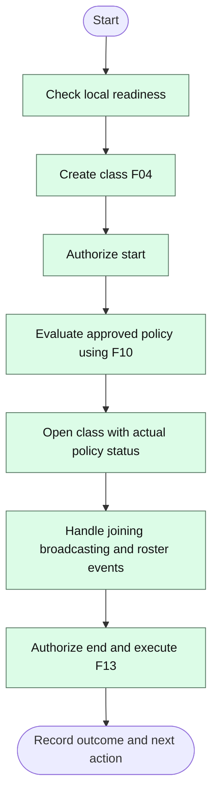

**Exception and recovery:** Unverified restrictions require the D05 agreed rule; aborted startup restores owned changes. Individual rejected joins do not end class.

**Postcondition / next action:** Class ended only after access/media closure verified; restoration is separate; F15 handles unresolved cleanup.


## 3. F02 — Prepare campus deployment

**Trigger / actor:** Authorized campus installer; before class.  
**References:** CN01–CN10; D10/D12/D18.

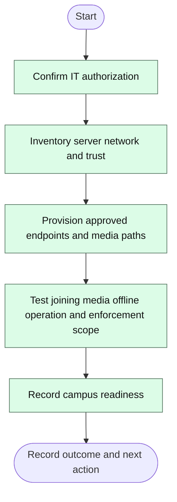

**Exception and recovery:** Missing permission, trust or media reachability prevents readiness; fix and retest.

**Postcondition / next action:** Prepared campus environment for F01; retain measured capacity and unverified integration gaps.


## 4. F03 — Prepare portable deployment

**Trigger / actor:** Authorized portable installer; before class.  
**References:** OR01–OR12; D12/D18.

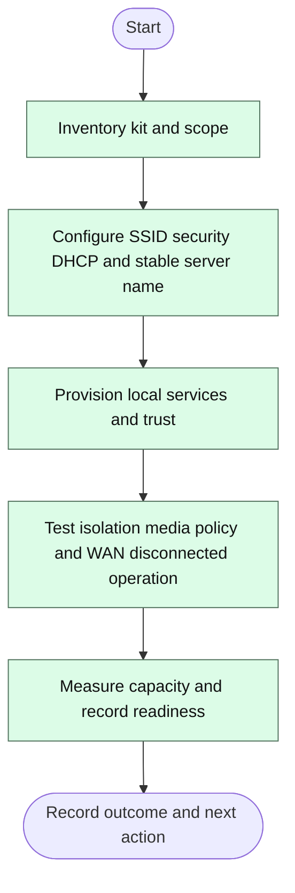

**Exception and recovery:** Insufficient AP capacity or unsupported adapter stays a documented gap; no per-class manual router-edit workaround counted as automation.

**Postcondition / next action:** Prepared portable environment for F01; equipment and recovery record retained.


## 5. F04 — Create classroom

**Trigger / actor:** Teacher requests new classroom.  
**References:** T01/T08; D04.

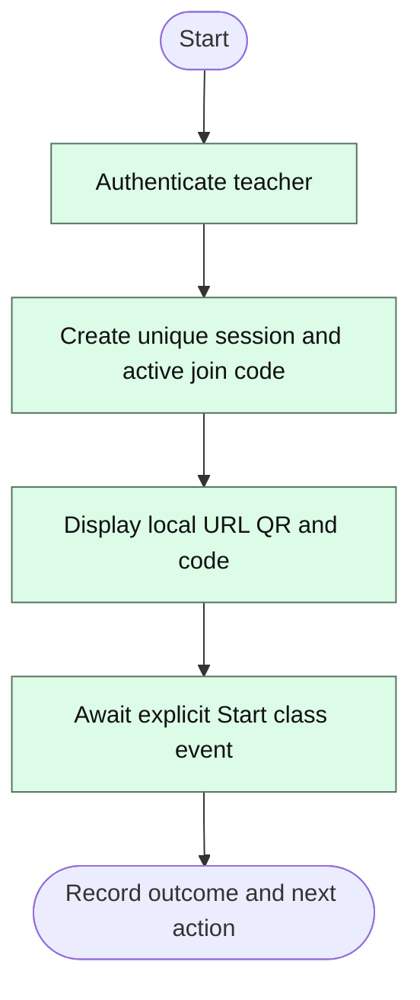

**Exception and recovery:** Unauthorized request creates no class; conflicting active code is regenerated safely.

**Postcondition / next action:** Created class; policy application and screen capture have not automatically happened.


## 6. F05 — Student joining and admission

**Trigger / actor:** Student opens local URL on classroom network.  
**References:** S01/S02/S07/T05/T06; D02/D03.

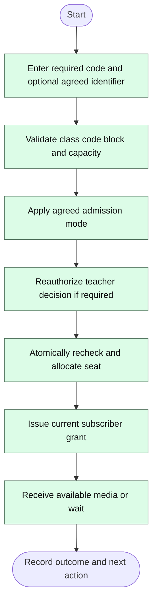

**Exception and recovery:** Pending/rejected/full/closed requests have no viewing grant. Recheck capacity at commit; rejected unauthorized teacher action does not reject the student.

**Postcondition / next action:** Admitted waiting or viewing; F12 reconnects, F08 manages access, F13 ends class.


## 7. F06 — Start screen and audio broadcasting

**Trigger / actor:** Authorized teacher starts or retries publication.  
**References:** T02/T03/T04/T07/S03/S04; D09.

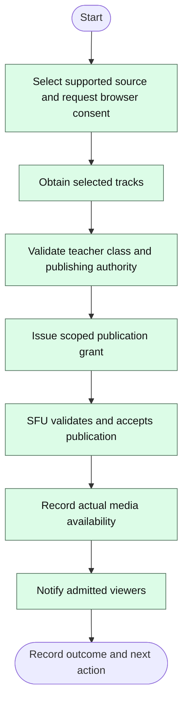

**Exception and recovery:** Capture refusal produces no publication. Missing optional mic must not be reported as captured. Service/authorization failure stays not publishing; release captured tracks when denied.

**Postcondition / next action:** Broadcast available even with zero viewers; F07 controls publication; F13 closes class.


## 8. F07 — Pause resume and stop broadcasting

**Trigger / actor:** Teacher controls current publication.  
**References:** T02/T07/S03/S04/S05; D08.

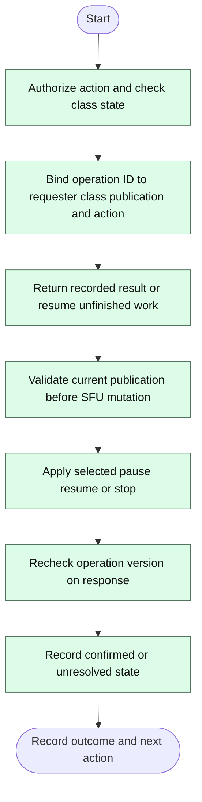

**Exception and recovery:** Closure takes precedence via F13; stale publication response cannot mutate new stream. Resume with ended capture goes to F06; failures route F12/F15.

**Postcondition / next action:** Pause/resume/stop leave admission intact. Stop ends publication, not class. D08 pause/audio semantics remain pending.


## 9. F08 — Participant management

**Trigger / actor:** Teacher opens roster and selects an action.  
**References:** T05/T06; D02/D03.

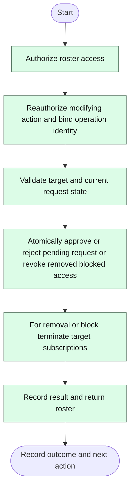

**Exception and recovery:** Approve rechecks final seat; rejected action changes nothing. SFU failure means removal recorded but media cleanup unresolved; schedule F15.

**Postcondition / next action:** Class stays open and teacher publication continues. Approved student continues F05; display names are not durable block identities.


## 10. F09 — Create or edit restriction profile

**Trigger / actor:** Scoped SYS or NET edits configuration.  
**References:** NAC02/03/04/07/08/16/17/18; D07/D15.

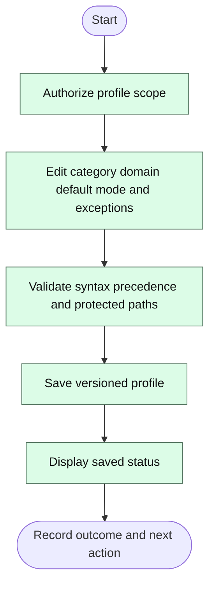

**Exception and recovery:** Invalid or out-of-scope edit is denied; no network mutation from save.

**Postcondition / next action:** Saved profile eligible for separately authorized F10 application.


## 11. F10 — Apply and verify restrictions

**Trigger / actor:** Authorized manual request or approved class-start automation.  
**References:** NAC01/05/10/11/16/17/18/19; D05/D06/D07/D15.

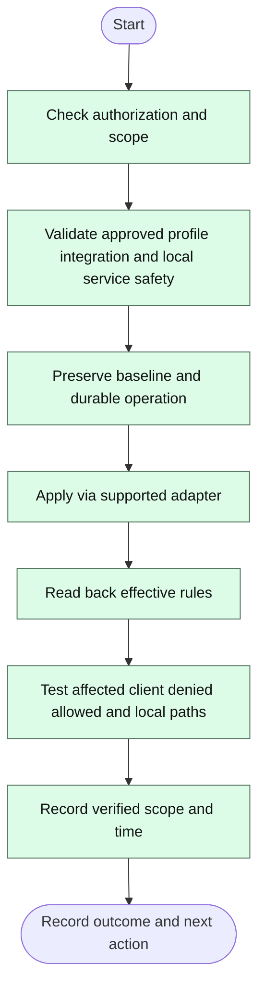

**Exception and recovery:** Rejected/partial/unknown result requires inspect/reconcile. Restore owned changes if needed; verified restoration or unresolved recovery is recorded.

**Postcondition / next action:** Return actual result to F01; F10 does not decide whether class may continue under D05.


## 12. F11 — Public website request

**Trigger / actor:** Student device requests an external domain.  
**References:** NAC02/03/04/08/18; D07.

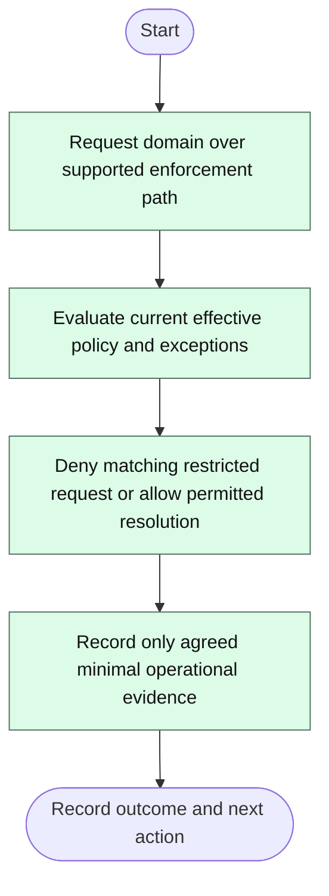

**Exception and recovery:** Alternate DNS/VPN/direct IP may bypass domain-only controls; WAN outage is not proof of selective denial.

**Postcondition / next action:** Local classroom remains available; show restrictions only for tested supported scope.


## 13. F12 — Connection loss and reconnection

**Trigger / actor:** Student or teacher media connection is interrupted.  
**References:** S06/S07; D11.

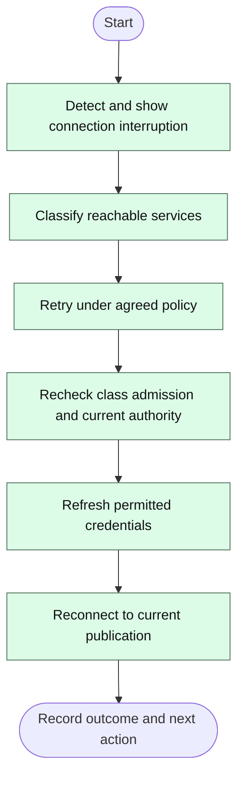

**Exception and recovery:** Ended class or revoked admission denies reconnect; lost capture requires explicit F06 consent. Persistent service failure routes F15.

**Postcondition / next action:** Same authorized class resumes or waiting/unresolved/denied status is shown; no automatic re-admission.


## 14. F13 — End class and restore policy

**Trigger / actor:** Teacher requests End class.  
**References:** NAC06/10/11; D11.

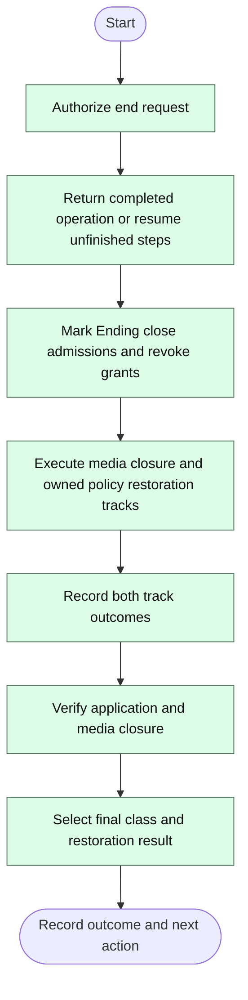

**Exception and recovery:** Unauthorized request leaves class unchanged. Closure unverified means Class ending; verified closure can coexist with pending restoration. Conflicting external network changes require reconciliation.

**Postcondition / next action:** Class ended with restoration not required verified or pending; otherwise Class ending cleanup unresolved. F15 continues recovery.


## 15. F14 — Temporary expiry and emergency disable

**Trigger / actor:** Durable expiry trigger or scoped authorized emergency action.  
**References:** NAC12/NAC13; D11/D15.

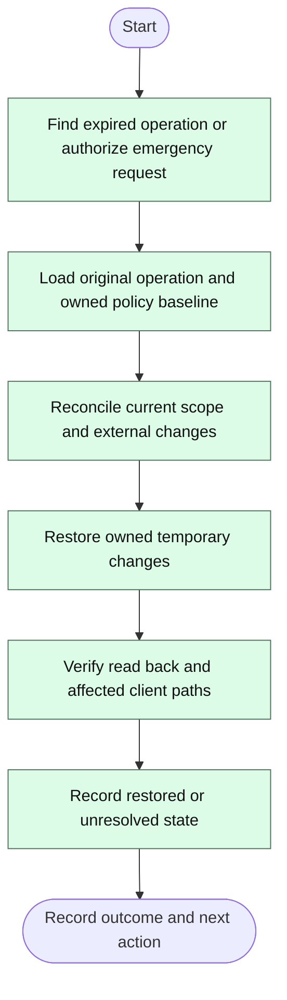

**Exception and recovery:** Unreachable or conflicting state is persistent unresolved recovery, not disabled/restored; repeated trigger is idempotent.

**Postcondition / next action:** Return status to active classroom/operator; F15 handles unresolved recovery; emergency policy action does not itself end class.


## 16. F15 — Diagnostics and recovery

**Trigger / actor:** Authorized operator or durable unresolved operation.  
**References:** Shared operational obligations; T09 Should; D11.

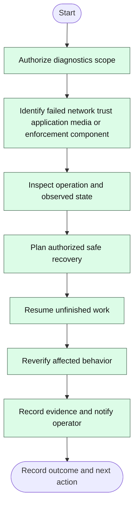

**Exception and recovery:** Never replay completed mutation or overwrite unrelated network changes; persistent fault remains unresolved and visible.

**Postcondition / next action:** Return verified result to originating flow or durable unresolved record with next operator action.


## 17. F16 — Share and download materials

**Trigger / actor:** Teacher shares approved materials; admitted student requests them.  
**References:** T10/S09 Should; D16.

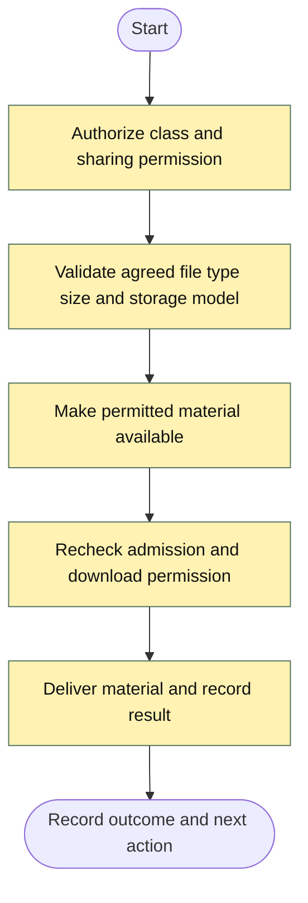

**Exception and recovery:** Reject forbidden type/size or revoked access; direct file route cannot bypass authorization.

**Postcondition / next action:** Material accessed or clear denial; class remains open; content handling details await D16.


## 18. F17 — Schedules and configuration transfer

**Trigger / actor:** Scoped administrator manages policy tools.  
**References:** NAC09/14/20 Should; D11.

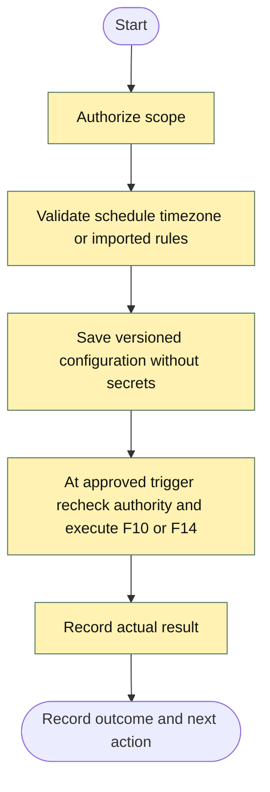

**Exception and recovery:** Malformed import changes nothing; missed schedule/retry behavior needs D11. Required offline runtime remains mandatory.

**Postcondition / next action:** Configuration saved or scheduled operation recorded; applying and verification remain separate.


## 19. F18 — Optional participation history and group policy

**Trigger / actor:** Actor uses an explicitly selected optional feature.  
**References:** S10/T11/NAC15 Could; D17.

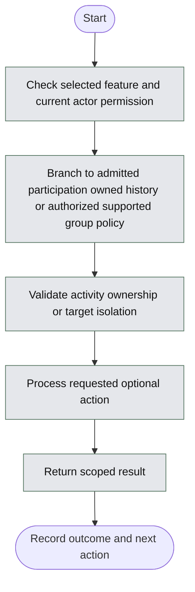

**Exception and recovery:** Unselected feature is not required; unauthorized submissions/history access denied; unsupported group identity cannot be claimed enforced.

**Postcondition / next action:** Return to class or admin view; no implied recording or remote student monitoring.


## 20. Mandatory branch diagrams for high-risk transitions

The overviews above show the principal sequence; the following diamonds define essential branching that must not be lost in a presentation.

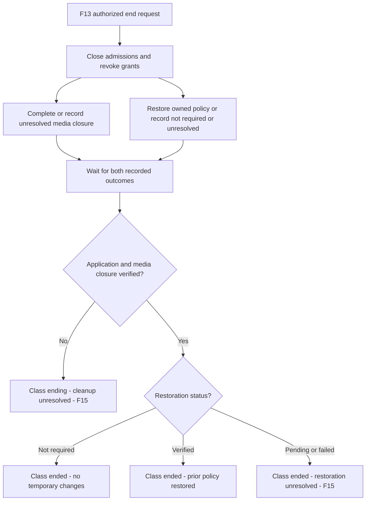

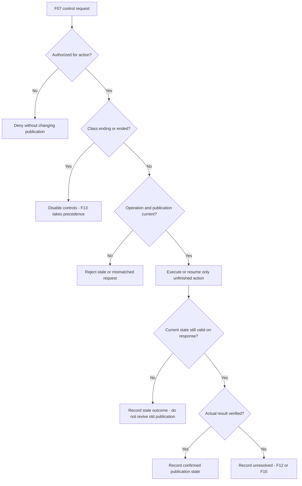


## Detailed inherited activity diagrams

## Flow 01 — Entire classroom lifecycle

**Responsibility lanes:** neutral backgrounds identify Operator, Teacher/browser, Student/browser, Backend, SFU and Enforcement Service. Individual node colors retain MoSCoW meaning; diamonds are conditions and double-bordered boxes reference detailed workflows.

**Workflow classification: MUST** — overview of required capabilities. D05 remains a white, unresolved client/operator choice; no proposed continuation rule is treated as approved.

**Trigger:** A prepared campus or portable classroom is about to begin. **Outcomes:** unauthorized start denied; startup aborted with distinct rollback outcomes; or a running class ends with restoration not required, verified or unresolved. If access/media closure itself is not verified, show **Class ending — cleanup unresolved**, not Class ended.

**Overview semantics:** F01 coordinates the detailed processes; it does not replace F04, F05, F06, F08, F10 or F13. The classroom-event loop is a compact view of repeated/asynchronous events, not a single-threaded implementation requirement. Student joining, pending-request completion, publication and participant control can occur independently while the class is open. Teacher publication does not wait for a first admission. An individual invalid/pending/rejected join does not terminate the class. Only current admitted viewers receive available media; successful publication with zero viewers is still valid.

```mermaid
flowchart TD
    subgraph OP["1. OPERATOR / AUTHORIZED OPERATOR"]
        direction TB
        START([Start: campus or portable infrastructure prepared]):::context
        CHECK[Check local service readiness]:::must
        READY{Required classroom services ready?}:::must
        REPAIR[Diagnose and repair setup]:::must
        CONTINUE{"D05 — PENDING<br/>May this class continue without verified restrictions?"}:::context
    end

    subgraph TE["2. TEACHER / TEACHER BROWSER"]
        direction TB
        CREATE[["F04 — CREATE CLASSROOM<br/>Create class and publish URL, QR and join code"]]:::must
        REQUEST_START[Request Start class]:::must
        PUBLISH[["F06 — START BROADCASTING<br/>Select source and grant browser capture consent"]]:::must
        MANAGE[["F08 — MANAGE PARTICIPANTS<br/>Monitor, approve, reject, remove or block"]]:::must
        REQUEST_END[Request End class]:::must
    end

    subgraph ST["3. STUDENT / STUDENT BROWSER"]
        direction TB
        JOIN[["F05 — JOINING AND ADMISSION<br/>Enter required code and request admission"]]:::must
        JOIN_STATUS[Show pending, rejected or invalid admission result]:::must
        WAIT[Show admitted status; waiting for media or media recovery]:::must
        WATCH[Any admitted viewers watch and use personal playback controls]:::must
    end

    subgraph BE["4. BACKEND / APPLICATION SERVICE"]
        direction TB
        AUTH{Teacher authorized and owns this class?}:::must
        DENY_START[Reject start and record denied outcome]:::must
        NOT_STARTED([Class not started]):::context
        PROFILE{Approved profile assigned to authorized scope?}:::must
        NO_POLICY[Record no class restriction applied]:::must
        APPLY[["F10 — APPLY AND VERIFY POLICY<br/>Validate permission, scope and protected local services"]]:::must
        VERIFY[Read back effective rules and probe affected-client path]:::must
        VERIFIED{F10 enforcement verified?}:::must
        FAILURE[Show unavailable or unverified enforcement and known partial changes]:::must
        ACTIVE[Record class active and actual restriction state]:::must
        EVENT{Next classroom event while class remains open?}:::must
        ADMISSION{F05 result under current admission and media state?}:::must
        PUB_RESULT{F06 publication successfully running?}:::must
        NO_BROADCAST[Keep class open; report waiting, denied capture or media failure]:::must

        ABORT[Mark startup aborted; prevent new admission and publication]:::must
        ABORT_CHANGES{Temporary policy changes exist or cannot be ruled out?}:::must
        ABORT_VERIFY[Read back and probe prior policy after rollback attempt]:::must
        ABORT_OK{Prior policy verified?}:::must
        ABORT_RECORD_NONE[Record startup aborted; no temporary change to restore]:::must
        ABORT_RECORD_OK[Record startup aborted and prior policy restored]:::must
        ABORT_RECORD_PENDING[Persist recovery task; record unresolved rollback and notify operator]:::must
        ABORT_END_NONE([Startup aborted — restoration not required]):::context
        ABORT_END_OK([Startup aborted — prior policy restored]):::context
        ABORT_END_PENDING([Startup aborted — rollback unresolved; background recovery continues]):::context

        END_CLASS[["F13 — AUTHORIZED END CLASS<br/>Check ownership before changes; close admission/media; restore if needed"]]:::must
        END_RESULT{F13 closure and restoration result?}:::must
        END_DENIED[Record denied end request; leave class unchanged]:::must
        END_RECORD_NONE[Record class closed, participants disconnected and no policy change to restore]:::must
        END_RECORD_OK[Record class closed, participants disconnected and verified restoration]:::must
        END_RECORD_PENDING[Record class closed and participants disconnected; persist unresolved restoration and notify operator]:::must
        CLOSE_PENDING[Keep explicit ending state; deny new admissions and report unverified cleanup through F15 recovery]:::must
        CLOSE_UNRESOLVED([Class ending — access or media cleanup unresolved; background recovery continues]):::context
        END_NONE([Class ended — restoration not required]):::context
        END_OK([Class ended — prior policy restored]):::context
        END_PENDING([Class ended — restoration pending/failed; background recovery continues]):::context
    end

    subgraph SF["5. SFU MEDIA SERVICE"]
        direction TB
        FORWARD[Forward available published tracks only to currently authorized admitted viewers]:::must
    end

    subgraph NE["6. NETWORK ENFORCEMENT SERVICE"]
        direction TB
        EN_APPLY[Apply supported rules only after F10 validation permits the change]:::must
        EN_ABORT[Attempt safe restoration of recorded prior policy for aborted startup]:::must
    end

    START --> CHECK --> READY
    READY -->|No| REPAIR --> CHECK
    READY -->|Yes| CREATE --> REQUEST_START --> AUTH
    AUTH -->|No| DENY_START --> NOT_STARTED
    AUTH -->|Yes| PROFILE
    PROFILE -->|No profile selected| NO_POLICY --> ACTIVE
    PROFILE -->|Selected but approval or scope unavailable| FAILURE
    PROFILE -->|Yes| APPLY
    APPLY -->|F10 preflight accepted| EN_APPLY
    APPLY -->|F10 denied or service unavailable| FAILURE
    EN_APPLY --> VERIFY --> VERIFIED
    VERIFIED -->|Yes| ACTIVE
    VERIFIED -->|No or service unavailable| FAILURE
    FAILURE --> CONTINUE
    CONTINUE -->|Yes: authorized continuation under D05| ACTIVE
    CONTINUE -->|No: abort startup| ABORT

    ABORT --> ABORT_CHANGES
    ABORT_CHANGES -->|No| ABORT_RECORD_NONE --> ABORT_END_NONE
    ABORT_CHANGES -->|Yes or uncertain| EN_ABORT --> ABORT_VERIFY --> ABORT_OK
    ABORT_OK -->|Yes| ABORT_RECORD_OK --> ABORT_END_OK
    ABORT_OK -->|No, conflict or service unavailable| ABORT_RECORD_PENDING --> ABORT_END_PENDING

    ACTIVE --> EVENT
    EVENT -->|Student join request| JOIN --> ADMISSION
    EVENT -->|Validated admission or media-state update| ADMISSION
    ADMISSION -->|Pending, rejected, invalid, blocked or full| JOIN_STATUS --> EVENT
    ADMISSION -->|Admitted; media unavailable| WAIT --> EVENT
    ADMISSION -->|Admitted; media available| FORWARD
    EVENT -->|Teacher starts or retries publication| PUBLISH --> PUB_RESULT
    PUB_RESULT -->|No| NO_BROADCAST --> EVENT
    PUB_RESULT -->|Yes| FORWARD
    FORWARD --> WATCH --> EVENT
    EVENT -->|Teacher manages participants| MANAGE --> EVENT
    EVENT -->|Teacher ends classroom| REQUEST_END --> END_CLASS --> END_RESULT
    END_RESULT -->|End request denied; class unchanged| END_DENIED --> EVENT
    END_RESULT -->|Closure incomplete or unverified| CLOSE_PENDING --> CLOSE_UNRESOLVED
    END_RESULT -->|Class closed; no temporary changes| END_RECORD_NONE --> END_NONE
    END_RESULT -->|Class closed; prior policy verified| END_RECORD_OK --> END_OK
    END_RESULT -->|Class closed; restoration pending or failed| END_RECORD_PENDING --> END_PENDING

    style OP fill:#F1F5F9,stroke:#94A3B8,color:#0F172A,stroke-width:2px
    style TE fill:#F1F5F9,stroke:#94A3B8,color:#0F172A,stroke-width:2px
    style ST fill:#F1F5F9,stroke:#94A3B8,color:#0F172A,stroke-width:2px
    style BE fill:#F1F5F9,stroke:#94A3B8,color:#0F172A,stroke-width:2px
    style SF fill:#F1F5F9,stroke:#94A3B8,color:#0F172A,stroke-width:2px
    style NE fill:#F1F5F9,stroke:#94A3B8,color:#0F172A,stroke-width:2px

    classDef must fill:#DCFCE7,stroke:#15803D,color:#14532D,stroke-width:2px;
    classDef should fill:#FEF3C7,stroke:#B45309,color:#78350F,stroke-width:2px;
    classDef could fill:#E5E7EB,stroke:#6B7280,color:#111827,stroke-width:2px;
    classDef wont fill:#FEE2E2,stroke:#B91C1C,color:#7F1D1D,stroke-width:2px;
    classDef context fill:#FFFFFF,stroke:#64748B,color:#0F172A,stroke-width:1px;
```

### F01 subprocess references and pending decision

| Reference | Responsibility in F01 | Contract to preserve |
|---|---|---|
| F04 — Create classroom | Teacher initiates; Backend validates/stores class | This overview proceeds after successful authorized creation. Creation/validation/media-setup errors remain in F04 and do not constitute successful startup |
| F05 — Joining and admission | Student submits code; Backend validates; owning Teacher decides where configured | Return actual admission/media state. Pending and rejected requests get no viewing grant. Recheck identity, class/code, block and capacity before allocating access |
| F06 — Start broadcasting | Teacher/browser capture and Backend/SFU publication authorization | Return publication running or not running. Permission denial/cancellation, unauthorized publish and media failure leave the class open with truthful waiting/error status |
| F08 — Participant management | Owning Teacher and Backend/SFU | Enforce ownership and current access; removal/blocking revokes relevant media/admission. Approval completion may produce a later validated admission-state event |
| F10 — Apply/verify policy | Backend coordinates; Enforcement Service applies permitted rules | The labeled F10 node and its downstream service/read-back actions are parts of one policy operation, not two applications. Reject unauthorized/unsafe scope before mutation; keep last actual state and partial changes visible |
| F13 — Authorized end class | Backend validates request before closure; SFU/enforcement perform required cleanup | Denied end request leaves the class unchanged. Only completed access/media closure produces Class ended. Policy restoration is conditional and separately verified |
| F15 — Diagnostics/recovery | Authorized operator and service recovery | Track unverified access/media cleanup separately from network-policy restoration; do not claim closure because the request was submitted |
| D05 — Continue without verified restrictions? | Authorized operator under client-agreed rule | Still Pending. A normal lesson/exam may need different behavior; this diagram does not authorize a particular override |

### F01 final states and next operational action

| Final state | Required record before the endpoint | Next action after the user-facing endpoint |
|---|---|---|
| Class not started — unauthorized start | Denied action and unchanged class state | Correct access or let the owning Teacher submit an authorized request |
| Startup aborted — restoration not required | No temporary policy mutation and admission/publication disabled for the aborted start | Resolve startup issue and make a fresh authorized start attempt |
| Startup aborted — prior policy restored | Verified rollback of temporary/partial policy changes | Resolve startup issue, revalidate scope and retry startup |
| Startup aborted — rollback unresolved | Durable recovery task, known state and operator notification | Retry safely/reconcile external changes; keep the scope unavailable for conflicting operations until recovered |
| Class ending — access/media cleanup unresolved | Explicit ending state, admission denial and unverified cleanup/recovery record | F15/operator completes and verifies cleanup; do not silently present the class as ended |
| Class ended — restoration not required | Completed access/media closure; no temporary change to restore | Return to dashboard, review permitted records or create a new class |
| Class ended — prior policy restored | Completed closure plus read-back/client-path verification of the prior policy | Return to dashboard, monitor services or create a new class |
| Class ended — restoration pending/failed | Completed access/media closure plus durable unresolved policy-restoration task | Background/operator recovery continues; prevent conflicting scope operations and update actual status when verified |

Startup rollback and normal class-end restoration use separate branches and records. They may reuse safe adapter/recovery functions, but their lifecycle outcomes must not be merged. Restoration is an attempt until read-back and affected-path checks confirm it; unreachable/conflicting service state remains unresolved. Outcome recording occurs before each terminal node, which has no outgoing process edge. Background recovery after an endpoint is described in this table rather than drawn as an outgoing edge from a terminal.

**Shape/color note:** All six lane styles are explicitly defined in the code. Mermaid may reposition subgraphs; a reference/layout change must not alter permissions, branching or recorded outcomes. This is an unexecuted workflow specification, not evidence of successful recovery or client acceptance.

## Flow 02 — Prepare campus deployment

**Responsibility lanes:** user/operator actions and automatic application/media/network actions are grouped separately. Authorization checks are server-side; delegated class automation uses recorded scope approval.


**Workflow classification: MUST*** — proposed MoSCoW label for source deployment obligations.

**Covers CN01–CN10.** This is installation/network preparation, generally performed before classes. Teachers should not need to edit router rules for every lesson.

```mermaid
flowchart TD
    subgraph F02LANE1["Campus IT / authorized installer"]
        direction TB
        A([Start]):::context
        B[Installer requests campus hosting and network authorization]:::must
        C{Hosting and required traffic approved?}:::must
        D[Record blocker; do not change campus controls]:::must
        Z([End: campus deployment blocked]):::context
        E[Configure approved server address, name and trusted HTTPS]:::must
        F[Run local web, backend, signaling, SFU and policy services]:::must
        G[Test student reachability, media ports and Wi-Fi isolation]:::must
        H{Classroom connectivity passes?}:::must
        I[Campus IT and installer fix approved configuration]:::must
        J{Enforcement authorized and supported?}:::must
        K[Configure approved DNS or gateway adapter and verify scope]:::must
        M[Validate capacity, discovery and local operation without WAN]:::must
        N[Record readiness and remaining acceptance gaps]:::must
        O([End]):::context
    end
    subgraph F02LANE2["Backend / application service"]
        direction TB
        L[Display enforcement unavailable or not authorized]:::must
    end

    A --> B
    B --> C
    C -->|No| D
    D --> Z
    C -->|Yes| E
    E --> F
    F --> G
    G --> H
    H -->|No| I
    I --> G
    H -->|Yes| J
    J -->|Yes| K
    J -->|No| L
    K --> M
    L --> M
    M --> N
    N --> O
    classDef must fill:#DCFCE7,stroke:#15803D,color:#14532D,stroke-width:2px;
    classDef should fill:#FEF3C7,stroke:#B45309,color:#78350F,stroke-width:2px;
    classDef could fill:#E5E7EB,stroke:#6B7280,color:#111827,stroke-width:2px;
    classDef wont fill:#FEE2E2,stroke:#B91C1C,color:#7F1D1D,stroke-width:2px;
    classDef context fill:#FFFFFF,stroke:#64748B,color:#0F172A,stroke-width:1px;
```

Campus browsing restrictions remain an acceptance gap if no approved integration exists. The system can expose that limitation accurately while classroom connectivity is tested; this does not mean CN10 is satisfied.

## Flow 03 — Prepare portable deployment

**Responsibility lanes:** user/operator actions and automatic application/media/network actions are grouped separately. Authorization checks are server-side; delegated class automation uses recorded scope approval.


**Workflow classification: MUST*** — proposed MoSCoW label for source deployment obligations.

**Covers OR01–OR12.** A teacher laptop may host the services if suitable; a separate local mini-PC/server is another option. Browser-only students do not mean server-free deployment.

```mermaid
flowchart TD
    subgraph F03LANE1["IT / authorized portable installer"]
        direction TB
        A([Start]):::context
        B[Installer checks router, access points, server, power and cables]:::must
        C[Set SSID, Wi-Fi security, DHCP and stable server address]:::must
        D[Connect server by Ethernet where possible]:::must
        E[Start local application, SFU and enforcement services]:::must
        F[Configure trusted local access and supported DNS routing]:::must
        G[Test application, media and restriction management from laptops]:::must
        H{Tests pass?}:::must
        I[Adjust network or service configuration]:::must
        J[Test with WAN disconnected]:::must
        K[Test increasing client counts and access-point capacity]:::must
        L{Offline and capacity requirements met?}:::must
        M[Fix bottleneck, add suitable equipment or record scope gap]:::must
        N[Save configuration and recovery instructions]:::must
        O([End: portable network ready]):::context
    end

    A --> B
    B --> C
    C --> D
    D --> E
    E --> F
    F --> G
    G --> H
    H -->|No| I
    I --> G
    H -->|Yes| J
    J --> K
    K --> L
    L -->|No| M
    M --> J
    L -->|Yes| N
    N --> O
    classDef must fill:#DCFCE7,stroke:#15803D,color:#14532D,stroke-width:2px;
    classDef should fill:#FEF3C7,stroke:#B45309,color:#78350F,stroke-width:2px;
    classDef could fill:#E5E7EB,stroke:#6B7280,color:#111827,stroke-width:2px;
    classDef wont fill:#FEE2E2,stroke:#B91C1C,color:#7F1D1D,stroke-width:2px;
    classDef context fill:#FFFFFF,stroke:#64748B,color:#0F172A,stroke-width:1px;
```

The example IP addresses in the source are examples, not fixed requirements. One router is not automatically sufficient for 150 active viewers; capacity and access-point needs must be measured.

## Flow 04 — Teacher creates a classroom

**Responsibility lanes:** user/operator actions and automatic application/media/network actions are grouped separately. Authorization checks are server-side; delegated class automation uses recorded scope approval.


**Workflow classification: MUST** (process steps support required capabilities).

**Covers T01, T08 and classroom administration.** Authentication is needed to enforce teacher authority; the source does not prescribe a particular login provider or token format.

```mermaid
flowchart TD
    subgraph F04LANE1["Teacher / Teacher browser"]
        direction TB
        A([Start]):::context
        B[Teacher opens local application and authenticates]:::must
        E[Teacher submits class settings]:::must
        H[Show errors for correction]:::must
        K[Display local URL, QR code and join code]:::must
        L([End: classroom available for joining]):::context
    end
    subgraph F04LANE2["Backend / application service"]
        direction TB
        C{Authorized to create class?}:::must
        D[Reject request and explain required access]:::must
        Z([End]):::context
        F[Backend validates settings and participant limit]:::must
        G{Valid?}:::must
        I[Create session ID and unique active join code]:::must
        SAVE[Backend stores class and requests media room]:::must
        READY{Media room ready?}:::must
        NOTREADY[Mark class unavailable for media and show retry]:::must
        FAILED([Class media setup incomplete]):::context
    end
    subgraph F04LANE3["SFU media service"]
        direction TB
        J[SFU attempts requested media-room preparation]:::must
    end

    A --> B
    B --> C
    C -->|No| D
    D --> Z
    C -->|Yes| E
    E --> F
    F --> G
    G -->|No| H
    H --> E
    G -->|Yes| I
    I --> SAVE
    SAVE --> J
    J --> READY
    READY -->|Yes| K
    READY -->|No or service unavailable| NOTREADY
    NOTREADY --> FAILED
    K --> L
    classDef must fill:#DCFCE7,stroke:#15803D,color:#14532D,stroke-width:2px;
    classDef should fill:#FEF3C7,stroke:#B45309,color:#78350F,stroke-width:2px;
    classDef could fill:#E5E7EB,stroke:#6B7280,color:#111827,stroke-width:2px;
    classDef wont fill:#FEE2E2,stroke:#B91C1C,color:#7F1D1D,stroke-width:2px;
    classDef context fill:#FFFFFF,stroke:#64748B,color:#0F172A,stroke-width:1px;
```

**URL** locates the application; **QR code** is a convenient way to open joining information; **join code** identifies/admit access to the session. A QR code does not create network connectivity by itself.

## Flow 05 — Student joins and is admitted

**Responsibility lanes:** user/operator actions and automatic application/media/network actions are grouped separately. Authorization checks are server-side; delegated class automation uses recorded scope approval.


**Workflow classification: MUST** (process steps support required capabilities).

**Covers S01–S02, S07, T05–T06; optional S08.** Mandatory manual approval for every student is a design choice. The system must support teacher approval/rejection, but the default admission mode needs agreement.

### Required join code and proposed admission modes

**S02 requires entry of a classroom join code in both modes below.** Teacher approval is an additional admission gate, not a replacement for code validation. Supporting both selectable modes is a proposal under D02; the required teacher approve/reject capability remains in scope. There is no approval-only, code-free joining path in this draft. A future QR-prefilled-code convenience would need explicit agreement about how S02 is satisfied; the current flow asks the student to enter the code.

| Proposed mode | Process | When viewing access is granted |
|---|---|---|
| **Code admission** | Student enters code → backend validates active class/code, block state and capacity → backend admits | Only after current checks pass; a valid code alone cannot bypass a full/closed class or a block |
| **Code + teacher approval** | Student enters code → backend checks eligibility → request waits for owning Teacher → Teacher approves/rejects → backend rechecks eligibility and capacity | Only after valid owning-Teacher approval and final backend checks; pending/rejected requests receive no subscriber grant |

Final checks must be atomic with admission/capacity allocation to avoid over-admitting simultaneous requests. If a code expires/rotates, the class ends, a block is added or capacity fills while approval is pending, do not admit based on the old check. Define pending-request timeout/cancellation and reserved-seat semantics in D02; proposed default is no seat reservation before admission. A rejected unauthorized approval attempt must not mutate the pending request as though the owning Teacher rejected it; deny the action and retain its actual admission state.

| Admission test | Proposed pass/fail check | References |
|---|---|---|
| TC-ADM01 | Code admission: valid active code plus available capacity admits; invalid/expired/closed code is rejected | S02, TC-S02, F05 |
| TC-ADM02 | Code + approval: valid code creates pending request with no viewing grant; owning Teacher approval admits only after final checks | T06, TC-T06, F05 |
| TC-ADM03 | Owning Teacher rejection prevents viewing; pending/cancelled/timed-out requests do not obtain media access | T06, TC-T06; timeout policy pending D02 |
| TC-ADM04 | Student, unrelated Teacher, or unscoped administrator cannot approve a request; denied attempt does not change its pending state | NAC16, TC-AUTH, F05/F08 |
| TC-ADM05 | While approval waits, end class / expire code / add block / fill capacity in separate trials; subsequent approval does not bypass final eligibility checks | T06, S02, TC-AUTH |
| TC-ADM06 | Two simultaneous requests compete for the final seat; at most one receives admission/media access under the agreed capacity rule | Classroom limits, S02, TC-S02 |
| TC-ADM07 | A missing join code is rejected in either mode; selecting approval mode does not create a code-free endpoint | S02, TC-S02 |

These are test specifications, not executed tests. Criteria approval remains Pending confirmation and results remain Not run. Link implementation of these checks to existing CC-003, CC-006 and CC-007 and their relevant verification items; no completed feature is inferred.

```mermaid
flowchart TD
    subgraph F05LANE1["Student / Student browser"]
        direction TB
        A([Start]):::context
        B[Student connects to classroom Wi-Fi or LAN]:::must
        C[Open local URL or scan QR code]:::must
        D{Application reachable?}:::must
        E[Show/check network instructions and diagnostics]:::must
        F[Enter class code]:::must
        IDENT{Optional identifier feature enabled?}:::context
        OPT[SHOULD: enter name or student ID]:::should
        I[Show invalid code, full, blocked or ended message]:::must
        Z([End: not admitted]):::context
        SFUE[Show media unavailable; retain explicit admission state]:::must
        SFUZ([Admitted; playback connection unresolved]):::context
        Q[Display waiting or paused message]:::must
        R[Begin receiving broadcast]:::must
        S([End: admitted and waiting]):::context
        T([End: admitted and viewing]):::context
    end
    subgraph F05LANE2["Backend / application service"]
        direction TB
        G[Backend checks code, class state, blocking and participant limit]:::must
        H{Initial code and eligibility checks pass?}:::must
        J{Configured admission mode under D02?}:::context
        K[Atomically allocate seat and admit with viewing permission]:::must
        FINAL{Class and code valid, not blocked, capacity available?}:::must
        AUTHDENY[Reject unauthorized approval action; preserve pending state]:::must
        STILLPENDING([Request remains pending without viewing access]):::context
        N[Reject request and inform student]:::must
        TAUTH{Backend verifies owning Teacher decision?}:::must
        DECISION{Submitted decision is approve?}:::must
        O[Backend authorizes subscription and updates teacher roster]:::must
        P{Teacher broadcasting?}:::must
    end
    subgraph F05LANE3["Teacher / Teacher browser"]
        direction TB
        L[Display pending request to teacher]:::must
        M[Teacher submits approval or rejection]:::must
    end
    subgraph F05LANE4["SFU media service"]
        direction TB
        SFUC{SFU connection available?}:::must
    end

    A --> B
    B --> C
    C --> D
    D -->|No| E
    E --> B
    D -->|Yes| F
    F --> IDENT
    IDENT -->|Yes| OPT
    IDENT -->|No| G
    OPT --> G
    G --> H
    H -->|No| I
    I --> Z
    H -->|Yes| J
    J -->|Code admission| FINAL
    J -->|Code plus teacher approval| L
    L --> M
    M --> TAUTH
    N --> Z
    TAUTH -->|No| AUTHDENY
    AUTHDENY --> STILLPENDING
    TAUTH -->|Yes| DECISION
    DECISION -->|Reject| N
    DECISION -->|Approve| FINAL
    FINAL -->|No| I
    FINAL -->|Yes| K
    K --> O
    O --> SFUC
    SFUC -->|No| SFUE
    SFUE --> SFUZ
    SFUC -->|Yes| P
    P -->|No| Q
    P -->|Yes| R
    Q --> S
    R --> T
    classDef must fill:#DCFCE7,stroke:#15803D,color:#14532D,stroke-width:2px;
    classDef should fill:#FEF3C7,stroke:#B45309,color:#78350F,stroke-width:2px;
    classDef could fill:#E5E7EB,stroke:#6B7280,color:#111827,stroke-width:2px;
    classDef wont fill:#FEE2E2,stroke:#B91C1C,color:#7F1D1D,stroke-width:2px;
    classDef context fill:#FFFFFF,stroke:#64748B,color:#0F172A,stroke-width:1px;
```

The diagram assumes the teacher makes a decision on a pending request; cancellation/timeouts require a final design. Names and class codes are not strong identity proof. Blocking persistence must be defined, particularly if students join anonymously.

## Flow 06 — Start screen and audio broadcasting

**Responsibility lanes:** user/operator actions and automatic application/media/network actions are grouped separately. Authorization checks are server-side; delegated class automation uses recorded scope approval.


**Workflow classification: MUST** (process steps support required capabilities).

**Covers T02–T04, T07, S03–S04.** WebRTC carries the real-time media. Signaling establishes the connection. The SFU receives teacher media and forwards it to students; the database stores application records, not the live video stream.

```mermaid
flowchart TD
    subgraph F06LANE1["Teacher / Teacher browser"]
        direction TB
        A([Start]):::context
        B[Teacher selects quality and audio settings]:::must
        C[Teacher clicks Start sharing]:::must
        D[Browser requests source selection and capture permission]:::must
        E{Teacher grants capture?}:::must
        F[Show cancellation or permission error; keep class open]:::must
        Z([End: no broadcast]):::context
        G[Capture selected screen, window or tab]:::must
        H[Include supported shared audio and optional microphone]:::must
        K[Show media error; release capture resources and offer retry]:::must
        L[Teacher publishes media to local SFU]:::must
    end
    subgraph F06LANE2["Backend / application service"]
        direction TB
        I[Backend authorizes publishing for this teacher and class]:::must
        AUTH{Publishing authorized?}:::must
        DENY[Reject publication and release capture]:::must
    end
    subgraph F06LANE3["SFU media service"]
        direction TB
        J{SFU reachable and publishing connection succeeds?}:::must
        M[SFU forwards permitted tracks to admitted students]:::must
    end
    subgraph F06LANE4["Student / Student browser"]
        direction TB
        N[Students display video and enable audio playback]:::must
        O([End: broadcast running]):::context
    end

    A --> B
    B --> C
    C --> D
    D --> E
    E -->|No| F
    F --> Z
    E -->|Yes| G
    G --> H
    H --> I
    I --> AUTH
    AUTH -->|No| DENY
    DENY --> Z
    AUTH -->|Yes| J
    J -->|No| K
    K --> Z
    J -->|Yes| L
    L --> M
    M --> N
    N --> O
    classDef must fill:#DCFCE7,stroke:#15803D,color:#14532D,stroke-width:2px;
    classDef should fill:#FEF3C7,stroke:#B45309,color:#78350F,stroke-width:2px;
    classDef could fill:#E5E7EB,stroke:#6B7280,color:#111827,stroke-width:2px;
    classDef wont fill:#FEE2E2,stroke:#B91C1C,color:#7F1D1D,stroke-width:2px;
    classDef context fill:#FFFFFF,stroke:#64748B,color:#0F172A,stroke-width:1px;
```

Capture requires the browser-supported secure context and user permission specified in the source. Audio support depends on operating system, browser and source selection. If audio is unavailable, show that limitation rather than claiming it is being shared. Agree which combinations satisfy the requirement.

## Flow 07 — View, pause, resume and stop sharing

**Responsibility lanes:** user/operator actions and automatic application/media/network actions are grouped separately. Authorization checks are server-side; delegated class automation uses recorded scope approval.


**Workflow classification: MUST** (process steps support required capabilities).

**Covers T02, T07, S03–S05, S07.** A student changes their own playback controls. A teacher changes the published stream. Stopping sharing is different from ending the classroom.

```mermaid
flowchart TD
    subgraph F07LANE1["Student / Student browser"]
        direction TB
        A([Start: viewer admitted]):::context
        B[Receive broadcast or display waiting state]:::must
        D[Change this student's playback display or volume]:::must
        L[Run reconnect flow]:::must
        N([End]):::context
    end
    subgraph F07LANE2["Session event coordination"]
        direction TB
        C{Next action or event?}:::must
    end
    subgraph F07LANE3["Teacher / Teacher browser"]
        direction TB
        E[Apply supported source/encoder settings and show result]:::must
        F[Pause publication behavior and show paused indicator]:::must
        G{Teacher resumes or stops?}:::must
        H[Resume media; request capture again if necessary]:::must
        I[Stop published tracks and release capture]:::must
        J[Keep classroom open with waiting message]:::must
        K([End: sharing stopped]):::context
    end
    subgraph F07LANE4["Backend / application service"]
        direction TB
        M[Disconnect viewer and clean up playback]:::must
    end

    A --> B
    B --> C
    C -->|Student volume/fullscreen| D
    D --> B
    C -->|Teacher changes quality| E
    E --> B
    C -->|Teacher pauses| F
    F --> G
    G -->|Resume| H
    H --> B
    G -->|Stop| I
    C -->|Teacher stops or browser ends capture| I
    I --> J
    J --> K
    C -->|Connection lost| L
    L --> B
    C -->|Class ends or student leaves| M
    M --> N
    classDef must fill:#DCFCE7,stroke:#15803D,color:#14532D,stroke-width:2px;
    classDef should fill:#FEF3C7,stroke:#B45309,color:#78350F,stroke-width:2px;
    classDef could fill:#E5E7EB,stroke:#6B7280,color:#111827,stroke-width:2px;
    classDef wont fill:#FEE2E2,stroke:#B91C1C,color:#7F1D1D,stroke-width:2px;
    classDef context fill:#FFFFFF,stroke:#64748B,color:#0F172A,stroke-width:1px;
```

**Unresolved:** whether pause freezes the last frame or shows a placeholder, whether audio pauses, and whether changing resolution requires new capture. Proposed behavior: clear paused indicator and no continuing live audio. The stop branch does not automatically restore the class policy unless the class is ended or restrictions are separately disabled.

## Flow 08 — Teacher monitors, removes or blocks a participant

**Responsibility lanes:** user/operator actions and automatic application/media/network actions are grouped separately. Authorization checks are server-side; delegated class automation uses recorded scope approval.


**Workflow classification: MUST** (process steps support required capabilities).

**Covers T05–T06 and classroom access control.** Monitoring here means connected participants and connection status. Viewing student screens, remote control and monitoring all their activity are not specified.

```mermaid
flowchart TD
    subgraph F08LANE1["Teacher / Teacher browser"]
        direction TB
        A([Start]):::context
        B[Teacher opens participant roster]:::must
        D[Teacher selects participant and action]:::must
        H{Action?}:::must
    end
    subgraph F08LANE2["Backend / application service"]
        direction TB
        C[System shows pending, connected and disconnected participants]:::must
        E[Backend checks teacher authority for this class]:::must
        F{Authorized?}:::must
        G[Reject request]:::must
        Z([End]):::context
        I[Update admission and notify student]:::must
        K[Record session block and revoke admission/media access]:::must
        REVOKE[Backend revokes current admission and media grants]:::must
        REJOIN[Backend rejects matching blocked rejoin attempts]:::must
        M[Refresh roster and record outcome]:::must
        N([End]):::context
    end
    subgraph F08LANE3["SFU media service"]
        direction TB
        J[SFU disconnects revoked participant]:::must
        L[SFU disconnects blocked participant]:::must
    end

    A --> B
    B --> C
    C --> D
    D --> E
    E --> F
    F -->|No| G
    G --> Z
    F -->|Yes| H
    H -->|Approve or reject pending request| I
    H -->|Remove| REVOKE
    REVOKE --> J
    H -->|Block| K
    K --> REJOIN
    REJOIN --> L
    I --> M
    J --> M
    L --> M
    M --> N
    classDef must fill:#DCFCE7,stroke:#15803D,color:#14532D,stroke-width:2px;
    classDef should fill:#FEF3C7,stroke:#B45309,color:#78350F,stroke-width:2px;
    classDef could fill:#E5E7EB,stroke:#6B7280,color:#111827,stroke-width:2px;
    classDef wont fill:#FEE2E2,stroke:#B91C1C,color:#7F1D1D,stroke-width:2px;
    classDef context fill:#FFFFFF,stroke:#64748B,color:#0F172A,stroke-width:1px;
```

Proposed distinction: removal ends current participation; blocking also prevents rejoin for the agreed identity and duration. The source requires both actions, but identity and block lifetime need clarification. A browser-only anonymous application cannot guarantee recognition after all browser identity is cleared.

## Flow 09 — Administrator creates a policy profile

**Responsibility lanes:** user/operator actions and automatic application/media/network actions are grouped separately. Authorization checks are server-side; delegated class automation uses recorded scope approval.


**Workflow classification: MUST** (process steps support required capabilities).

**Covers NAC02–NAC04, NAC07–NAC08, NAC16–NAC18.** A profile is a reusable configuration, such as Normal Class, Programming Lab or Exam Mode. Saving one does not apply it to the network.

```mermaid
flowchart TD
    subgraph F09LANE1["SYS or NET / policy administrator"]
        direction TB
        A([Start]):::context
        B[SYS or NET with scoped permission opens policy editor]:::must
        F[Choose profile name and default allow/restrict mode]:::must
        G[Select categories, custom domains and allow exceptions]:::must
        K[Show effective policy preview]:::must
    end
    subgraph F09LANE2["Backend / application service"]
        direction TB
        C[Backend verifies policy-management permission]:::must
        D{Authorized?}:::must
        E[Reject policy edit]:::must
        Z([End]):::context
        H[Validate rules, conflicts and protected local services]:::must
        I{Valid and supported?}:::must
        J[Show invalid/conflicting rules for correction]:::must
        L[Save reusable profile and audit action]:::must
        M([End: profile saved, not yet enforced]):::context
    end

    A --> B
    B --> C
    C --> D
    D -->|No| E
    E --> Z
    D -->|Yes| F
    F --> G
    G --> H
    H --> I
    I -->|No| J
    J --> G
    I -->|Yes| K
    K --> L
    L --> M
    classDef must fill:#DCFCE7,stroke:#15803D,color:#14532D,stroke-width:2px;
    classDef should fill:#FEF3C7,stroke:#B45309,color:#78350F,stroke-width:2px;
    classDef could fill:#E5E7EB,stroke:#6B7280,color:#111827,stroke-width:2px;
    classDef wont fill:#FEE2E2,stroke:#B91C1C,color:#7F1D1D,stroke-width:2px;
    classDef context fill:#FFFFFF,stroke:#64748B,color:#0F172A,stroke-width:1px;
```

**Allow-by-default:** public destinations are permitted unless a rule restricts them. **Restricted-by-default:** only explicitly approved destinations are permitted within the adapter's supported scope. Specify exception precedence and domain/subdomain matching before implementation. Neither mode alone proves protection against VPNs or alternate DNS.

Categories are maintained domain collections, not an automatic guarantee of identifying every AI tool. The category checkbox preview in the pasted requirements is an illustration, not an active policy.

## Flow 10 — Apply and verify restrictions

**Responsibility lanes:** user/operator actions and automatic application/media/network actions are grouped separately. Authorization checks are server-side; delegated class automation uses recorded scope approval.


**Workflow classification: MUST** (process steps support required capabilities).

**Covers NAC01, NAC05, NAC10–NAC11, NAC16–NAC19; CN10/OR12.** Trigger: a class starts with an administrator-approved profile, or an authorized administrator requests application. The teacher's start event can trigger preapproved policy behavior without giving the teacher unrestricted policy-edit privileges.

```mermaid
flowchart TD
    subgraph F10LANE1["SYS or NET / approved class automation"]
        direction TB
        A([Start: apply requested]):::context
    end
    subgraph F10LANE2["Backend / application service"]
        direction TB
        B[Backend checks actor or approved class automation]:::must
        C{Authorized scope and compatible enforcement service?}:::must
        D[Show unavailable or unauthorized; record outcome]:::must
        Z([End: not applied]):::context
        E[Validate profile and prevent local classroom lockout]:::must
        F{Safe and no conflicting active scope?}:::must
        G[Reject and explain policy conflict]:::must
        H[Save previous policy and durable restoration/expiry record]:::must
        I[Send rules through backend adapter to enforcement service]:::must
        K[Record failed apply and request recovery of partial changes]:::must
        RECOVERED{No partial change or prior policy verified?}:::must
        RECOVERFAIL[Keep durable restoration task and notify operator]:::must
        RECOVEREND([Apply failed; restoration unresolved]):::context
        L[Read back effective rules and test affected network path]:::must
        M{Verification passes?}:::must
        N[Show unverified/degraded state; retry or restore with visible result]:::must
        O([End: verification unresolved]):::context
        P[Display profile, verified scope and verification timestamp]:::must
        Q[Record administrator or automated action outcome]:::must
        R([End: verified enforcement for tested scope]):::context
    end
    subgraph F10LANE3["Network Enforcement Service"]
        direction TB
        J{Service accepts request?}:::must
    end

    A --> B
    B --> C
    C -->|No| D
    D --> Z
    C -->|Yes| E
    E --> F
    F -->|No| G
    G --> Z
    F -->|Yes| H
    H --> I
    I --> J
    J -->|No| K
    K --> RECOVERED
    RECOVERED -->|Yes| Z
    RECOVERED -->|No| RECOVERFAIL
    RECOVERFAIL --> RECOVEREND
    J -->|Yes| L
    L --> M
    M -->|No| N
    N --> O
    M -->|Yes| P
    P --> Q
    Q --> R
    classDef must fill:#DCFCE7,stroke:#15803D,color:#14532D,stroke-width:2px;
    classDef should fill:#FEF3C7,stroke:#B45309,color:#78350F,stroke-width:2px;
    classDef could fill:#E5E7EB,stroke:#6B7280,color:#111827,stroke-width:2px;
    classDef wont fill:#FEE2E2,stroke:#B91C1C,color:#7F1D1D,stroke-width:2px;
    classDef context fill:#FFFFFF,stroke:#64748B,color:#0F172A,stroke-width:1px;
```

Saving a baseline durably and refusing conflicting scope operations are proposed implementation safeguards. The requirement is reliable apply/status/restore behavior; the storage mechanism is a design choice.

**Three different results:** profile saved; service accepted changes; restrictions verified on the tested path. Display them accurately. A backend DNS test alone does not establish that every student is using the configured resolver.

## Flow 11 — A student requests a public website

**Responsibility lanes:** user/operator actions and automatic application/media/network actions are grouped separately. Authorization checks are server-side; delegated class automation uses recorded scope approval.


**Workflow classification: MUST** (process steps support required capabilities).

This explains what the enforcement component does. It is separate from the student watching the local broadcast. It also explains the supplied DNS-filtering limitations.

```mermaid
flowchart TD
    subgraph F11LANE1["Student browser / client network"]
        direction TB
        A([Start: public site requested]):::context
        B{DNS request reaches configured filtering service?}:::must
        C[Request follows another resolver or tunnel path]:::must
        D[DNS-only classroom policy may not control this request]:::must
        Z([End: outside verified DNS scope]):::context
        H[Browser reports unavailable or blocked destination]:::must
        I([End: denied at DNS step]):::context
        M[Resolve destination and attempt network connection]:::must
        N([End: connection result depends on network and site]):::context
    end
    subgraph F11LANE2["Network Enforcement Service / resolver"]
        direction TB
        E[Evaluate supported domain rules and allow exceptions]:::must
        F{Denied by effective policy?}:::must
        G[Return filtering response for this domain]:::must
        J{Upstream answer or usable cache available?}:::must
        K[Report DNS/upstream failure]:::must
        L([End: allowed by policy but not reachable]):::context
    end

    A --> B
    B -->|No| C
    C --> D
    D --> Z
    B -->|Yes| E
    E --> F
    F -->|Yes| G
    G --> H
    H --> I
    F -->|No| J
    J -->|No| K
    K --> L
    J -->|Yes| M
    M --> N
    classDef must fill:#DCFCE7,stroke:#15803D,color:#14532D,stroke-width:2px;
    classDef should fill:#FEF3C7,stroke:#B45309,color:#78350F,stroke-width:2px;
    classDef could fill:#E5E7EB,stroke:#6B7280,color:#111827,stroke-width:2px;
    classDef wont fill:#FEE2E2,stroke:#B91C1C,color:#7F1D1D,stroke-width:2px;
    classDef context fill:#FFFFFF,stroke:#64748B,color:#0F172A,stroke-width:1px;
```

This diagram is scoped to DNS lookups. Cached addresses, existing connections, direct IP access and offline agents need separate treatment; policy changes may not instantly terminate existing website connections. A gateway can enforce additional restrictions only where supported and authorized. Do not promise a custom block page for every HTTPS website.

## Flow 12 — Connection loss and reconnection

**Responsibility lanes:** user/operator actions and automatic application/media/network actions are grouped separately. Authorization checks are server-side; delegated class automation uses recorded scope approval.


**Workflow classification: MUST** (process steps support required capabilities).

**Covers S06–S07 and teacher connection status.** The source requires reconnection but does not define timeout/retry limits or teacher-offline behavior.

```mermaid
flowchart TD
    subgraph F12LANE1["Student / Student browser"]
        direction TB
        A([Start: connection lost]):::context
        B[Student UI shows disconnected/reconnecting]:::must
        C[Attempt recovery according to retry policy]:::must
        D{Application network reachable?}:::must
        E{Retry limit reached or student cancels?}:::must
        F[Show manual reconnect and network instructions]:::must
        Z([End: recovery unresolved]):::context
        I[Show ended, removed or blocked message]:::must
        J([End: do not reconnect]):::context
        M[Display waiting/paused or teacher-disconnected state]:::must
        N[Resume playback and update roster]:::must
        O([End: connected and waiting]):::context
        P([End: playback recovered]):::context
    end
    subgraph F12LANE2["Backend / application service"]
        direction TB
        G[Backend checks session and participant admission]:::must
        H{Class ended or participant no longer allowed?}:::must
        K[Reauthorize and reconnect media subscription]:::must
    end
    subgraph F12LANE3["SFU media service"]
        direction TB
        L{Broadcast available?}:::must
    end

    A --> B
    B --> C
    C --> D
    D -->|No| E
    E -->|No| C
    E -->|Yes| F
    F --> Z
    D -->|Yes| G
    G --> H
    H -->|Yes| I
    I --> J
    H -->|No| K
    K --> L
    L -->|No| M
    L -->|Yes| N
    M --> O
    N --> P
    classDef must fill:#DCFCE7,stroke:#15803D,color:#14532D,stroke-width:2px;
    classDef should fill:#FEF3C7,stroke:#B45309,color:#78350F,stroke-width:2px;
    classDef could fill:#E5E7EB,stroke:#6B7280,color:#111827,stroke-width:2px;
    classDef wont fill:#FEE2E2,stroke:#B91C1C,color:#7F1D1D,stroke-width:2px;
    classDef context fill:#FFFFFF,stroke:#64748B,color:#0F172A,stroke-width:1px;
```

A temporary teacher connection failure should not silently mean that network restrictions are restored or left forever. Proposed behavior: keep explicit class state, use visible recovery status, and retain an independent policy expiry mechanism. Agree the teacher-disconnect grace period before implementation.

## Flow 13 — End a classroom and restore policy

**Responsibility lanes:** user/operator actions and automatic application/media/network actions are grouped separately. Authorization checks are server-side; delegated class automation uses recorded scope approval.


**Workflow classification: MUST** (process steps support required capabilities).

**Covers NAC06, NAC10–NAC11 and classroom end/disconnect requirements.** Closing student access and restoring network policy are separate outcomes; a failed restore must remain visible even after the class has ended.

```mermaid
flowchart TD
    subgraph F13LANE1["Teacher / Teacher browser"]
        direction TB
        A([Start: teacher requests End class]):::context
    end
    subgraph F13LANE2["Backend / application service"]
        direction TB
        B[Backend verifies Teacher ownership and end authority]:::must
        AUTH{Authorized?}:::must
        DENY[Reject request without closing class]:::must
        DENIED([Class unchanged]):::context
        C[Mark ending; reject new joins and publishing]:::must
        E[Mark classroom ended]:::must
        F{Temporary policy applied or partly applied?}:::must
        G[Record closure; no ClassroomCast policy change to restore]:::must
        Z([End]):::context
        H[Request restoration of the recorded prior policy]:::must
        I{Service reachable and prior state safe to restore?}:::must
        J[Keep durable restore task; show pending/failure; notify operator]:::must
        K([End: class ended, restoration unresolved]):::context
        VERIFY[Backend reads back and probes effective state]:::must
        M{Restoration verified?}:::must
        N[Record restored status and release policy scope]:::must
        O([End: class ended and policy restored]):::context
    end
    subgraph F13LANE3["SFU media service"]
        direction TB
        D[Disconnect participants and close media room]:::must
    end
    subgraph F13LANE4["Network Enforcement Service"]
        direction TB
        L[Enforcement service restores prior policy]:::must
    end

    A --> B
    B --> AUTH
    AUTH -->|No| DENY
    DENY --> DENIED
    AUTH -->|Yes| C
    C --> D
    D --> E
    E --> F
    F -->|No| G
    G --> Z
    F -->|Yes| H
    H --> I
    I -->|No| J
    J --> K
    I -->|Yes| L
    L --> VERIFY
    VERIFY --> M
    M -->|No| J
    M -->|Yes| N
    N --> O
    classDef must fill:#DCFCE7,stroke:#15803D,color:#14532D,stroke-width:2px;
    classDef should fill:#FEF3C7,stroke:#B45309,color:#78350F,stroke-width:2px;
    classDef could fill:#E5E7EB,stroke:#6B7280,color:#111827,stroke-width:2px;
    classDef wont fill:#FEE2E2,stroke:#B91C1C,color:#7F1D1D,stroke-width:2px;
    classDef context fill:#FFFFFF,stroke:#64748B,color:#0F172A,stroke-width:1px;
```

Proposed safeguard: detect unrelated configuration changes before overwriting a saved snapshot. A simple unrestricted “allow everything” operation is not necessarily correct restoration. Preserve protections that existed before ClassroomCast started the class.

## Flow 14 — Temporary expiry and emergency disable

**Responsibility lanes:** user/operator actions and automatic application/media/network actions are grouped separately. Authorization checks are server-side; delegated class automation uses recorded scope approval.


**Workflow classification: MUST** (process steps support required capabilities).

**Covers NAC12–NAC13 and recovery requirements.** Expiry should operate without a teacher browser remaining open. Proposed durable expiry records and a recovery worker support that requirement.

```mermaid
flowchart TD
    subgraph F14LANE1["Trigger: SYS/NET or expiry clock"]
        direction TB
        A([Start: expiry reached or emergency action requested]):::context
        B{Trigger type?}:::must
    end
    subgraph F14LANE2["Backend / application service"]
        direction TB
        C[Backend verifies scoped SYS or NET restore permission]:::must
        D{Authorized?}:::must
        E[Reject action and record outcome]:::must
        Z([End]):::context
        F[Find active temporary policy and recorded prior state]:::must
        G[Record durable restoration request]:::must
        VERIFY[Backend reads back and probes restored state]:::must
        I{Restoration verified?}:::must
        H[Ask enforcement service to remove temporary changes safely]:::must
        J[Update status, audit outcome and notify operator]:::must
        K([End: restrictions restored]):::context
        L[Display unresolved restore; retry and provide operator recovery]:::must
        M([End: intervention or later retry needed]):::context
    end
    subgraph F14LANE3["Network Enforcement Service"]
        direction TB
        EN[Enforcement service attempts safe restoration]:::must
    end

    A --> B
    B -->|Emergency action| C
    C --> D
    D -->|No| E
    E --> Z
    D -->|Yes| F
    B -->|Automatic expiry| F
    F --> G
    G --> H
    H --> EN
    EN --> VERIFY
    VERIFY --> I
    I -->|Yes| J
    J --> K
    I -->|No| L
    L --> M
    classDef must fill:#DCFCE7,stroke:#15803D,color:#14532D,stroke-width:2px;
    classDef should fill:#FEF3C7,stroke:#B45309,color:#78350F,stroke-width:2px;
    classDef could fill:#E5E7EB,stroke:#6B7280,color:#111827,stroke-width:2px;
    classDef wont fill:#FEE2E2,stroke:#B91C1C,color:#7F1D1D,stroke-width:2px;
    classDef context fill:#FFFFFF,stroke:#64748B,color:#0F172A,stroke-width:1px;
```

Restoration cannot be guaranteed while the enforcement service is unreachable. Independent service-side expiry may strengthen recovery where supported. Emergency disable should restore ClassroomCast's changes without disabling unrelated campus controls. Whether ending restrictions also ends the classroom is unspecified; proposed behavior is to keep these separate unless the operator ends the class.

## Flow 15 — Health, restart and diagnosis

**Responsibility lanes:** user/operator actions and automatic application/media/network actions are grouped separately. Authorization checks are server-side; delegated class automation uses recorded scope approval.


**Workflow classification: MUST** (process steps support required capabilities).

**Covers local diagnostic page, health checks, logs and recovery; T09 is Should for expanded streaming diagnostics.** Basic health/recovery obligations already exist in the architectural requirements.

```mermaid
flowchart TD
    subgraph F15LANE1["Authorized operator: SYS/NET as permitted"]
        direction TB
        A([Start: startup, health alarm or operator opens diagnostics]):::context
        J[Authorized operator repairs configuration or restarts affected service]:::must
    end
    subgraph F15LANE2["Backend / application service"]
        direction TB
        B[Check application, database, SFU and enforcement separately]:::must
        C[Read persistent sessions and outstanding policy operations]:::must
        D{Expired or unfinished temporary policy found?}:::must
        E[Recover safely through verification or restoration]:::must
        F[Collect service reachability and permitted diagnostic metrics]:::must
        G{Fault detected?}:::must
        H[Show healthy state with verification times]:::must
        Z([End]):::context
        I[Identify affected service; show useful error and recovery action]:::must
        K[Retest relevant classroom and enforcement behavior]:::must
        L{Resolved?}:::must
        M[Keep degraded state and escalate with minimal relevant logs]:::must
        N([End: issue open]):::context
    end
    subgraph F15LANE3["Teacher / own-class diagnostics"]
        direction TB
        METRIC[SHOULD: expanded streaming diagnostics T09]:::should
    end

    A --> B
    B --> C
    C --> D
    D -->|Yes| E
    D -->|No| F
    E --> F
    F --> G
    G -->|No| H
    H --> METRIC
    METRIC --> Z
    G -->|Yes| I
    I --> J
    J --> K
    K --> L
    L -->|No| M
    M --> N
    L -->|Yes| H
    classDef must fill:#DCFCE7,stroke:#15803D,color:#14532D,stroke-width:2px;
    classDef should fill:#FEF3C7,stroke:#B45309,color:#78350F,stroke-width:2px;
    classDef could fill:#E5E7EB,stroke:#6B7280,color:#111827,stroke-width:2px;
    classDef wont fill:#FEE2E2,stroke:#B91C1C,color:#7F1D1D,stroke-width:2px;
    classDef context fill:#FFFFFF,stroke:#64748B,color:#0F172A,stroke-width:1px;
```

Avoid displaying global “Healthy” when only the web page is reachable. Media can fail while the API works; DNS filtering can fail while media works. Logs must avoid secrets and unnecessary browsing-history collection (NAC17/NAC19).

## Flow 16 — Share and download materials — Should

**Responsibility lanes:** user/operator actions and automatic application/media/network actions are grouped separately. Authorization checks are server-side; delegated class automation uses recorded scope approval.


**Workflow classification: SHOULD** (authorization and validation still required when implemented).

**Covers T10 and S09.** Displaying a PDF inside a shared screen is already possible through screen capture. Uploading a file and giving students download permission is an additional application workflow. The exact upload/transfer model is a proposed interpretation to confirm.

```mermaid
flowchart TD
    subgraph F16LANE1["Teacher / Teacher browser"]
        direction TB
        A([Start]):::context
        B[Teacher selects a material file and classroom]:::should
    end
    subgraph F16LANE2["Backend / application service"]
        direction TB
        C[Backend checks authority, allowed type and size]:::should
        D{Valid?}:::should
        E[Show upload/selection error]:::should
        Z([End]):::context
        F[Store material locally and set viewing/download permissions]:::should
        I{Student admitted and requested action permitted?}:::should
        J[Reject access]:::should
        K[Serve permitted local content]:::should
        L([End]):::context
    end
    subgraph F16LANE3["Student / Student browser"]
        direction TB
        G[Show material to admitted students]:::should
        H[Student requests viewing or download]:::should
    end

    A --> B
    B --> C
    C --> D
    D -->|No| E
    E --> Z
    D -->|Yes| F
    F --> G
    G --> H
    H --> I
    I -->|No| J
    I -->|Yes| K
    J --> L
    K --> L
    classDef must fill:#DCFCE7,stroke:#15803D,color:#14532D,stroke-width:2px;
    classDef should fill:#FEF3C7,stroke:#B45309,color:#78350F,stroke-width:2px;
    classDef could fill:#E5E7EB,stroke:#6B7280,color:#111827,stroke-width:2px;
    classDef wont fill:#FEE2E2,stroke:#B91C1C,color:#7F1D1D,stroke-width:2px;
    classDef context fill:#FFFFFF,stroke:#64748B,color:#0F172A,stroke-width:1px;
```

## Flow 17 — Policy schedules and configuration transfer — Should

**Responsibility lanes:** user/operator actions and automatic application/media/network actions are grouped separately. Authorization checks are server-side; delegated class automation uses recorded scope approval.


**Workflow classification: SHOULD** (authorization and validation still required when implemented).

**Covers NAC09, NAC14, NAC20.** Local rules are also necessary for the broader offline operation requirement; clarify that overlap rather than allowing the global requirement to disappear behind a Should label.

```mermaid
flowchart TD
    subgraph F17LANE1["SYS or NET / policy administrator"]
        direction TB
        A([Start: SYS or NET opens policy tools]):::context
        D{Requested operation?}:::should
        E[Choose profile, authorized scope, start/end and timezone]:::should
        L[Select profile and export rules without credentials]:::should
    end
    subgraph F17LANE2["Backend / application service"]
        direction TB
        B[Verify policy-management permission]:::should
        C{Authorized?}:::should
        Z([End: reject]):::context
        F[Validate conflicts and store schedule durably]:::should
        H[Read policy configuration and validate schema/rules]:::should
        I{Import valid?}:::should
        J[Show validation errors]:::should
        K[Preview changes and save confirmed local profile]:::should
        M[Store versioned rule lists locally before class]:::should
        N[Display operation outcome and record action]:::should
        O([End]):::context
    end
    subgraph F17LANE3["Backend scheduler / automation"]
        direction TB
        G[At due time recheck authorization/scope and invoke apply or restore flow]:::should
    end

    A --> B
    B --> C
    C -->|No| Z
    C -->|Yes| D
    D -->|Schedule| E
    E --> F
    F --> G
    D -->|Import| H
    H --> I
    I -->|No| J
    I -->|Yes| K
    D -->|Export| L
    D -->|Prepare offline rules| M
    G --> N
    J --> N
    K --> N
    L --> N
    M --> N
    N --> O
    classDef must fill:#DCFCE7,stroke:#15803D,color:#14532D,stroke-width:2px;
    classDef should fill:#FEF3C7,stroke:#B45309,color:#78350F,stroke-width:2px;
    classDef could fill:#E5E7EB,stroke:#6B7280,color:#111827,stroke-width:2px;
    classDef wont fill:#FEE2E2,stroke:#B91C1C,color:#7F1D1D,stroke-width:2px;
    classDef context fill:#FFFFFF,stroke:#64748B,color:#0F172A,stroke-width:1px;
```

Importing or scheduling a profile does not itself prove enforcement. Scheduled operations must still verify outcomes. Timezone and clock behavior during offline operation need agreement.

## Flow 18 — Optional participation, history and group policies — Could

**Responsibility lanes:** user/operator actions and automatic application/media/network actions are grouped separately. Authorization checks are server-side; delegated class automation uses recorded scope approval.


**Workflow classification: COULD** (authorization and scope checks still required when implemented).

**Covers S10, T11, NAC15.** These are three distinct optional features, shown as separate branches so they do not become hidden Must work.

```mermaid
flowchart TD
    subgraph F18LANE1["Optional-feature selection"]
        direction TB
        A([Start]):::context
        B{Optional feature requested?}:::could
    end
    subgraph F18LANE2["Student / Student browser"]
        direction TB
        C[Student submits participation action]:::could
        F[Show rejected or closed activity]:::could
    end
    subgraph F18LANE3["Backend / application service"]
        direction TB
        D[Validate current admission and activity state]:::could
        E{Allowed?}:::could
        I[Check ownership/access and return retained summary/counts]:::could
        K{Adapter can identify and isolate that scope?}:::could
        L[Show unsupported targeting; do not claim group enforcement]:::could
        M[Resolve policy conflicts and invoke apply/verify flow for scope]:::could
        N([End]):::context
    end
    subgraph F18LANE4["Teacher / Teacher browser"]
        direction TB
        G[Deliver event or answer to authorized teacher view]:::could
        H[Teacher requests past-session summary]:::could
    end
    subgraph F18LANE5["SYS or NET / policy administrator"]
        direction TB
        J[SYS or NET selects authorized supported target group]:::could
    end

    A --> B
    B -->|Hand, question or poll response| C
    C --> D
    D --> E
    E -->|No| F
    E -->|Yes| G
    B -->|Session history| H
    H --> I
    B -->|Group/device policy| J
    J --> K
    K -->|No| L
    K -->|Yes| M
    F --> N
    G --> N
    I --> N
    L --> N
    M --> N
    classDef must fill:#DCFCE7,stroke:#15803D,color:#14532D,stroke-width:2px;
    classDef should fill:#FEF3C7,stroke:#B45309,color:#78350F,stroke-width:2px;
    classDef could fill:#E5E7EB,stroke:#6B7280,color:#111827,stroke-width:2px;
    classDef wont fill:#FEE2E2,stroke:#B91C1C,color:#7F1D1D,stroke-width:2px;
    classDef context fill:#FFFFFF,stroke:#64748B,color:#0F172A,stroke-width:1px;
```

For polls, question creation/open/close/results behavior needs refinement; the source lists the feature but does not specify the complete poll product. Session history does not imply recording the teacher's screen. Per-device network identity cannot automatically be inferred from a browser nickname, especially behind shared network translation.

