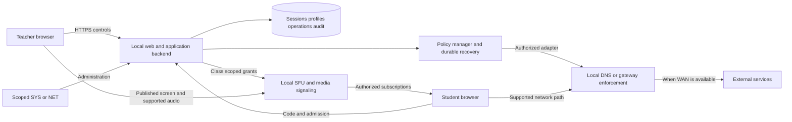
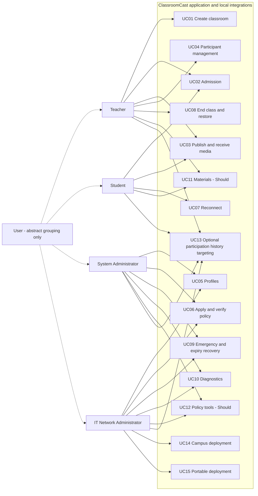
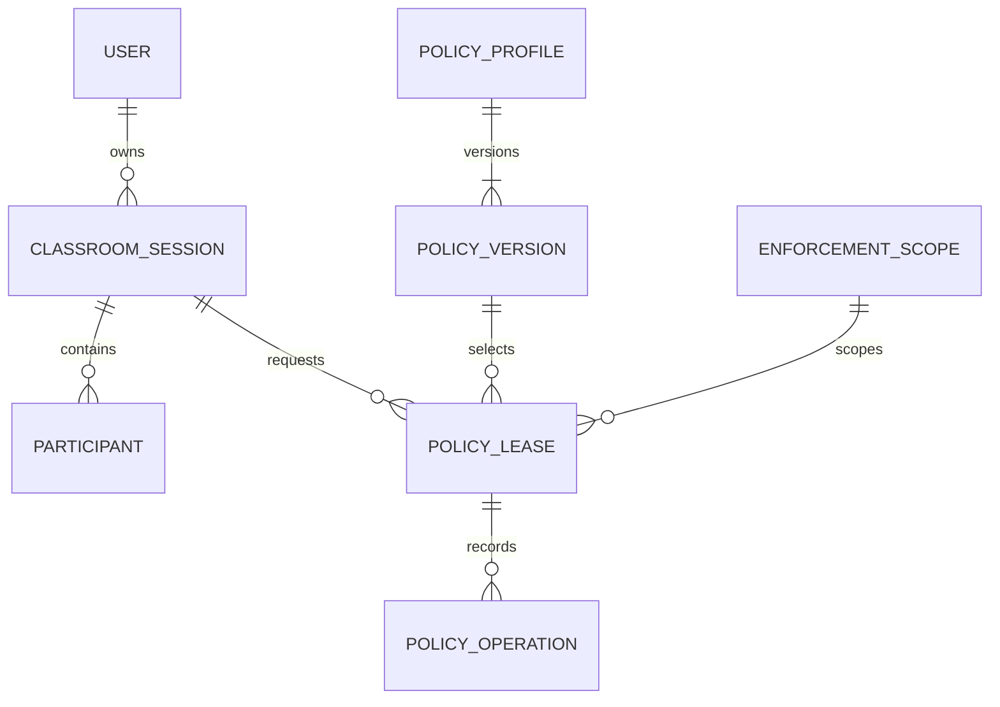

# 06 — System Design and Architecture

Prepared 9 November 2026 for teacher review on 10 November. **Draft; not approved or implemented.**

The architecture, ERD and endpoint catalogue are proposed designs. Concrete field constraints, request/response schemas, browser/SFU selection and feasibility evidence remain design-stage work. Do not describe them as implementation-complete.

---

Source: [01-system-architecture.md](../03-system-analysis-and-design/01-system-architecture.md)

# System architecture

**Version:** 0.1 · **Prepared:** 9 November 2026 · **Status:** Proposed review draft; no teacher approval or product test execution claimed.

## 1. Required boundaries and proposed technology

The source requires local services, SFU media delivery, secure browser capture, server-side secrets, actual enforcement verification and recovery. The v1 proposal selects React/Vite/TypeScript, NestJS, SQLite initially, self-hosted LiveKit, AdGuard Home, Caddy and Docker Compose. These are **Proposed**, not newly selected or approved here. Confirm selected versions, compatibility, licenses and operational support through D19. Hosting on the existing school Ubuntu/Linux server is user-stated context; suitability is not established.

## 2. Component diagram

## 3. Responsibility and communication

Backend owns user/resource authorization and class admission. SFU handles publication and subscriptions; media signaling establishes those connections. Application roster/status events are distinct from media signaling. Policy manager persists operations and requests approved enforcement; it is not itself a guarantee that a client uses that path. Database stores metadata and recovery records, not live video streams.

## 4. State and failure boundaries

Maintain separate class, publication and policy status as defined in [business rules](../01-requirements/07-business-rules.md). Class end revokes grants and media; network restoration may remain unresolved. SFU failure alone does not restore network rules. WAN loss differs from LAN loss. Reject stale publication actions and do not claim success from an adapter acknowledgment alone.

## 5. Architecture review

Confirm trust provisioning, server capacity, adapter capabilities, network authorization, role boundaries, durable recovery and source-derived tests before acceptance. See [ARCHITECTURE-AND-FLOWS.md](../../../classroomcast_v1/ARCHITECTURE-AND-FLOWS.md) for original proposal provenance; its coupled class/media state names and fixed retention/pause suggestions are not adopted as confirmed decisions.

---

Source: [03-use-case-diagram.md](../03-system-analysis-and-design/03-use-case-diagram.md)

# Role-to-use-case diagram

**Version:** 0.1 · **Prepared:** 9 November 2026 · **Status:** Proposed review draft; no teacher approval or product test execution claimed.

## 1. Interpretation

This Mermaid flowchart is an actor-goal map, not a claim of formal UML use-case notation. Human roles are external to the application; automation is an internal mechanism. The optional abstract User parent conveys common access only and grants no inherited permissions. UC identifiers match the canonical catalogue.

## 2. Permission caveats

Every edge is subject to the [permission matrix](../01-requirements/06-user-roles-and-permissions.md). SYS/NET policy actions require assigned scope; diagnostic access is limited. Optional group targeting requires supported network identity. Teacher approval concerns only owned classes. No edge grants SYS/NET classroom media access. Automatic expiry and approved class-start policy actions act under recorded authority.

---

Source: [04-database-design.md](../03-system-analysis-and-design/04-database-design.md)

# Conceptual database design

**Version:** 0.1 · **Prepared:** 9 November 2026 · **Status:** Proposed review draft; no teacher approval or product test execution claimed.

## 1. Design status

The existing v1 data-model sketch is the basis below. This is a proposed logical model, not migrations or an approved physical schema. SQLite was previously proposed initially; PostgreSQL remains an existing alternative. Final engine, constraints and transaction behavior require feasibility review. Student identity need not be a permanent account (D03).

## 2. Entity catalogue

| Entity | Key fields / rule |
|---|---|
| User | id, role(s), credential hash; teacher/admin provisioning is authorized |
| ClassroomSession | id, teacherId, joinCodeHash, state, openedAt, endedAt, mediaRoomId |
| Participant | id, sessionId, admitted identity/token reference, admissionState, lastSeenAt |
| PolicyProfile / PolicyVersion | id, version, defaultAction, categories, domain rules, allow exceptions |
| EnforcementScope | id, adapter type, authorized network selector, capability flags, secret reference |
| PolicyLease | scopeId, sessionId, prior version/snapshot, desired version, expiry, state; at most one active per scope |
| PolicyOperation | idempotency key, leaseId, requested action, retries, result and verification timestamp |
| AuditEvent | actor, action, scope/session, timestamp, outcome; exclude credentials and browsing history |

## 3. Conceptual relationships

## 4. Integrity and transaction requirements

- Enforce unique active class codes and stable session identity; protect join secrets according to the finalized design.
- Admission final checks and seat allocation occur atomically. Concurrent final-seat approvals cannot both succeed. Rejection updates only a still-pending request.
- Operation identity binds requester/service, action, class, target/publication version or scope. Reused IDs with different intent are rejected; completed results are returned without mutation.
- Persist policy baseline, owned changes and operation intent before network mutation. Scope conflict handling is proposed under D06, not a license to overwrite other classes or campus IT.
- Closure stores independent application/media and policy-restoration outcomes. Recovery resumes unfinished work without repeating completed changes.
- Audit actor, scope, action, time and outcome; exclude raw secrets and unnecessary browsing histories. Retention and deletion await D13.

## 5. Proposed extensions requiring schema review

Role/scope grants, media publication versions, participant blocks and generic operation records support the reviewed workflows. Their precise tables/columns are **Proposed**; the original PolicyOperation entity alone does not define all media/control idempotency needs. Material metadata, schedules and history are included only for selected lower-priority scope.

## 6. Backup and restore verification

Inventory database, policy baselines, configuration and protected secret/certificate references. Restore a consistent test copy, reconcile pending operations against actual network state, and verify ended/revoked clients cannot regain access. Recovery objectives, backup frequency, encryption and retention choices require owner agreement; no successful backup drill is claimed.

---

Source: [05-api-design.md](../03-system-analysis-and-design/05-api-design.md)

# API and event design

**Version:** 0.1 · **Prepared:** 9 November 2026 · **Status:** Proposed review draft; no teacher approval or product test execution claimed.

## 1. Contract status

The following endpoints come from the prior architecture sketch. They are proposed contracts, not implemented APIs. Concrete schemas, authentication mechanism, response codes and versioning require joint backend/frontend review. Host-service restart is an authorized operator procedure, not an implied web endpoint.

## 2. Existing proposed endpoint catalogue

| Action | Proposed endpoint | Permission / key behavior |
|---|---|---|
| Create class | POST /api/sessions | Teacher; generates unique active join code |
| Join class | POST /api/sessions/join | Validates code/admission and rate limits |
| Control broadcast/class | POST /api/sessions/:id/actions | Owning teacher; validates state transition |
| Admit/remove participant | POST /api/sessions/:id/participants/:pid/actions | Owning teacher; updates media access |
| Obtain room token | POST /api/sessions/:id/media-token | Admitted identity; scoped publish/subscribe grants |
| Save versioned profile | POST /api/policy-profiles | Administrator; validates rules and exceptions |
| Apply profile | POST /api/scopes/:id/policy-operations | Administrator; lease/idempotency required |
| Read enforcement | GET /api/scopes/:id/status | Authorized operator; desired and observed state |
| Emergency restore | POST /api/scopes/:id/restore | Administrator; recorded, idempotent operation |
| Diagnostics | GET /api/health | Public minimal readiness; detailed network status is restricted |

## 3. Shared request and response semantics

| Contract concern | Proposed requirement |
|---|---|
| Identity | Derive authenticated requester on server; do not trust a client-supplied role |
| Resource scope | Check class ownership/admission or explicit network scope on each request |
| Mutating intent | Include stable operation ID and relevant class/participant/profile/publication identifiers |
| Concurrency | Validate expected current state/version before mutation; return stale/conflict result truthfully |
| Idempotency | Same identity/intent returns previous result or resumes unfinished steps; mismatch denied |
| Async results | Return operation reference and pending state; later report actual result and evidence timestamp |
| Errors | Distinguish denied, invalid input, full, closed, stale, service unavailable and unresolved; no secrets |
| Media grants | Short-lived, class-scoped publish or subscribe permission; revoked access cannot refresh |
| Events | Backend-authoritative admission, participant, publication, closure and policy-status updates |

Event names and payloads are **Pending Decision**, not newly promised API features. SFU event authenticity must be checked using the selected service's documented mechanism. A notification is not proof of media revocation; backend evidence determines the state.

## 4. Example interaction contract

F08 approval: authorize requester → verify pending admission → atomically validate class/code/block/capacity → allocate seat → persist result → notify student → F05 obtains subscriber grant. A stale or denied action allocates no seat. F07 Stop: bind current publication → authorize and check closure/version → request termination → verify actual result → record stopped or unresolved; student admission remains unchanged.

## 5. Review checklist

For every endpoint agree input schema, response/error schema, caller permission, resource check, state transition, idempotency/concurrency rule, audit fields, failure path and test references. Use TC-AUTH, TC-ADM01–07 and source-specific TC IDs before freezing the contract.

---

Source: [06-security-design.md](../03-system-analysis-and-design/06-security-design.md)

# Security design

**Version:** 0.1 · **Prepared:** 9 November 2026 · **Status:** Proposed review draft; no teacher approval or product test execution claimed.

## 1. Assets and trust boundaries

Protect teacher publication authority, student admission/media access, application accounts, network credentials, policy baselines and minimal audit data. Boundaries include browser-to-backend, browser-to-SFU, backend-to-enforcement adapter, operational storage and campus infrastructure ownership. A role assignment cannot replace network-owner permission.

## 2. Threat and control mapping

| Threat | Proposed control | Verification |
|---|---|---|
| Cross-class control or roster disclosure | Server-side role plus ownership checks | TC-AUTH, TC-T06 |
| Subscriber publishes or stale participant reconnects | Scoped grants, current admission, revocation/refresh checks | TC-S03, TC-S06, TC-AUTH |
| Concurrent seat approval or stale action | Atomic transition and operation/version checks | TC-ADM05/06; F07/F08 race tests |
| Secret leakage | Protected server config; redacted logs/exports/client responses | TC-NAC17, TC-PRIVACY |
| Unauthorized network changes | Explicit scope authority, validated rules, protected local paths | TC-NAC16/18 |
| Unsafe restore overwrites IT changes | Owned-change tracking, read-back, conflict reconciliation | TC-NAC06/12/13 |
| Misleading restriction status | Affected-client verification; scope/time/limitations displayed | TC-NAC10 |
| Excessive browsing/identity retention | Data minimization and agreed deletion/access rules | TC-NAC19, D13 |

## 3. Capture and transport

User consent to browser capture is independent of application authorization. Local trusted secure endpoints and supported media paths must be tested. Do not count bypassed certificate checks as a passing deployment. Student mute/fullscreen is local playback control, not teacher publication authority.

## 4. Incident and recovery procedure proposal

Identify affected scope, restrict unauthorized operations, preserve minimal diagnostic evidence, notify authorized operator, revoke/rotate affected credentials where necessary, reconcile state and retest access. Do not restart all services or reset campus rules indiscriminately. F15 records unresolved recovery and next action. Operational ownership and secret-rotation/retention details remain pending.

## 5. Enforcement limits

DNS/gateway integration controls supported paths only. Alternate resolvers, encrypted DNS, VPNs, direct IP or offline tools may bypass domain-only restrictions. Test and report limitations; do not claim device lockdown. Stronger controls require explicit supported integration and authorization, not hidden new scope.

---

Source: [07-infrastructure-design.md](../03-system-analysis-and-design/07-infrastructure-design.md)

# Infrastructure and deployment design

**Version:** 0.1 · **Prepared:** 9 November 2026 · **Status:** Proposed review draft; no teacher approval or product test execution claimed.

## 1. Intended host and missing inventory

Latest user context specifies an existing school server on Ubuntu/Linux. Confirm actual OS/version, CPU, RAM, storage, NIC, virtualization/container permissions, existing workloads, admin contact, maintenance window and backup location. No hardware minimum or successful installation is established here.

## 2. Network modes

| Mode | Preparation | Evidence |
|---|---|---|
| Campus | Approved hostname/address, client trust, server/media paths, isolation, DNS/gateway scope | CN01–CN10; written IT approval and client-path tests |
| Portable | Suitable router/APs, SSID/security, DHCP, stable host, wired uplink where possible, power and local runtime | OR01–OR12; measured setup and WAN-off tests |

Portable inclusion remains in source scope until D18 approves a change. Use the same application with mode-specific configuration; teachers should not edit router rules per class.

## 3. Deployment checklist proposal

1. Confirm authority and inventory; record baseline configuration.
2. Select and pin reviewed component versions after feasibility; document licenses and dependencies.
3. Provision local application, backend, database, SFU, required enforcement integration and trusted endpoints.
4. Preload assets/images/rule lists and necessary name/certificate trust for offline use.
5. Verify app, signaling and actual media paths separately; approved firewall rules depend on chosen configuration.
6. Exercise authorized policy apply/verify/restore in an isolated scope before classroom use.
7. Record restart/recovery, backup and operational ownership; verify a fresh-browser WAN-off class.

These are planned steps, not runnable installation commands. Exact ports, domains, subnets, resource reservations and trust method are **Pending Decision**; no guessed production values are supplied.

## 4. Capacity model

An SFU reduces teacher upload fan-out but server egress still scales with subscriptions. Existing example: 1.5 Mbps per viewer ×150 ≈225 Mbps before overhead. This is arithmetic, not a benchmark or selected quality setting. Measure actual bitrates, CPU/RAM/NIC, AP airtime and physical client behavior; resolve D12 before acceptance.

## 5. Operations

Keep component health separate: LAN/name/trust, app/database, SFU/media, enforcement API and effective rules. A service can be reachable while its desired policy is not effective. Document restart order, configuration restore, safe rollback, certificate renewal and equipment return under named operators before handover.

---

Source: [08-ui-ux-design.md](../03-system-analysis-and-design/08-ui-ux-design.md)

# UI and UX design

**Version:** 0.1 · **Prepared:** 9 November 2026 · **Status:** Proposed review draft; no teacher approval or product test execution claimed.

## 1. Screen inventory proposal

| Role / screen | Primary actions | Required visible states | Flows |
|---|---|---|---|
| Teacher class page | Create/start/end; show URL/code/QR; select assigned profile | Created/open/ending/ended, actual restriction status | F04/F01/F13 |
| Teacher broadcast panel | Capture, supported audio/quality, pause/resume/stop | Requested versus confirmed publishing state, capture limitation | F06/F07 |
| Teacher roster | Approve/reject/remove/block | Pending/admitted/blocked/removed, connection and unresolved cleanup | F05/F08 |
| Student join | Network instructions, code, optional agreed ID | Invalid/full/pending/rejected/closed | F05 |
| Student viewer | Playback, volume, fullscreen | Admitted waiting, viewing, media unavailable, revoked/ended | F06/F07/F12 |
| Scoped policy dashboard | Profiles, approved scope, apply/restore | Saved/applying/verified/degraded/restoration unresolved; scope/time | F09/F10/F14 |
| Authorized diagnostics | Component health and recovery evidence | Component fault, action pending, verified or unresolved result | F15 |
| SYS administration | Accounts/roles/settings within agreed scope | Permission denied, validated changes, audit outcome | D01/D14 proposals |

## 2. Interaction rules

Starting class and starting screen capture are distinct. Stop sharing must not look like End class. A saved profile must not display a verified badge. Provide actionable error text without exposing credentials or another class's data. Teacher approval is not the same as media becoming available. Show pending restoration after verified class closure.

## 3. Accessibility and review

Use readable labels, keyboard-operable controls and text/icons alongside color. The board's MoSCoW palette denotes priority only; operational success/failure needs a separate labeled legend. Accessibility specifics and supported browser/layout matrix require usability review rather than an unsupported conformance claim.

## 4. Prototype evaluation

Give pilot teacher tasks: create class, share joining information, start screen/audio, admit/remove student, stop sharing, end class and interpret restoration failure. Students join, adjust playback, recover connection and recognize denied access. Record completion, assistance, error interpretation and improvement; do not invent trial results.

