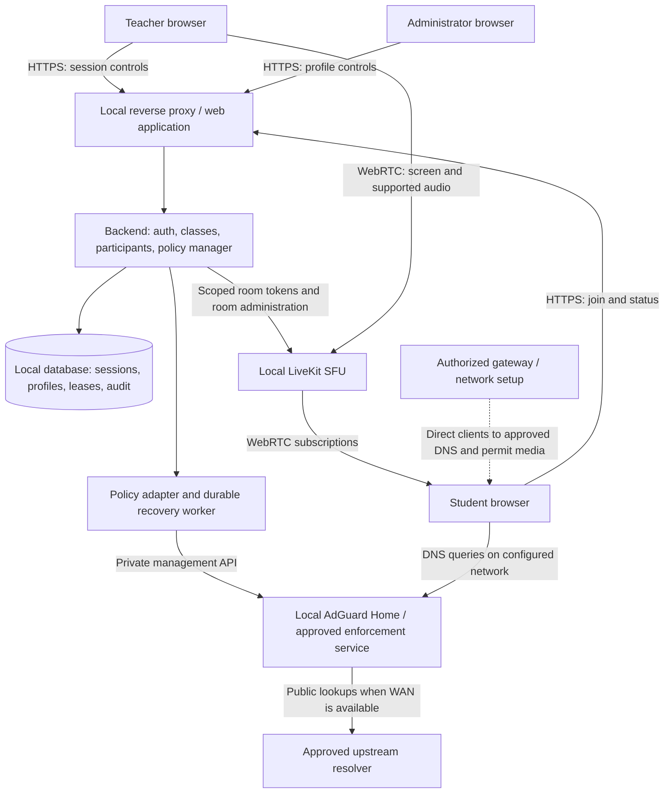
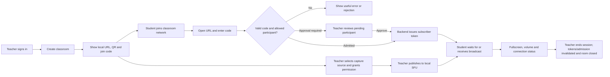
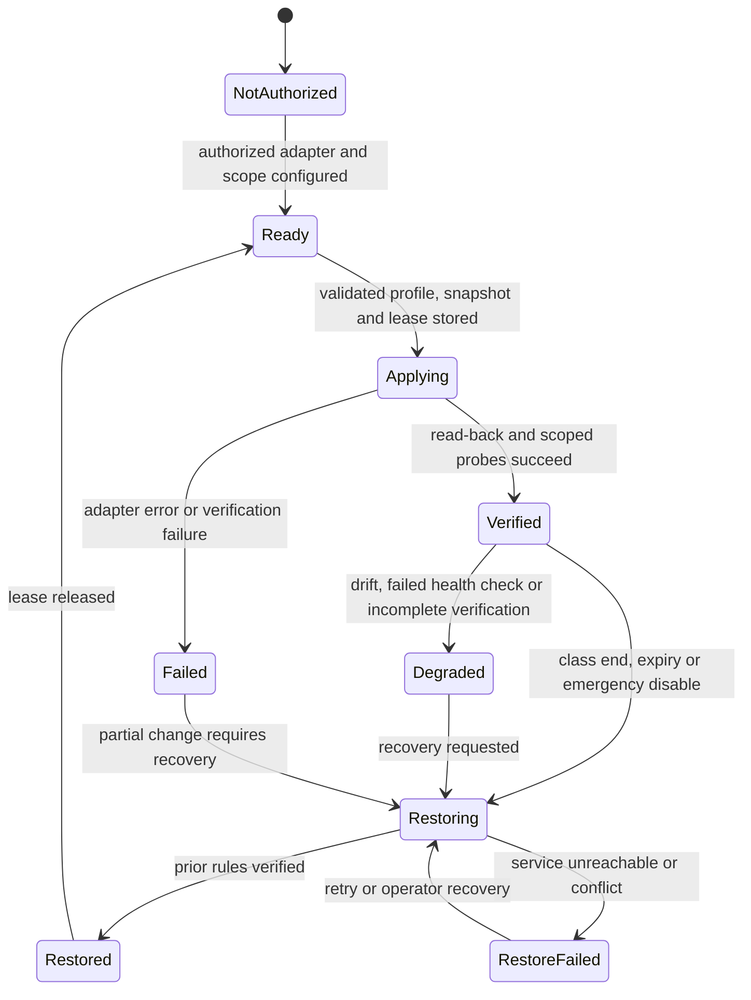

# Architecture and user flows

Proposed design, 2 November 2026. Technology choices must pass the first-sprint feasibility tests before being fixed. This is a planning design, not a deployed system.

## Components and boundaries

Use a React/Vite/TypeScript frontend, a modular NestJS/TypeScript backend, SQLite initially, a self-hosted LiveKit SFU, AdGuard Home through a backend adapter, Caddy for HTTPS, and Docker Compose on a suitable local host. Choose these provisionally to reuse existing media and filtering capabilities. Revisit SQLite if write concurrency/deployment requirements justify PostgreSQL.

LiveKit supplies media signaling and room transport. The application backend owns class authorization, participant admission, policy orchestration and short-lived room tokens. A separate application WebSocket can update rosters/status; do not duplicate SFU signaling with a second custom protocol.

Browser traffic to the web/API and SFU signaling endpoints uses trusted HTTPS/WSS. WebRTC media follows its negotiated network path and needs appropriate firewall permission; forwarding HTTP through Caddy does not by itself open the media path. Use the selected version's [LiveKit port documentation](https://docs.livekit.io/transport/self-hosting/ports-firewall/) when writing the deployment configuration.

Screen capture requires a secure context and user permission; see [MDN getDisplayMedia](https://developer.mozilla.org/en-US/docs/Web/API/MediaDevices/getDisplayMedia). The [LiveKit deployment guide](https://docs.livekit.io/transport/self-hosting/deployment/) requires a certificate trusted by clients. Test the chosen certificate trust arrangement on real laptops early. A raw LAN HTTP address or a certificate warning is insufficient proof that the full flow works. Provision certificates, images, dependencies and local name resolution before offline class; plan certificate renewal separately from offline runtime.

## Ownership by component

| Component | Lead | Integration partner |
|---|---|---|
| Session/auth/API/database | Sengleang | Dyhengmesa |
| Teacher/admin UI | Sengkea | Hour |
| SFU hosting and network transport | Mengkong | Dyhengmesa |
| Browser media and token integration | Dyhengmesa | Mengkong and Sengleang |
| Student UI | Hour | Sengkea |
| Policy lifecycle | Dyhengmesa | Mengkong |
| DNS adapter, HTTPS and deployment | Mengkong | Dyhengmesa |

## Teacher and student flow

The teacher controls admission, rejection, removal and blocking. Student tokens can subscribe only; publishing/control requires explicit server permission. Join codes are unique among active sessions and expire with the session. Rate-limit guesses. A join code is an admission credential, not reliable proof of a person's identity. A removed device/user must be rejected by the application's admission/rejoin controls; short-lived tokens alone are insufficient if an old token remains accepted by the SFU.

Proposed session states: CREATED → LOBBY → LIVE ↔ PAUSED → ENDING → ENDED. A teacher can stop sharing without ending the classroom; show a waiting state. Starting capture uses an explicit browser action. Capture denial leaves the class usable with an explanatory message. Define pause as stopping live screen updates, muting published audio, and showing a paused indicator; confirm this behavior with the teacher.

Reconnect validates that the session is still open and the participant is still admitted, requests fresh credentials as needed, and resubscribes. Closed-session users see an ended message. Students may need a user click to start audio playback because of browser behavior.

## Administrator policy flow

1. Administrator chooses an approved network scope and an allow-by-default or restricted-by-default profile.
2. Backend checks the administrator's role, scope authorization, domain syntax, exceptions and protected local services.
3. Backend obtains a scope lease, stores a versioned baseline snapshot and records a durable pending operation before sending changes.
4. Adapter applies a versioned ruleset. Store desired configuration separately from adapter-reported effective configuration.
5. Verify read-back and DNS probes from the affected network path. Backend probes alone do not prove every student device uses the resolver. Show verification time, tested scope and limitations.
6. Session end, temporary-rule expiry or emergency disable schedules restoration of the prior effective policy. Verify restoration and release the lease only after completion.
7. On restart, the recovery worker finds outstanding leases/operations, retries idempotently and records the result. Keep failed or pending restoration visible and available to an operator.

Saving a profile is not an enforcement state. Display desired profile, operation state, last successful verification, affected scope and any error. If the network is unauthorized or unsupported, show that status clearly. Class broadcasting can continue independently; the operator must see that restrictions are not verified.

For the first release allow one active policy lease per network scope. Reject a conflicting second request with a clear message. Detect external ruleset changes before restoring a snapshot: avoid overwriting unrelated changes made by campus IT. Require operator reconciliation when a safe restore cannot be determined. Emergency disable removes ClassroomCast's temporary restrictions or restores its prior state; it must not disable campus-wide protections.

Expiry must survive a browser closing and application restart. The durable worker provides eventual retry, but cannot restore rules while the enforcement service/network is unreachable. Document this limit, retry status and a local operator procedure. Adapter-specific autonomous expiry is an optional improvement where supported.

## Data model sketch

| Entity | Key fields / rule |
|---|---|
| User | id, role(s), credential hash; teacher/admin provisioning is authorized |
| ClassroomSession | id, teacherId, joinCodeHash, state, openedAt, endedAt, mediaRoomId |
| Participant | id, sessionId, admitted identity/token reference, admissionState, lastSeenAt |
| PolicyProfile / PolicyVersion | id, version, defaultAction, categories, domain rules, allow exceptions |
| EnforcementScope | id, adapter type, authorized network selector, capability flags, secret reference |
| PolicyLease | scopeId, sessionId, prior version/snapshot, desired version, expiry, state; at most one active per scope |
| PolicyOperation | idempotency key, leaseId, requested action, retries, result and verification timestamp |
| AuditEvent | actor, action, scope/session, timestamp, outcome; exclude credentials and browsing history |

Keep adapter credentials and signing keys in protected server configuration, separate from frontend bundles and exported profiles. Minimize participant identifiers. Proposed audit retention is 30 days and session identifiers 7 days after class, subject to institutional requirements and lecturer agreement. Avoid recording browsing histories; disable unnecessary resolver query logging and document any operational logs still needed.

## API sketch for shared implementation

| Action | Proposed endpoint | Permission / key behavior |
|---|---|---|
| Create class | POST /api/sessions | Teacher; generates unique active join code |
| Join class | POST /api/sessions/join | Validates code/admission and rate limits |
| Control broadcast/class | POST /api/sessions/:id/actions | Owning teacher; validates state transition |
| Admit/remove participant | POST /api/sessions/:id/participants/:pid/actions | Owning teacher; updates media access |
| Obtain room token | POST /api/sessions/:id/media-token | Admitted identity; scoped publish/subscribe grants |
| Save versioned profile | POST /api/policy-profiles | Administrator; validates rules and exceptions |
| Apply profile | POST /api/scopes/:id/policy-operations | Administrator; lease/idempotency required |
| Read enforcement | GET /api/scopes/:id/status | Authorized operator; desired and observed state |
| Emergency restore | POST /api/scopes/:id/restore | Administrator; recorded, idempotent operation |
| Diagnostics | GET /api/health | Public minimal readiness; detailed network status is restricted |

Finalize status/error/event contracts jointly in Sprint 1. Audit relevant actions on the backend. Trust SFU webhook events only after validating their signatures.

## Deployment modes and capacity

**Campus:** connect a local server by Ethernet to approved LAN infrastructure. Obtain approved names/certificates, reachability, media ports and DNS/gateway scope. Student Wi-Fi isolation must allow the server and resolver path. Keep enforcement unavailable until the approved integration exists. Demonstrate the same application build with campus-specific configuration.

**Portable:** use a local server, router and sufficient access points, with DHCP pointing to the intended local resolver where authorized. Configure the infrastructure once during installation; class-by-class policies flow through the backend adapter. The example 192.168.50.x network from the source is only a candidate subnet; check conflicts first. Test with WAN disconnected.

DNS rules act on queries reaching the configured service. Categories need locally stored, versioned domain lists and maintenance; the list is not a complete catalog of every AI service. Alternate resolvers, encrypted DNS, VPNs and direct IP access can bypass domain-only restrictions. Gateway/device controls may strengthen enforcement when explicitly supported and authorized. AdGuard documents [client identification](https://adguard-dns.io/kb/adguard-home/clients/) and [rule syntax](https://adguard-dns.io/kb/general/dns-filtering-syntax/); whether per-client scope is available depends on the network path and identifiers. Do not infer browser session identity from a shared resolver's client IP.

SFU forwarding reduces teacher upload fan-out, while the server still sends one copy per subscriber. At an illustrative 1.5 Mbps per viewer, 150 viewers need about **225 Mbps of server media egress before protocol overhead**. This arithmetic is a sizing example, not a benchmark. Measure actual encoded bitrate, NIC capacity, AP airtime, CPU and browser decode performance. If simulcast is enabled, account for multiple teacher upload layers as well.

Preload frontend assets, container images, local rules and documentation. Keep health checks for app, SFU and filtering separate. Back up database, policy snapshots, configuration and certificate material securely; verify restore on a clean test setup.
