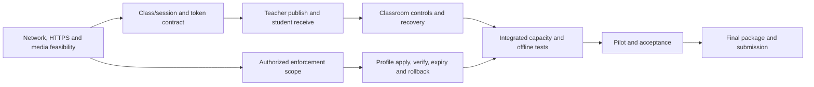

# ClassroomCast project management plan

Version 0.1, proposed 2 November 2026. All dates use Asia/Phnom_Penh. Approval names/date: pending team and lecturer discussion.

## 1. Charter and business justification

ClassroomCast supports local classroom screen/audio broadcasting and software-managed network restriction policies. The purpose is to let teachers run a class when internet access is unavailable and let authorized administrators configure restrictions from one dashboard.

Build the classroom application and its policy integration as the student project. Reuse an existing self-hosted SFU and DNS filtering service to reduce implementation risk. A cloud-only meeting service does not meet the supplied offline requirement. A custom media server would require more specialist development effort. These are qualitative alternatives; quantified savings and user adoption remain to be established through interviews and tests.

**Product Goal:** By 25 January 2027, demonstrate a locally deployed classroom session with browser-based teacher/student access, the agreed Must features, and verified policy application and restoration on a supported authorized network.

The supplied scale requirement remains **one teacher and 50–150 students**. Plan an early small test, then a physical 50-device pilot and a 150-subscriber load test. Report the exact conditions and physical device count. A reduced pilot or reduced supported capacity requires an explicit scope decision; a simulator alone cannot establish Wi-Fi capacity for 150 laptops.

Team representative: HENG NGUON HOUR. Proposed Product Owner: Hour. Proposed Scrum Master: HONG DYHENGMESA. Sponsor, supervising lecturer and campus IT contact: to be identified.

## 2. Constraints, assumptions and decisions needed

| ID | Type | Statement | Owner / check by |
|---|---|---|---|
| C01 | Constraint | Submission editing ends 25 January 2027 at 11:59 PM, per supplied page | Hour / verify site timezone by 6 Nov |
| C02 | Constraint | Browser-based students, local runtime, two deployment modes, SFU distribution | Team / scope review 6 Nov |
| C03 | Constraint | Campus enforcement requires campus IT authorization and compatible controls | Mengkong / request prerequisites by 6 Nov |
| A01 | Assumption | Published capacity is approximately 10 h/week per member, including meetings | Each member / confirm calendar 6 Nov |
| A02 | Assumption | Suitable local server, wired uplink and test network can be borrowed or supplied | Mengkong / inventory 6 Nov |
| A03 | Assumption | At least one supported browser/OS combination captures required screen/audio | Mengkong / spike 13 Nov |
| A04 | Assumption | A hostname and trusted HTTPS arrangement can be provisioned before offline use | Mengkong / two-laptop test 13 Nov |
| A05 | Assumption | Lecturer and 50 pilot students can be booked; 150 subscribers can be tested | Hour / booking plan 27 Nov |
| A06 | Assumption | Initial release supports one active class per enforcement network scope | Hour + Mengkong / agree 13 Nov |

An unavailable assumption becomes an issue with a response, rather than silently remaining in the plan. Confirm actual holidays/exams before each sprint. Do not backdate November work to the course example's September start.

## 3. Scope and acceptance boundary

Preserve supplied IDs and MoSCoW priorities. **All supplied Must requirements remain release commitments**, subject to lecturer-approved change. An early demonstration is a subset and is not the complete Must-feature release.

| Area | Included Must IDs | Supporting release work |
|---|---|---|
| Classroom management and broadcasting | T01–T08 | Local authentication, session state, permissions and media publishing |
| Student experience | S01–S07 | Browser join, audio, fullscreen, reconnect and useful errors |
| Network policy management | NAC01–NAC08, NAC10–NAC13, NAC16–NAC19 | Profile/rule UI, restricted/allow default modes, verified application, audit, rollback, expiry, minimal data |
| Campus deployment | CN01–CN10 | Reachability, approved hosting/network controls and capacity validation |
| Portable deployment | OR01–OR12 | Hardware/network readiness, installation, offline operation and automation |
| Shared architecture | Supplied architectural requirements | Local SFU, backend/database, filtering, HTTPS, health and recovery |

Should items: NAC09, NAC14, NAC20, T09–T10, S08–S09. Could items: NAC15, T11, S10. Prioritize Should/Could only after forecasting the Must workload; additional features cannot consume needed acceptance/recovery time. Offline local rules are necessary to meet the overall offline constraint even though NAC20 is individually labeled Should; flag this overlap for scope agreement.

Release exclusions proposed for agreement: custom SFU implementation, cloud dependence during class, native student application, classroom recording, LMS integration, and simultaneous conflicting policies on the same network. These exclusions must not remove an existing Must requirement. Universal prevention of VPN/DoH bypass and blocking offline coding agents are beyond DNS filtering's capability; describe this limit in the accepted scope.

## 4. Work breakdown structure and initial effort

These are preliminary bottom-up work-package allowances, not measured estimates. Estimates include each package's implementation, review and component testing. Central acceptance/capacity work is budgeted separately in 6.1. Refine packages with optimistic/most likely/pessimistic estimates before commitment; expected effort = (O + 4M + P) / 6.

| WBS | Deliverable | Owner | Initial h | Acceptance evidence |
|---|---|---|---:|---|
| 1.1 | Charter, scope and management records | Hour | 24 | Reviewed scope, decisions, risks and progress records |
| 1.2 | Scrum events and shared coordination | Dyhengmesa | 36 | Planning/review/retro notes and updated board |
| 2.1 | Session, identity and authorization service | Sengleang | 48 | Join, role, participant and closed-session checks |
| 2.2 | Teacher/admin interfaces | Sengkea | 44 | Class controls, roster, QR and policy UI demonstration |
| 3.1 | SFU and screen/audio module | Dyhengmesa + Mengkong | 56 | Teacher publishes; students receive supported screen/audio |
| 3.2 | Student viewer and reconnect interface | Hour | 32 | Join, playback, fullscreen, errors and recovery checks |
| 4.1 | Policy profile and lifecycle service | Dyhengmesa | 36 | Validation, scope lease, apply/end/expiry orchestration |
| 4.2 | DNS adapter and recovery integration | Mengkong | 44 | Verification, apply failure, rollback and restart evidence |
| 5.1 | Local deployment and network-mode runbooks | Mengkong | 32 | Installation and offline checks in both modes |
| 6.1 | Integrated acceptance and capacity evidence | Hour coordinates; all contribute | 48 | Test report with device counts, metrics and limitations |
| 6.2 | Guides, demo and submission package | Hour coordinates; all contribute | 20 | Reproducible demo, links and handover checklist |
| | **Work-package estimate** | | **420** | |

Parent totals: management 60 h; classroom 92 h; media/student 88 h; policy 80 h; deployment 32 h; acceptance/handover 68 h. Sum = 420 h. Work packages account for the whole proposed delivery, including project work.

Named ownership is accountability for coordination, not a promise to personally implement every hour. During planning distribute tests/review/documentation across the five members. Early technical work concentrates on Mengkong and Dyhengmesa; others pair and learn to avoid a single point of failure. Check personal capacity each sprint.

## 5. Schedule and dependencies

Six two-week sprints provide a planning window of 12 weeks, ending 24 January. Use **25 January as final submission contingency**, with internal submission readiness by 22 January. Prepare checks continuously within every sprint.

| Sprint | Dates | Goal and main outputs | Primary leads | Gate |
|---|---|---|---|---|
| 1 | 2–15 Nov 2026 | One teacher shares to students on LAN; contracts and feasibility checks | All, per first-sprint plan | G1: feasibility and draft scope reviewed |
| 2 | 16–29 Nov | Teacher/student classroom controls, permissions, supported audio and reconnect | Sengleang, Sengkea, Dyhengmesa, Hour | End-to-end classroom demo |
| 3 | 30 Nov–13 Dec | Admin creates profile; supported DNS scope applies and verifies rules; expiry and restoration skeleton | Dyhengmesa + Mengkong; Sengkea UI | G2: classroom + policy demonstration |
| 4 | 14–27 Dec | Complete remaining Must behavior; failure recovery; portable/campus mode validation | All | Must-feature readiness review; capacity adjusted for holidays |
| 5 | 28 Dec–10 Jan 2027 | Capacity tests, offline tests, rollback/restart drills and defect fixes | Dyhengmesa + Mengkong + Mengkong | G3: measured release candidate by 10 Jan |
| 6 | 11–24 Jan | Physical pilot, fixes, acceptance, guides, demo recording and submission links | All; Hour coordinates acceptance | G4: readiness by 22 Jan, final review by 24 Jan |

Target physical pilot: 11–15 January, subject to room/student booking. Capacity evidence should be available by 10 January so there is time to fix issues before the pilot. If 150-device Wi-Fi testing is unavailable, record that gap and seek an agreed acceptance decision.

These are dependency paths to watch. A mathematical critical path needs activity durations, resource calendars and forward/backward passes; it is not yet calculated. Maintain detailed tasks for the next sprint and refine later work as evidence arrives. Network access approval and trusted HTTPS can delay both delivery paths.

## 6. Effort, budget and measurement

Published approximate capacity: 5 × 10 h/week × 12 weeks = **600 h**, before exam/holiday adjustments. An initial 80% sprint-selection ceiling corresponds to 480 h over the window; this is a planning guideline rather than additional work or a separate budget.

The preliminary work estimate is **420 h**. Add a provisional **42 h contingency allowance** and **18 h management reserve** for a total **480 h envelope**, leaving **120 h of nominal capacity unallocated** against the published 600 h. This headroom may shrink after exam/holiday calendars and technical estimates are confirmed; it is not a second contingency budget. The initial 80% sprint-selection guideline is deliberately cautious; later commitments must be adjusted using actual effort and the remaining forecast. These reserve figures are provisional allowances, not EMV results. Confirm feasibility in Sprint 1 rather than treating the arithmetic as a delivery guarantee.

If the refined forecast exceeds actual capacity, options for the team/lecturer are to validate reuse and reduce effort through spikes, agree extra availability, or approve a narrower release. Keep the 25 January deadline visible. Do not quietly remove Must features or assume overtime.

Use one earned-value convention consistently if required by the course: after approval, BAC includes the approved work estimate plus contingency; management reserve sits outside BAC. Record contingency allocations transparently. PV = approved budgeted work scheduled by status date; EV = budgeted value of verified completed work; AC = actual effort in the same units. SPI = EV/PV and CPI = EV/AC; leave ratios blank when denominators are zero. No actual values exist yet. Do not combine this with a convention that excludes contingency without documenting a change.

Keep cash separate from student effort:

| Cash item | Basis / current status | Decision owner |
|---|---|---|
| Local server and wired adapter | Inventory/loan availability unknown; quote only if needed | Mengkong |
| Router/APs/switch/cables/power | Existing equipment unknown; benchmark before procurement | Mengkong |
| Hostname/certificate arrangement | Campus-provided name/cert or pre-provisioned alternative; confirm lifecycle cost | Mengkong |
| Software and licenses | Verify selected versions, licenses and deployment terms | Hour + Mengkong |
| Pilot and replacement equipment | Determine from test venue and hardware inventory | Hour |

No purchase or cash budget has been approved. A zero-cash implementation is possible only if equipment and certificate provisions are available; do not present unknown prices as zero. Cost baseline, cash cap and funding owner remain pending.

## 7. Quality and acceptance plan

Targets below are proposed for lecturer agreement and are not achieved results. Hour coordinates the evidence register; module owners run relevant checks.

| Test | Proposed pass criterion | Method / timing |
|---|---|---|
| Q01 Core classroom | T01–T08 and S01–S07 accepted on supported browser matrix | Traceable functional checks, every increment |
| Q02 Media delay | Screen-to-display p95 ≤ 1 second at agreed 720p/15 fps profile | Visible timestamp captured at source/receiver in same recording; report samples and client/network conditions |
| Q03 Stable session | 50 physical viewers for 30 minutes; ≥98% of one-minute viewer checks show active playback; no open release-blocking defect | Physical pilot; record disconnects, manual recoveries and audio defects |
| Q04 Scale | 150 concurrent subscribers for 30 minutes; report per-client received bitrate, freezes, loss, CPU/RAM/NIC and delay | Load test plus physical Wi-Fi evidence where available; no Wi-Fi claim from simulation alone |
| Q05 Reconnect | Following a 10-second network interruption, playback returns within 15 seconds after connectivity is restored on ≥9/10 attempts | Student device tests, each supported browser |
| Q06 Policy correctness | Blocked test domain denied, approved exception resolves, local class stays reachable; UI shows actual verification outcome | Separate client DNS probes and app checks before/after apply |
| Q07 Restoration | End, expiry and emergency action restore prior effective rules within 30 seconds when adapter is reachable | Test retries, service restart and unreachable-adapter cases; pending/failed restore stays visible |
| Q08 Offline operation | App loads and classroom/policy flows work with WAN disconnected and runtime dependencies already provisioned | New browser session with external network disabled; verify no CDN/cloud runtime dependency |
| Q09 Authorization | Student cannot publish/control; teacher cannot administer policies without admin role; stale/removed participant cannot rejoin | API and SFU authorization/rejoin tests |
| Q10 Usability and handover | Teacher completes create/start/end after brief guide; feedback median ≥4/5; restore drill succeeds | Pilot observation, anonymous feedback and runbook walkthrough |

Declare supported OS/browser versions after the first spike. System/tab audio support varies; document the exact captured source, browser and OS rather than promising identical support everywhere. Pause behavior must be defined: stop current screen updates and indicate paused state; define audio behavior explicitly.

Release-blocking defects include unauthorized control, failed local joining/broadcast on the supported setup, inaccurate enforcement status, unsafe policy restoration, or loss of required offline operation. The acceptance record names requirement/test, build, evidence, result, reviewer and date. A review/demo produces feedback; formal lecturer acceptance is separately recorded.

## 8. Risk register

Provisional ordinal scoring: probability and impact 1–5; score = P×I. Impact 5 threatens pilot/submission, 4 threatens a major Must feature, 3 needs up to a week of recovery, 2 up to two working days, 1 a small local fix. Scores ≥12 and any impact-5 risk require a response and escalation. Re-score every sprint.

| ID | Cause → event → effect | P/I | Owner | Prevention, trigger and fallback |
|---|---|---|---|---|
| R01 | Campus control access unknown → integration unavailable → campus enforcement cannot be accepted | 4/5 | Mengkong | Obtain IT decision in Sprint 1; trigger: no workable path by 13 Nov; use authorized portable network for development and escalate campus gap |
| R02 | High viewer density → Wi-Fi saturation → freezes and capacity failure | 4/5 | Mengkong | Wired server, staged tests and measured AP placement; trigger: loss/delay above targets at next load stage; lower agreed media profile/add APs or seek scope decision |
| R03 | Laptop trust provisioning unknown → screen/SFU connection fails → offline demo blocked | 3/5 | Mengkong | Two-laptop HTTPS test in Sprint 1; trigger: untrusted endpoint; obtain campus trusted cert/name or agreed trust provisioning and retest |
| R04 | Policies span sessions/process restarts → incomplete restore → network remains restricted | 3/5 | Dyhengmesa | Durable lease/snapshot, idempotent recovery worker and restore drill; trigger: rules differ after end/expiry; emergency restore with visible failure and operator runbook |
| R05 | DNS bypass is possible → users reach restricted services → enforcement overstated | 4/4 | Mengkong | Agree DNS scope/limitations; test alternate resolver/VPN cases on lab equipment; stronger authorized gateway/device controls or accepted limitation |
| R06 | Audio varies by platform → expected source unavailable → media acceptance fails | 3/3 | Mengkong | Publish compatibility matrix early; trigger: missing required audio source; agree supported combination and explicit fallback |
| R07 | Initial work exceeds available hours → delivery slips → Must scope incomplete | 4/5 | Hour | Refine estimate and actual calendar by 15 Nov; trigger: forecast above remaining capacity; defer Should/Could and obtain explicit Must trade-off decision |
| R08 | Privileged credentials or tokens mishandled → unauthorized control → demo/data compromised | 2/5 | Hour | Server-only secrets, scoped tokens and permission tests; trigger: exposed credential or bypass; revoke/rotate and stop affected admin action until corrected |

Opportunity O01: campus can lend a wired server and managed access points, reducing cash and setup effort. Hour requests availability by 6 November; Mengkong validates equipment rather than assuming suitability.

## 9. Stakeholders and communications

| Stakeholder | Need / engagement action | Owner / cadence | Feedback evidence |
|---|---|---|---|
| Lecturer/sponsor, identity pending | Agree scope, acceptance, budget and trade-offs; manage closely | Hour / weekly status and sprint review invitation | Recorded decision within agreed response window |
| Campus IT | Review hosting, certificate, ports, DNS scope and restoration; manage closely | Mengkong / early technical meeting, then on blockers | Written integration/authorization decision |
| Pilot teacher | React to sketches and operate classroom demo | Sengkea / each review where available | Observed usability results and backlog feedback |
| Students | Explain joining, supported browser and data collected; recruit pilot | Hour / small trials, then Jan pilot | Join success and anonymous feedback |
| Team | Shared board, ownership, blockers and decisions | Dyhengmesa / daily Scrum and retro | Updated tasks and one completed improvement |
| Equipment owner/operator | Confirm loan, return, credentials and post-project responsibility | Mengkong / before install and at handover | Inventory and handover record |

Proposed weekly status thresholds: Green when the forecast fits capacity and next gate has no unresolved dependency; Amber when a recovery action/scope decision is needed; Red when the next gate or agreed deadline cannot be met without a constraint change. Record facts and a recovery proposal. Current status is **Amber** because individual calendars, equipment and campus integration remain unconfirmed. The published 10 h/person/week gives nominal headroom, subject to validation.

Store minutes with decisions, actions, owners and dates. Keep a central issue/change log; decisions made in chat enter it within one working day. Escalate urgent network impact immediately and other external blockers through Hour after one working day. Avoid publishing personal attitude ratings or credentials in public course descriptions.

## 10. Procurement and closure

Build the app and adapter; reuse reviewed self-hosted media/filter components; borrow hardware first if suitable. Before buying, compare at least two practical options on total cost over three years, offline capability, capacity, API support, warranty, power/portability and lead time. Weights proposed: capacity 30%, offline/API suitability 25%, total cost 25%, support 10%, portability 10%. Reject options that fail mandatory offline or connectivity requirements before scoring. Hardware claims require test evidence.

Record quote/date, license/version, purchaser, funding authority and expected arrival. For commodity equipment use a precise specification and quote; outsourcing is not assumed. Accept equipment through local connectivity, load and power/recovery checks. Include certificate renewal, upgrades, maintenance and eventual return/replacement in operating costs. Purchases require the team's actual funding authority, which remains to be named.

Closure package: accepted requirement matrix, final build/version, source and demo URLs, installation/configuration guide, backup and restore evidence, network-mode runbooks, known limitations, ownership of renewals/credentials, equipment return record, lessons learned and lecturer acceptance. Restore the test network's prior policy before handover. Assign the post-project operator or document that continued operation is not funded.
