# Understand ClassroomCast: requirements, workflows and activity diagrams

Originally prepared 2 November 2026. **Revision 0.6, updated 8 November 2026** to correct F01 lifecycle, subprocess outcomes and recovery branches. Status: **draft for client/supervisor review**.

This guide explains the project before team/Scrum assignment. The original requirement IDs, supplied MoSCoW priorities, both deployment modes and **50–150-student target** are retained. New role allocations, permission rules, numeric acceptance targets, and the staged early demonstration are proposals. **No client approval, completed implementation or successful test is implied.**

Revision 0.2 added four roles, a scoped permission matrix, measurable acceptance criteria, an early-demo boundary, actor/service lanes in F01–F18, a formal decision register and requirement-to-task/test traceability. Shared specifications and flows are aligned with [all_flow_process_in_ClassroomCast.md](all_flow_process_in_ClassroomCast.md), which also contains the colored requirement trees. This file remains the requirements-and-activities reading guide. Revision 0.3 adds code-required admission modes and eight isolated failure/recovery scenarios while retaining full network-control scope and the 50–150 target.

F01 review update (8 November 2026): explicit subprocess references, neutral lane styling, independent admission/publication events, separate startup rollback and normal class closure, conditional verified restoration, and nonterminal cleanup state. See [F01 master prompt](board/row-3/F01-MASTER-PROMPT.md) for board recreation instructions.

## Reading order and navigation

Start with [The main problem ClassroomCast aims to solve](#the-main-problem-classroomcast-aims-to-solve), then follow the requirements and workflows below.

1. [What are we building?](#1-what-are-we-building)
2. [Four user roles and account model](#four-user-roles-and-account-model)
3. [Role-permission matrix](#role-permission-matrix)
4. [Requirements versus choices](#3-requirements-versus-choices)
5. [Early demonstration and final-release boundary](#early-demonstrable-mvp-and-full-release-boundary)
6. [Reading the diagrams](#4-reading-the-diagrams), then [Flow 01: classroom lifecycle](#flow-01--entire-classroom-lifecycle)
7. Detailed Flow 02–Flow 18, in workflow order
8. [Acceptance criteria and test conditions](#acceptance-criteria-and-test-conditions)
9. [Use-case catalogue](#use-case-catalogue)
10. [Full requirement traceability matrix](#full-requirement-traceability-matrix)
11. [Formal decision register](#formal-decision-register)
12. [Admission modes and checks](#required-join-code-and-proposed-admission-modes)
13. [Separate failure tests](#separate-failure-and-recovery-scenarios)
14. [Product areas, features and functions](#product-areas-features-and-functions)

## The main problem ClassroomCast aims to solve

**Teachers need a way to share demonstrations clearly with every student and manage classroom internet restrictions through one interface, even when external internet access is unavailable.**

Classroom teaching requires clear delivery of screen-based demonstrations, controlled student participation, and appropriate access to online resources. Reliance on a shared display, external internet services, and manual network configuration can make these tasks difficult. ClassroomCast proposes a locally hosted platform that broadcasts teacher content to student browsers, manages classroom participation, and integrates with authorized network services to apply and restore website restrictions.

### Classroom problems and proposed solutions

| Classroom problem to validate | ClassroomCast's proposed solution |
|---|---|
| Students may struggle to read code or fine details on a distant projector | Show the teacher's selected screen directly on each admitted student's laptop |
| Internet-dependent screen-sharing services may be unavailable during class | Host the application and media services locally so classroom functions can operate without WAN connectivity |
| Teachers need to control who joins and receives the broadcast | Provide join-code validation, teacher approval where configured, and participant removal/blocking |
| Different lessons and exams need different access to public websites | Let authorized administrators configure reusable profiles with categories, domain rules and approved exceptions |
| Manually changing network rules for every class is inconvenient and can leave temporary restrictions in place | Apply approved profiles through a supported integration, verify their effects, and restore the prior policy when the class ends or temporary rules expire |

**Validation status:** These are proposed problem statements to confirm with the client and pilot users, not measured findings or confirmed stakeholder approval. Record their examples, existing workflow, impact and agreed priorities before treating them as the approved business justification.

### Technical challenges to validate

Reliable network enforcement requires an authorized DNS/gateway integration; the dashboard alone cannot restrict unrelated websites across student laptops. DNS-only filtering has bypass and coverage limitations, so verified enforcement must state its supported scope. The 50–150-student target also requires actual server and Wi-Fi capacity evidence.

Offline operation assumes the local network, required services, local names and trusted browser access remain available. Public websites may be unreachable without WAN regardless of policy; their unavailability does not prove selective blocking. The separate failure scenarios later in this document define how to distinguish these cases.

## 1. What are we building?

**ClassroomCast lets a teacher broadcast a screen and supported audio to students' browsers on a local network, while authorized administrators manage classroom network restrictions through software.**

Imagine a programming lesson: the teacher opens a class, displays its join code, and students join on classroom Wi-Fi. The teacher shares an IDE screen. An administrator-approved Programming Lab profile restricts selected AI domains while allowing approved documentation. When the class ends, students disconnect and the previous network policy is restored.

For this report, the product is organized into six areas. This refines the earlier four-area overview by separating deployment from diagnostics/recovery and making supporting administration/security visible. It groups the existing scope; it does not introduce six new commitments.

| Area | User need | Visible result |
|---|---|---|
| 01 — Classroom broadcasting | Share and receive the lesson | Screen/audio publication, media controls and student playback |
| 02 — Classroom management and participation | Organize sessions and control participation | Session/code/QR, admission, roster and permitted class activities |
| 03 — Network access control | Configure and apply supported restrictions | Profiles, categories, domains, exceptions and policy lifecycle |
| 04 — Deployment and infrastructure | Operate on campus or portable infrastructure | Authorized connectivity, local services, trusted access and capacity |
| 05 — Diagnostics, verification and recovery | Understand failures and recover safely | Connection feedback, actual enforcement state, reconnection and restoration |
| 06 — Application administration and security | Enforce appropriate access and accountability | Roles/scopes, server-side secrets, audit and minimal data collection |

**Local network is different from internet.** Laptops can exchange classroom data through a router/access point without an internet connection. With no internet, local broadcasting still works, but public websites may be unavailable regardless of filtering. To demonstrate selective public-domain restrictions, test on a controlled network with upstream connectivity; do not treat WAN disconnection as proof that domain blocking works.

## Product areas, features and functions

**Area** means a major product responsibility. **Feature** means a capability within that area. **Function** means a specific action performed by a user or service. For example: Classroom management → Participant control → Approve, reject, remove or block a participant.

The tables provide a readable feature catalogue before the detailed activities. They preserve all **63 original requirement IDs** and their source priorities. Each numbered requirement has one primary home below to avoid double counting; functions may support several areas. The RTM and acceptance catalogue later in this document remain the detailed task/test references.

**Priority key:** Must = required; Should = important, lower priority; Could = optional. CN/OR are deployment obligations without individual source MoSCoW labels; their proposed Must* coloring elsewhere is not an original priority. Proposed administration details have no new source priority or invented requirement ID.

### Area 01 — Classroom broadcasting

**Purpose:** Publish the teacher's selected screen and supported audio through the local SFU, and let admitted students receive and control their own playback.

| Feature | Specific functions | Main actor / service | Source IDs | Source priority | Activities |
|---|---|---|---|---|---|
| Broadcast controls | Start, stop, pause and resume publication; show the agreed sharing state | Teacher, Backend, SFU | T02 | Must | F06, F07 |
| Screen capture | Select an entire screen, window or browser tab where supported; request browser consent | Teacher, browser | T03 | Must | F06 |
| Audio publication | Share supported system/tab audio and optional microphone audio; disclose unsupported combinations | Teacher, browser, SFU | T04 | Must | F06, F07 |
| Media quality | Configure supported resolution, frame rate and bitrate; report limitations/adaptation | Teacher, media service | T07 | Must | F06, F07 |
| Live screen viewing | Receive and display the teacher's live screen after admission | Student, SFU | S03 | Must | F06, F07 |
| Personal audio playback | Play supported shared audio; adjust or mute this student's volume | Student | S04 | Must | F06, F07 |
| Fullscreen playback | Enter and exit fullscreen on the student's supported browser | Student | S05 | Must | F07 |

Stopping publication does not end the classroom. Video/audio pause behavior and the supported browser/source matrix remain subject to D08/D09. Expanded streaming diagnostics belong to Area 05 under T09, whose source priority is Should.

### Area 02 — Classroom management and participation

**Purpose:** Create a classroom, publish joining information, admit eligible students and manage their participation throughout the lesson.

| Feature | Specific functions | Main actor / service | Source IDs | Source priority | Activities |
|---|---|---|---|---|---|
| Classroom creation | Create a unique session ID and active classroom join code | Teacher, Backend | T01 | Must | F04 |
| Joining information | Display the local URL, join code and QR code | Teacher, application | T08 | Must | F04, F05 |
| Participant monitoring | Show connected participants and their connection status | Teacher, Backend | T05 | Must | F05, F08 |
| Admission and participant control | Approve/reject admission; remove/block participants; enforce owning-teacher authority | Teacher, Backend, SFU | T06 | Must | F05, F08 |
| Local classroom access | Open the application through a local URL or QR destination | Student | S01 | Must | F05 |
| Join-code validation | Enter required code; validate current class/code, block state and capacity; apply the configured approval gate | Student, Backend | S02 | Must | F05 |
| Student identifier | Enter a student name or assigned ID; apply agreed validation and retention | Student, Backend | S08 | Should | F05 |
| Materials sharing | Share presentations, PDFs, images and videos through the agreed supported method | Teacher, application | T10 | Should | F16 |
| Permitted downloads | Download teacher-provided materials only when admitted and permitted | Student, Backend | S09 | Should | F16 |
| Session history | Display retained session history and participant counts within authorized ownership | Teacher, Backend | T11 | Could | F18 |
| Classroom interaction | Raise a hand, submit a question or answer a poll where the selected feature/activity is available | Student, Teacher, Backend | S10 | Could | F18 |

Both proposed admission modes require S02 code entry. Teacher approval adds a gate and does not replace the code. Names/codes do not by themselves establish strong identity. Ending a classroom, preventing new joins and disconnecting participants are also explicit unnumbered classroom-administration obligations in the source (F13); they are not additional invented T/S IDs. Session history does not imply video recording.

### Area 03 — Network access control

**Purpose:** Let authorized administrators configure approved restriction profiles and apply supported changes through an authorized enforcement integration.

| Feature | Specific functions | Main actor / service | Source IDs | Source priority | Activities |
|---|---|---|---|---|---|
| Restriction switch | Enable or disable class restrictions within the approved scope | Scoped SYS/NET, Policy Manager | NAC01 | Must | F10 |
| Category rules | Select blocked website categories, including selected AI and coding-agent domains | Scoped SYS/NET | NAC02 | Must | F09, F10, F11 |
| Domain rules | Add blocked/allowed domains and validate their syntax/matching behavior | Scoped SYS/NET, Policy Manager | NAC03 | Must | F09, F10, F11 |
| Default policy modes | Configure allow-by-default or restricted-by-default behavior within adapter capabilities | Scoped SYS/NET, enforcement service | NAC04 | Must | F09, F10, F11 |
| Automatic class-start policy | Trigger the class's approved profile when the agreed Start event occurs | Teacher event, Backend automation | NAC05 | Must | F01, F10 |
| Class-end restoration | Restore the prior policy when the class ends; track unresolved restoration separately | Backend, enforcement service | NAC06 | Must | F13, F14 |
| Reusable profiles | Save and retrieve versioned restriction profiles for later classes | Scoped SYS/NET, Backend | NAC07 | Must | F09 |
| Approved exceptions | Add allowlist exceptions to category/domain restrictions and evaluate agreed precedence | Scoped SYS/NET, enforcement service | NAC08 | Must | F09, F10, F11 |
| Scheduled restrictions | Schedule start/end with timezone, authorization and restart semantics | Scoped SYS/NET, scheduler | NAC09 | Should | F17 |
| Policy configuration transfer | Import/export validated policy configurations without secrets | Scoped SYS/NET, Backend | NAC14 | Should | F17 |
| Group/device targeting | Apply different policies only where target identity and isolation are supported | Scoped SYS/NET, adapter | NAC15 | Could | F18 |
| Classroom protection | Prevent configured restrictions from breaking local application, names and media paths | Policy Manager, enforcement service | NAC18 | Must | F09, F10, F13, F14 |
| Local rule storage | Keep required rule data locally usable without remote fetching during class | Backend, enforcement service | NAC20 | Should | F03, F17 |

Saving a profile, having a service accept changes and verifying affected-client enforcement are separate outcomes. NAC20 retains its Should label, while the broader required offline behavior must still work. NAC10 status, NAC12 emergency restoration and NAC13 expiry are primarily explained in Area 05; NAC11 audit and NAC16/NAC17/NAC19 security/privacy are in Area 06.

### Area 04 — Deployment and infrastructure

**Purpose:** Provision and validate both network modes using the same application and mode-specific configuration. **Source priority for every row below: deployment obligation, individually unlabeled.** Written campus authorization and suitable equipment are dependencies to validate, not assumed achievements.

| Feature | Specific functions | Main actor / service | Source IDs | Activities |
|---|---|---|---|---|
| Campus endpoint | Use an approved local server address/hostname | NET, campus IT | CN01 | F02 |
| Campus application reachability | Verify student access to application and signaling services | NET, installer | CN02 | F02 |
| Campus media connectivity | Permit and test required WebRTC media traffic | NET, campus IT, SFU | CN03 | F02 |
| Campus network isolation | Check Wi-Fi client isolation and guest-network restrictions against required paths | NET, campus IT | CN04 | F02 |
| Campus authorization | Obtain hosting and firewall-change approval before performing those changes | Campus IT, NET | CN05 | F02 |
| Campus capacity | Validate network throughput and Wi-Fi capacity for 150 students with declared test conditions | NET, test team | CN06 | F02 |
| Campus discovery | Provide working QR and manual URL access instructions | Installer, application | CN07 | F02 |
| Campus addressing safety | Avoid IP conflicts with existing campus services | NET, campus IT | CN08 | F02 |
| Campus offline runtime | Host required application components locally and test with WAN disconnected | NET, local services | CN09 | F02 |
| Campus enforcement integration | Use approved DNS/gateway controls; verify effects and restoration | NET, Policy Manager | CN10 | F02, F10, F13 |
| Portable high-density Wi-Fi | Select Wi-Fi 6-or-better equipment and validate real client capacity | NET, installer | OR01 | F03 |
| Portable network identity | Configure classroom SSID and password | NET, installer | OR02 | F03 |
| Portable Wi-Fi security | Configure compatible WPA2-AES or WPA3 | NET, installer | OR03 | F03 |
| Portable address allocation | Provide DHCP capacity for students and support devices | NET, DHCP service | OR04 | F03 |
| Portable server discovery | Provide a stable server address or local hostname | NET, installer | OR05 | F03 |
| Wired server uplink | Use Gigabit Ethernet or faster where possible; record measured exceptions | NET, installer | OR06 | F03 |
| Portable network isolation | Permit required server/enforcement access under intended isolation settings | NET, installer | OR07 | F03 |
| Access-point capacity | Determine AP count and placement through classroom tests | NET, test team | OR08 | F03 |
| Portable expansion | Support additional APs and a wired switch | NET, installer | OR09 | F03 |
| Portable kit | Provide and check power, cables/adapters and carrying equipment | Installer, equipment owner | OR10 | F03 |
| Portable offline runtime | Run required local services without WAN/internet | NET, local services | OR11 | F03 |
| Portable policy automation | Change class policies through supported software integration without per-class manual router-rule editing | NET, Policy Manager | OR12 | F03, F10, F13 |

Capacity remains 50–150 students. Two-viewer demonstrations establish basic feasibility; simulated subscriptions alone do not prove 150-laptop Wi-Fi capacity. Trusted local access and SFU-based forwarding are shared architectural obligations, not extra original CN/OR IDs.

### Area 05 — Diagnostics, verification and recovery

**Purpose:** Expose the actual state of each service, distinguish failures and recover without hiding unresolved policy operations.

| Feature | Specific functions | Main actor / service | Source IDs / basis | Source priority | Activities |
|---|---|---|---|---|---|
| Student reconnection | Revalidate current admission and recover playback after a temporary interruption | Student, Backend, SFU | S06 | Must | F12 |
| Connection feedback | Show useful joining, disconnected, waiting, ended and media-error states | Student, application | S07 | Must | F05, F07, F12, F15 |
| Expanded stream diagnostics | Display available streaming health and connection diagnostics | Teacher, application | T09 | Should | F15 |
| Actual enforcement status | Show desired/active policy separately from verified enforcement, with scope/time and failures | Scoped administrator, Backend | NAC10 | Must | F10, F13, F14, F15 |
| Emergency disable/rollback | Safely restore ClassroomCast-managed temporary changes and report the result | Scoped SYS/NET, recovery worker | NAC12 | Must | F14, F15 |
| Temporary expiry | Expire temporary rules automatically with durable restart/recovery behavior | Backend/recovery worker, enforcement service | NAC13 | Must | F14, F15 |
| Basic health and operations | Provide local diagnostics, health checks, relevant logs, configuration and recovery procedures | Authorized operator, local services | Shared architectural and classroom-administration obligations; no extra original ID | Required by source; not individually MoSCoW-labeled | F15 |

NAC06 restoration is owned by Area 03 but verified through this area. Basic health/recovery does not become optional because expanded diagnostics T09 is Should. The eight isolated failure tests distinguish lost WAN from failed Wi-Fi/LAN, backend, SFU, naming, HTTPS and enforcement; failed local infrastructure does not imply guaranteed uninterrupted media.

### Area 06 — Application administration and security

**Purpose:** Enforce authorized actions, keep integration credentials server-side, record accountable outcomes and minimize unnecessary student data.

| Feature | Specific functions | Main actor / service | Source IDs / basis | Source priority | Activities / references |
|---|---|---|---|---|---|
| Policy action audit | Record administrator actions, timestamps and relevant outcomes without secrets | Backend; authorized SYS/NET review | NAC11 | Must | F09–F15 |
| Policy authorization | Restrict policy-management operations to authorized administrators and scopes | Backend; scoped SYS/NET | NAC16 | Must | F09, F10, F14, F17 |
| Secret protection | Keep router credentials/API secrets on the server and out of clients, exports and logs | NET, Backend | NAC17 | Must | F02, F03, F09, F10, F15 |
| Minimal browsing data | Minimize student browsing-history collection; agree allowed logs, access and retention | Client/data owner, SYS/NET, Backend | NAC19 | Must | F09–F15; D13 |
| Classroom authorization | Prevent unauthorized broadcast control; check owned class and current admission/media grants | Backend, SFU | Unnumbered classroom-administration obligation; supports T01/T06 and S03 | Required by source; no new original ID | F04–F08, F12, F13; TC-AUTH |
| Application account management | Provision/deactivate accounts and define recovery | SYS | Proposed account model, not a separate original numbered feature | Proposed; no source MoSCoW label | Role-permission matrix; D01/D14 |
| Role assignment | Explicitly assign/revoke roles; combine multiple roles without automatically granting network scope | SYS; network authority for NET scope | Proposed RBAC allocation | Proposed; no source MoSCoW label | Role-permission matrix; D01/D14/D15 |
| Application settings and scoped review | Manage permitted app settings; review only authorized audit/health data | SYS; limited scoped NET | Proposed administration UI/permission details | Proposed; no source MoSCoW label | Role-permission matrix; D15 |

SYS and NET profile responsibilities remain proposed: the matrix permits assigned profile work, while infrastructure configuration is NET-only and still needs infrastructure-owner authorization. Policy-profile functions are counted in Area 03; audit/health views here do not grant automatic access to classroom media or browsing histories.

### Source priority summary and catalogue boundaries

The following counts come from the original requirement rows, not from counting repeated cross-area references or proposed administration features.

| Requirement group | Must | Should | Could | Individually unlabeled | Total |
|---|---:|---:|---:|---:|---:|
| Teacher — T01–T11 | 8 | 2 | 1 | 0 | 11 |
| Student — S01–S10 | 7 | 2 | 1 | 0 | 10 |
| Network access control — NAC01–NAC20 | 16 | 3 | 1 | 0 | 20 |
| Campus deployment — CN01–CN10 | 0 | 0 | 0 | 10 | 10 |
| Portable deployment — OR01–OR12 | 0 | 0 | 0 | 12 | 12 |
| **Total original IDs** | **31** | **7** | **3** | **22** | **63** |

The source contains no original Won't list. Proposed exclusions remain in the colored companion and pending decision D17. Reorganizing features does not approve exclusions, promote Should/Could capabilities to Must, or establish completed work. In particular, scheduling/materials remain Should, and history/interactions/group targeting remain Could. Source architectural obligations and proposed account/permission details are identified separately rather than assigned fabricated requirement IDs or included in these counts.

For each catalogue row, use its source IDs to find the acceptance criterion and RTM task/test mapping later in this report. Cross-cutting actions may appear in more than one workflow, but original requirements are counted once. Confirm client decisions before using this draft catalogue as a scope baseline.

## Four user roles and account model

**Proposed RBAC model:** RBAC means role-based access control. An account can hold multiple explicitly assigned roles. Permissions combine only within their authorized resource scopes. Having a system role does not automatically make someone a teacher, a classroom participant or a network administrator. Student participation may use a session-scoped identity instead of a permanent account; D03 must settle that model.

| Role | Main responsibility | Explicit boundary |
|---|---|---|
| **System Administrator — SYS** | Provision application accounts/roles, application settings, policy profiles and application audit/health access | No automatic teacher publishing, student media access or infrastructure configuration rights |
| **Teacher — TCH** | Create and run owned classes; publish screen/audio; admit/remove/block participants; select an approved profile assigned to the class | Cannot edit DNS/router settings, see secrets, expand network scope or edit policy rules using the Teacher role alone |
| **Student — STU** | Request admission; view/listen in an admitted class; use permitted materials/participation features | Cannot publish teacher media, control the classroom, manage other students or change policies |
| **IT / Network Administrator — NET** | Provision approved DNS/gateway/router integrations and network scopes; manage network policy operations, verification and recovery | Application privileges do not substitute for campus IT authorization or infrastructure-owner permission |

In F09/F17, “Administrator” means SYS or NET with the named policy permission and assigned scope. Network credentials, integration settings and scope provisioning are NET-only. SYS policy-profile editing is a proposed allocation of NAC16, not a source requirement that every system administrator can change campus rules.

Account/role assignment is recorded with actor, target and timestamp. A newly granted NET role still needs an authorized integration scope. Proposed rule: SYS maintains role assignments through the agreed approval process; NET scope access is granted only after the network authority approves it. Prevent removal of the last recoverable SYS account; emergency account recovery is an operational procedure to define in D14.

## Role-permission matrix

**Legend:** Allow = role grants this action; Own = only owned classes/resources; Scoped = only assigned approved enforcement scopes; Limited = the condition stated below applies; Deny = no permission from this role. No row grants access outside the resource boundary. These are proposed server-side authorization rules.

| Permission / operation | SYS | TCH | STU | NET | Scope or condition |
|---|---|---|---|---|---|
| Create/deactivate application users | Allow | Deny | Deny | Deny | No access to plaintext passwords; audit changes |
| Assign/revoke application roles | Allow | Deny | Deny | Deny | Controlled process; NET scope authorization remains separate |
| Configure application settings | Allow | Deny | Deny | Limited | NET only changes assigned integration configuration |
| Create classroom | Deny | Allow | Deny | Deny | Account must have Teacher role |
| Read/manage classroom and roster | Deny | Own | Limited | Deny | Student sees own admitted session state, not the full roster by default |
| Start/pause/resume/stop teacher publication | Deny | Own | Deny | Deny | Server grants publisher permission; browser capture consent still required |
| Change media quality | Deny | Own | Deny | Deny | Supported capture/encoder settings only |
| Request classroom admission | Deny | Deny | Allow | Deny | Valid code and session state; no automatic admission |
| Receive classroom media | Deny | Limited | Limited | Deny | Teacher preview for own class; Student only after current admission |
| Approve/reject/remove/block participants | Deny | Own | Deny | Deny | Server verifies ownership and target class |
| End classroom | Deny | Own | Deny | Deny | Backend closes access and triggers required restoration |
| Change own volume/fullscreen | Deny | Limited | Limited | Deny | Only one's own authorized playback |
| Read policy profiles | Scoped | Limited | Deny | Scoped | Teacher sees only approved profiles assigned for own classes |
| Create/edit policy profiles and exceptions | Scoped | Deny | Deny | Scoped | Validate protected local services and version changes |
| Approve profiles for a network scope | Deny | Deny | Deny | Scoped | Proposed network-authority approval; D15 confirms process |
| Select approved profile for class | Deny | Own | Deny | Deny | Cannot edit rules or choose an unauthorized network scope |
| Apply/disable policy manually | Scoped | Deny | Deny | Scoped | Assigned scope and approved profile; preserve prior state |
| Trigger preapproved policy through class start/end | Deny | Own | Deny | Deny | Backend automation rechecks profile/scope approval; not arbitrary infrastructure access |
| Emergency restore ClassroomCast changes | Scoped | Deny | Deny | Scoped | Does not disable unrelated campus controls; audited |
| Request emergency help/restore | Allow | Own | Deny | Allow | Teacher requests action; request itself changes no policy |
| Configure DNS/router/gateway, credentials or scopes | Deny | Deny | Deny | Scoped | Network owner authorization required; secrets stay server-side |
| Read enforcement status | Scoped | Own | Deny | Scoped | Teacher sees assigned class summary without secrets/device browsing history |
| Schedule/import/export profiles — Should | Scoped | Deny | Deny | Scoped | Validate scope; no credentials in exports |
| Target group/device policy — Could | Scoped | Deny | Deny | Scoped | Only where adapter can identify and isolate authorized target |
| Upload/share class materials — Should | Deny | Own | Deny | Deny | Validate size/type and class permissions |
| View/download materials — Should | Deny | Own | Limited | Deny | Student admitted and teacher permits requested action |
| Submit hand/question/poll response — Could | Deny | Deny | Limited | Deny | Admitted student; activity open where applicable |
| Read class history/results — Could | Deny | Own | Deny | Deny | Limited to retained authorized summaries; not a video recording feature |
| View audit records | Limited | Limited | Deny | Limited | SYS: application/policy audit; Teacher: own class actions; NET: assigned network scopes; redact secrets and unrelated identities |
| View health/diagnostics | Limited | Limited | Limited | Limited | SYS: app health; Teacher: own class/media; Student: own connection; NET: assigned infrastructure health |
| Restart/reconfigure host services | Deny | Deny | Deny | Limited | Authorized operator procedure/host access; no new web restart endpoint is implied |

### Authorization rules and negative tests

1. Default deny: backend endpoints, application events and media-room grants enforce permissions. Hiding a UI button is insufficient.
2. Check the action **and** resource: Teacher A cannot control Teacher B's class even with a valid Teacher role. Admission/media access is class-scoped.
3. Backend automation acts on the recorded class/profile/scope authorization. It has no independent permission to modify an arbitrary network.
4. Revoke current admission/media grants when a participant is removed, blocked or the class ends. Reconnect must recheck current state; identity persistence limits stay explicit.
5. Ordinary student media grants are subscribe-only. SYS/NET do not get media access unless separately holding the appropriate scoped Teacher/Student permission.
6. Never return network credentials or API signing secrets in frontend bundles, policy exports, status responses or logs.
7. Record privileged outcomes with actor/service identity, scope, timestamp and result. Do not turn audit logging into student browsing-history collection.
8. Test each matrix row with allow and deny cases, including cross-class access, unauthorized network scope, revoked admission and expired/forged media credentials. Map representative tests to AC-AUTH and TC-NAC16 below.

## 2. System services and network authority

The four **user roles** above are different from the software services below. A service performs automatic work under validated user or recorded automation authority; it is not another human login role.

| Component or external authority | Responsibility | Boundary |
|---|---|---|
| Backend / application service | Enforce permissions; manage sessions, admission, policy lifecycle and audit | Validate action and class/network scope on every protected request |
| Local SFU / media service | Receive teacher publication and forward media to authorized viewers | Publishing/subscription grants are class-scoped; Student is subscribe-only |
| Network enforcement service | Apply supported DNS/gateway rules and expose operation/read-back results | It controls only supported, authorized traffic paths; does not prove universal blocking |
| Local database and recovery worker | Persist sessions, profile versions, prior policy and outstanding recovery operations | Closing a browser must not discard expiry/restoration work |
| Campus IT / infrastructure owner | Authorize hosting, certificates, reachability and network-control integration | Application NET role does not replace the infrastructure owner's authorization |

## 3. Requirements versus choices

**Must** means required for the described release. **Should** means important but lower priority. **Could** means optional. Campus and router requirements are listed without separate MoSCoW labels; they are deployment obligations in the supplied specification, not automatically optional.

The source recommends technology options. React/Vite, NestJS, LiveKit, SQLite and AdGuard Home are proposed choices from our earlier plan, not the only permissible implementation. The required architecture is local services with an SFU, secure capture context, server-side secrets, diagnostics/recovery, and distinct configured/actual enforcement state.

The source does **not** define exact latency, expiry timing, certificate distribution, student identity strength, join-code lifetime, mandatory approval on every join, or behavior when enforcement fails. Any such detail below is labeled a proposed decision. Earlier planning numbers such as 1-second latency are proposed acceptance targets, not requirements copied from this source.

## Early demonstrable MVP and full-release boundary

**“Early MVP” here means a first end-to-end demonstration.** It does not redefine the final contracted release or make remaining Must requirements optional. No client-approved scope reduction has been recorded.

| Stage | Demonstrable outcome | Coverage / remaining gap |
|---|---|---|
| E1 — Foundation | Local services and trusted browser access; authorized teacher creates class; student joins | Initial portions of T01/T08/S01/S02/S07; authorization foundation; installation evidence |
| E2 — Broadcasting | Teacher publishes screen and supported audio; two real student browsers view; teacher manages admission and controls | T02–T07 and S03–S06 demonstrated on the tested combination; not 50–150 capacity proof |
| E3 — Network-control demonstration | One supported authorized adapter applies a profile, verifies it, restores prior policy and shows failures honestly | Initial NAC01–NAC08/NAC10–NAC13/NAC16–NAC19 demonstration; other test cases may remain open |
| Final required release | All supplied Must capabilities, shared architectural obligations and both supplied deployment modes verified against agreed acceptance | T/S/NAC Must scope; CN/OR obligations; measured capacity and recovery; explicit acceptance of any deviation |
| Later-priority work | Additional diagnostics, material tools, names, schedules/import/export, participation/history/group policies | Original Should/Could priorities remain; NAC20 overlaps required offline behavior |

Validate the campus and portable modes in separate stages if needed, using the same application build and mode-specific configuration. A working portable demo does not satisfy missing campus authorization/integration. The source target remains **50–150 students**; D12 confirms test conditions, not an automatic change to that target. If the client changes scope, record their decision and update the baseline and affected tests explicitly.

## 4. Reading the diagrams

These are **simplified activity diagrams in Mermaid**, with rounded start/end nodes, action boxes, decision diamonds, labeled branches and actor/service responsibility lanes. Trees and component diagrams are in the linked colored document. Lanes are rendered as Mermaid subgraphs; exact visual alignment may vary by viewer, while lane labels identify responsibility.

**Color key:** green = Must; yellow = Should; gray = Could; red = proposed Won't exclusion; white = context/start/end or unresolved decision. Each diagram defines its own node colors. Red is not used for errors: failure handling retains the priority of the capability it supports. A security guard remains necessary whenever an optional capability is implemented.

T/S/NAC priorities are copied from the source. CN/OR have no individual MoSCoW labels in the source, so green **Must*** is a proposed classification of those deployment obligations. No original Won't list was supplied; W01–W05 in the colored companion remain proposed exclusions pending client agreement.

Flow 01 shows the lifecycle. Flow 02/03 prepares the network. Flow 04–08 handles the lesson. Flow 09–14 handles policies, failures and closure. Flow 15 handles diagnosis/recovery. Flow 16–18 covers lower-priority features. Each flow represents one invocation; many viewers can participate concurrently. Fxx in the RTM is the same numbered Flow xx here.

The role-permission matrix applies to every protected action even where a flow summarizes a sub-process. User actions are separated from automatic backend/SFU/enforcement steps, and final states distinguish class closure from unfinished restoration.

## Flow 01 — Entire classroom lifecycle

**Responsibility lanes:** neutral backgrounds identify Operator, Teacher/browser, Student/browser, Backend, SFU and Enforcement Service. Individual node colors retain MoSCoW meaning; diamonds are conditions and double-bordered boxes reference detailed workflows.

**Workflow classification: MUST** — overview of required capabilities. D05 remains a white, unresolved client/operator choice; no proposed continuation rule is treated as approved.

**Trigger:** A prepared campus or portable classroom is about to begin. **Outcomes:** unauthorized start denied; startup aborted with distinct rollback outcomes; or a running class ends with restoration not required, verified or unresolved. If access/media closure itself is not verified, show **Class ending — cleanup unresolved**, not Class ended.

**Overview semantics:** F01 coordinates the detailed processes; it does not replace F04, F05, F06, F08, F10 or F13. The classroom-event loop is a compact view of repeated/asynchronous events, not a single-threaded implementation requirement. Student joining, pending-request completion, publication and participant control can occur independently while the class is open. Teacher publication does not wait for a first admission. An individual invalid/pending/rejected join does not terminate the class. Only current admitted viewers receive available media; successful publication with zero viewers is still valid.

```mermaid
flowchart TD
    subgraph OP["1. OPERATOR / AUTHORIZED OPERATOR"]
        direction TB
        START([Start: campus or portable infrastructure prepared]):::context
        CHECK[Check local service readiness]:::must
        READY{Required classroom services ready?}:::must
        REPAIR[Diagnose and repair setup]:::must
        CONTINUE{"D05 — PENDING<br/>May this class continue without verified restrictions?"}:::context
    end

    subgraph TE["2. TEACHER / TEACHER BROWSER"]
        direction TB
        CREATE[["F04 — CREATE CLASSROOM<br/>Create class and publish URL, QR and join code"]]:::must
        REQUEST_START[Request Start class]:::must
        PUBLISH[["F06 — START BROADCASTING<br/>Select source and grant browser capture consent"]]:::must
        MANAGE[["F08 — MANAGE PARTICIPANTS<br/>Monitor, approve, reject, remove or block"]]:::must
        REQUEST_END[Request End class]:::must
    end

    subgraph ST["3. STUDENT / STUDENT BROWSER"]
        direction TB
        JOIN[["F05 — JOINING AND ADMISSION<br/>Enter required code and request admission"]]:::must
        JOIN_STATUS[Show pending, rejected or invalid admission result]:::must
        WAIT[Show admitted status; waiting for media or media recovery]:::must
        WATCH[Any admitted viewers watch and use personal playback controls]:::must
    end

    subgraph BE["4. BACKEND / APPLICATION SERVICE"]
        direction TB
        AUTH{Teacher authorized and owns this class?}:::must
        DENY_START[Reject start and record denied outcome]:::must
        NOT_STARTED([Class not started]):::context
        PROFILE{Approved profile assigned to authorized scope?}:::must
        NO_POLICY[Record no class restriction applied]:::must
        APPLY[["F10 — APPLY AND VERIFY POLICY<br/>Validate permission, scope and protected local services"]]:::must
        VERIFY[Read back effective rules and probe affected-client path]:::must
        VERIFIED{F10 enforcement verified?}:::must
        FAILURE[Show unavailable or unverified enforcement and known partial changes]:::must
        ACTIVE[Record class active and actual restriction state]:::must
        EVENT{Next classroom event while class remains open?}:::must
        ADMISSION{F05 result under current admission and media state?}:::must
        PUB_RESULT{F06 publication successfully running?}:::must
        NO_BROADCAST[Keep class open; report waiting, denied capture or media failure]:::must

        ABORT[Mark startup aborted; prevent new admission and publication]:::must
        ABORT_CHANGES{Temporary policy changes exist or cannot be ruled out?}:::must
        ABORT_VERIFY[Read back and probe prior policy after rollback attempt]:::must
        ABORT_OK{Prior policy verified?}:::must
        ABORT_RECORD_NONE[Record startup aborted; no temporary change to restore]:::must
        ABORT_RECORD_OK[Record startup aborted and prior policy restored]:::must
        ABORT_RECORD_PENDING[Persist recovery task; record unresolved rollback and notify operator]:::must
        ABORT_END_NONE([Startup aborted — restoration not required]):::context
        ABORT_END_OK([Startup aborted — prior policy restored]):::context
        ABORT_END_PENDING([Startup aborted — rollback unresolved; background recovery continues]):::context

        END_CLASS[["F13 — AUTHORIZED END CLASS<br/>Check ownership before changes; close admission/media; restore if needed"]]:::must
        END_RESULT{F13 closure and restoration result?}:::must
        END_DENIED[Record denied end request; leave class unchanged]:::must
        END_RECORD_NONE[Record class closed, participants disconnected and no policy change to restore]:::must
        END_RECORD_OK[Record class closed, participants disconnected and verified restoration]:::must
        END_RECORD_PENDING[Record class closed and participants disconnected; persist unresolved restoration and notify operator]:::must
        CLOSE_PENDING[Keep explicit ending state; deny new admissions and report unverified cleanup through F15 recovery]:::must
        CLOSE_UNRESOLVED([Class ending — access or media cleanup unresolved; background recovery continues]):::context
        END_NONE([Class ended — restoration not required]):::context
        END_OK([Class ended — prior policy restored]):::context
        END_PENDING([Class ended — restoration pending/failed; background recovery continues]):::context
    end

    subgraph SF["5. SFU MEDIA SERVICE"]
        direction TB
        FORWARD[Forward available published tracks only to currently authorized admitted viewers]:::must
    end

    subgraph NE["6. NETWORK ENFORCEMENT SERVICE"]
        direction TB
        EN_APPLY[Apply supported rules only after F10 validation permits the change]:::must
        EN_ABORT[Attempt safe restoration of recorded prior policy for aborted startup]:::must
    end

    START --> CHECK --> READY
    READY -->|No| REPAIR --> CHECK
    READY -->|Yes| CREATE --> REQUEST_START --> AUTH
    AUTH -->|No| DENY_START --> NOT_STARTED
    AUTH -->|Yes| PROFILE
    PROFILE -->|No profile selected| NO_POLICY --> ACTIVE
    PROFILE -->|Selected but approval or scope unavailable| FAILURE
    PROFILE -->|Yes| APPLY
    APPLY -->|F10 preflight accepted| EN_APPLY
    APPLY -->|F10 denied or service unavailable| FAILURE
    EN_APPLY --> VERIFY --> VERIFIED
    VERIFIED -->|Yes| ACTIVE
    VERIFIED -->|No or service unavailable| FAILURE
    FAILURE --> CONTINUE
    CONTINUE -->|Yes: authorized continuation under D05| ACTIVE
    CONTINUE -->|No: abort startup| ABORT

    ABORT --> ABORT_CHANGES
    ABORT_CHANGES -->|No| ABORT_RECORD_NONE --> ABORT_END_NONE
    ABORT_CHANGES -->|Yes or uncertain| EN_ABORT --> ABORT_VERIFY --> ABORT_OK
    ABORT_OK -->|Yes| ABORT_RECORD_OK --> ABORT_END_OK
    ABORT_OK -->|No, conflict or service unavailable| ABORT_RECORD_PENDING --> ABORT_END_PENDING

    ACTIVE --> EVENT
    EVENT -->|Student join request| JOIN --> ADMISSION
    EVENT -->|Validated admission or media-state update| ADMISSION
    ADMISSION -->|Pending, rejected, invalid, blocked or full| JOIN_STATUS --> EVENT
    ADMISSION -->|Admitted; media unavailable| WAIT --> EVENT
    ADMISSION -->|Admitted; media available| FORWARD
    EVENT -->|Teacher starts or retries publication| PUBLISH --> PUB_RESULT
    PUB_RESULT -->|No| NO_BROADCAST --> EVENT
    PUB_RESULT -->|Yes| FORWARD
    FORWARD --> WATCH --> EVENT
    EVENT -->|Teacher manages participants| MANAGE --> EVENT
    EVENT -->|Teacher ends classroom| REQUEST_END --> END_CLASS --> END_RESULT
    END_RESULT -->|End request denied; class unchanged| END_DENIED --> EVENT
    END_RESULT -->|Closure incomplete or unverified| CLOSE_PENDING --> CLOSE_UNRESOLVED
    END_RESULT -->|Class closed; no temporary changes| END_RECORD_NONE --> END_NONE
    END_RESULT -->|Class closed; prior policy verified| END_RECORD_OK --> END_OK
    END_RESULT -->|Class closed; restoration pending or failed| END_RECORD_PENDING --> END_PENDING

    style OP fill:#F1F5F9,stroke:#94A3B8,color:#0F172A,stroke-width:2px
    style TE fill:#F1F5F9,stroke:#94A3B8,color:#0F172A,stroke-width:2px
    style ST fill:#F1F5F9,stroke:#94A3B8,color:#0F172A,stroke-width:2px
    style BE fill:#F1F5F9,stroke:#94A3B8,color:#0F172A,stroke-width:2px
    style SF fill:#F1F5F9,stroke:#94A3B8,color:#0F172A,stroke-width:2px
    style NE fill:#F1F5F9,stroke:#94A3B8,color:#0F172A,stroke-width:2px

    classDef must fill:#DCFCE7,stroke:#15803D,color:#14532D,stroke-width:2px;
    classDef should fill:#FEF3C7,stroke:#B45309,color:#78350F,stroke-width:2px;
    classDef could fill:#E5E7EB,stroke:#6B7280,color:#111827,stroke-width:2px;
    classDef wont fill:#FEE2E2,stroke:#B91C1C,color:#7F1D1D,stroke-width:2px;
    classDef context fill:#FFFFFF,stroke:#64748B,color:#0F172A,stroke-width:1px;
```

### F01 subprocess references and pending decision

| Reference | Responsibility in F01 | Contract to preserve |
|---|---|---|
| F04 — Create classroom | Teacher initiates; Backend validates/stores class | This overview proceeds after successful authorized creation. Creation/validation/media-setup errors remain in F04 and do not constitute successful startup |
| F05 — Joining and admission | Student submits code; Backend validates; owning Teacher decides where configured | Return actual admission/media state. Pending and rejected requests get no viewing grant. Recheck identity, class/code, block and capacity before allocating access |
| F06 — Start broadcasting | Teacher/browser capture and Backend/SFU publication authorization | Return publication running or not running. Permission denial/cancellation, unauthorized publish and media failure leave the class open with truthful waiting/error status |
| F08 — Participant management | Owning Teacher and Backend/SFU | Enforce ownership and current access; removal/blocking revokes relevant media/admission. Approval completion may produce a later validated admission-state event |
| F10 — Apply/verify policy | Backend coordinates; Enforcement Service applies permitted rules | The labeled F10 node and its downstream service/read-back actions are parts of one policy operation, not two applications. Reject unauthorized/unsafe scope before mutation; keep last actual state and partial changes visible |
| F13 — Authorized end class | Backend validates request before closure; SFU/enforcement perform required cleanup | Denied end request leaves the class unchanged. Only completed access/media closure produces Class ended. Policy restoration is conditional and separately verified |
| F15 — Diagnostics/recovery | Authorized operator and service recovery | Track unverified access/media cleanup separately from network-policy restoration; do not claim closure because the request was submitted |
| D05 — Continue without verified restrictions? | Authorized operator under client-agreed rule | Still Pending. A normal lesson/exam may need different behavior; this diagram does not authorize a particular override |

### F01 final states and next operational action

| Final state | Required record before the endpoint | Next action after the user-facing endpoint |
|---|---|---|
| Class not started — unauthorized start | Denied action and unchanged class state | Correct access or let the owning Teacher submit an authorized request |
| Startup aborted — restoration not required | No temporary policy mutation and admission/publication disabled for the aborted start | Resolve startup issue and make a fresh authorized start attempt |
| Startup aborted — prior policy restored | Verified rollback of temporary/partial policy changes | Resolve startup issue, revalidate scope and retry startup |
| Startup aborted — rollback unresolved | Durable recovery task, known state and operator notification | Retry safely/reconcile external changes; keep the scope unavailable for conflicting operations until recovered |
| Class ending — access/media cleanup unresolved | Explicit ending state, admission denial and unverified cleanup/recovery record | F15/operator completes and verifies cleanup; do not silently present the class as ended |
| Class ended — restoration not required | Completed access/media closure; no temporary change to restore | Return to dashboard, review permitted records or create a new class |
| Class ended — prior policy restored | Completed closure plus read-back/client-path verification of the prior policy | Return to dashboard, monitor services or create a new class |
| Class ended — restoration pending/failed | Completed access/media closure plus durable unresolved policy-restoration task | Background/operator recovery continues; prevent conflicting scope operations and update actual status when verified |

Startup rollback and normal class-end restoration use separate branches and records. They may reuse safe adapter/recovery functions, but their lifecycle outcomes must not be merged. Restoration is an attempt until read-back and affected-path checks confirm it; unreachable/conflicting service state remains unresolved. Outcome recording occurs before each terminal node, which has no outgoing process edge. Background recovery after an endpoint is described in this table rather than drawn as an outgoing edge from a terminal.

**Shape/color note:** All six lane styles are explicitly defined in the code. Mermaid may reposition subgraphs; a reference/layout change must not alter permissions, branching or recorded outcomes. This is an unexecuted workflow specification, not evidence of successful recovery or client acceptance.

## Flow 02 — Prepare campus deployment

**Responsibility lanes:** user/operator actions and automatic application/media/network actions are grouped separately. Authorization checks are server-side; delegated class automation uses recorded scope approval.

**Workflow classification: MUST*** — proposed MoSCoW label for source deployment obligations.

**Covers CN01–CN10.** This is installation/network preparation, generally performed before classes. Teachers should not need to edit router rules for every lesson.

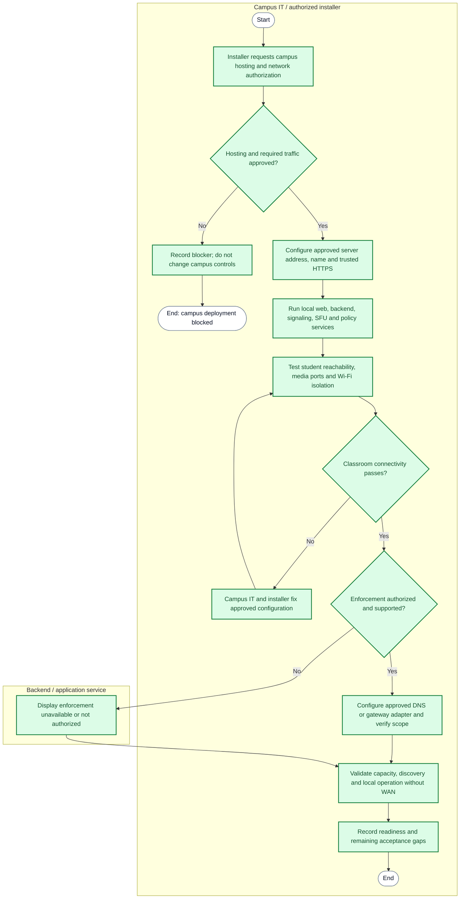

Campus browsing restrictions remain an acceptance gap if no approved integration exists. The system can expose that limitation accurately while classroom connectivity is tested; this does not mean CN10 is satisfied.

## Flow 03 — Prepare portable deployment

**Responsibility lanes:** user/operator actions and automatic application/media/network actions are grouped separately. Authorization checks are server-side; delegated class automation uses recorded scope approval.

**Workflow classification: MUST*** — proposed MoSCoW label for source deployment obligations.

**Covers OR01–OR12.** A teacher laptop may host the services if suitable; a separate local mini-PC/server is another option. Browser-only students do not mean server-free deployment.

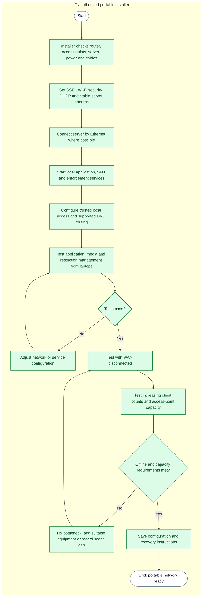

The example IP addresses in the source are examples, not fixed requirements. One router is not automatically sufficient for 150 active viewers; capacity and access-point needs must be measured.

## Flow 04 — Teacher creates a classroom

**Responsibility lanes:** user/operator actions and automatic application/media/network actions are grouped separately. Authorization checks are server-side; delegated class automation uses recorded scope approval.

**Workflow classification: MUST** (process steps support required capabilities).

**Covers T01, T08 and classroom administration.** Authentication is needed to enforce teacher authority; the source does not prescribe a particular login provider or token format.

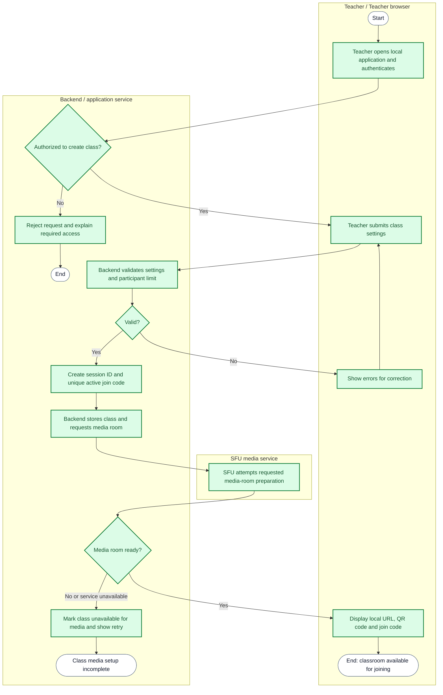

**URL** locates the application; **QR code** is a convenient way to open joining information; **join code** identifies/admit access to the session. A QR code does not create network connectivity by itself.

## Flow 05 — Student joins and is admitted

**Responsibility lanes:** user/operator actions and automatic application/media/network actions are grouped separately. Authorization checks are server-side; delegated class automation uses recorded scope approval.

**Workflow classification: MUST** (process steps support required capabilities).

**Covers S01–S02, S07, T05–T06; optional S08.** Mandatory manual approval for every student is a design choice. The system must support teacher approval/rejection, but the default admission mode needs agreement.

### Required join code and proposed admission modes

**S02 requires entry of a classroom join code in both modes below.** Teacher approval is an additional admission gate, not a replacement for code validation. Supporting both selectable modes is a proposal under D02; the required teacher approve/reject capability remains in scope. There is no approval-only, code-free joining path in this draft. A future QR-prefilled-code convenience would need explicit agreement about how S02 is satisfied; the current flow asks the student to enter the code.

| Proposed mode | Process | When viewing access is granted |
|---|---|---|
| **Code admission** | Student enters code → backend validates active class/code, block state and capacity → backend admits | Only after current checks pass; a valid code alone cannot bypass a full/closed class or a block |
| **Code + teacher approval** | Student enters code → backend checks eligibility → request waits for owning Teacher → Teacher approves/rejects → backend rechecks eligibility and capacity | Only after valid owning-Teacher approval and final backend checks; pending/rejected requests receive no subscriber grant |

Final checks must be atomic with admission/capacity allocation to avoid over-admitting simultaneous requests. If a code expires/rotates, the class ends, a block is added or capacity fills while approval is pending, do not admit based on the old check. Define pending-request timeout/cancellation and reserved-seat semantics in D02; proposed default is no seat reservation before admission. A rejected unauthorized approval attempt must not mutate the pending request as though the owning Teacher rejected it; deny the action and retain its actual admission state.

| Admission test | Proposed pass/fail check | References |
|---|---|---|
| TC-ADM01 | Code admission: valid active code plus available capacity admits; invalid/expired/closed code is rejected | S02, TC-S02, F05 |
| TC-ADM02 | Code + approval: valid code creates pending request with no viewing grant; owning Teacher approval admits only after final checks | T06, TC-T06, F05 |
| TC-ADM03 | Owning Teacher rejection prevents viewing; pending/cancelled/timed-out requests do not obtain media access | T06, TC-T06; timeout policy pending D02 |
| TC-ADM04 | Student, unrelated Teacher, or unscoped administrator cannot approve a request; denied attempt does not change its pending state | NAC16, TC-AUTH, F05/F08 |
| TC-ADM05 | While approval waits, end class / expire code / add block / fill capacity in separate trials; subsequent approval does not bypass final eligibility checks | T06, S02, TC-AUTH |
| TC-ADM06 | Two simultaneous requests compete for the final seat; at most one receives admission/media access under the agreed capacity rule | Classroom limits, S02, TC-S02 |
| TC-ADM07 | A missing join code is rejected in either mode; selecting approval mode does not create a code-free endpoint | S02, TC-S02 |

These are test specifications, not executed tests. Criteria approval remains Pending confirmation and results remain Not run. Link implementation of these checks to existing CC-003, CC-006 and CC-007 and their relevant verification items; no completed feature is inferred.

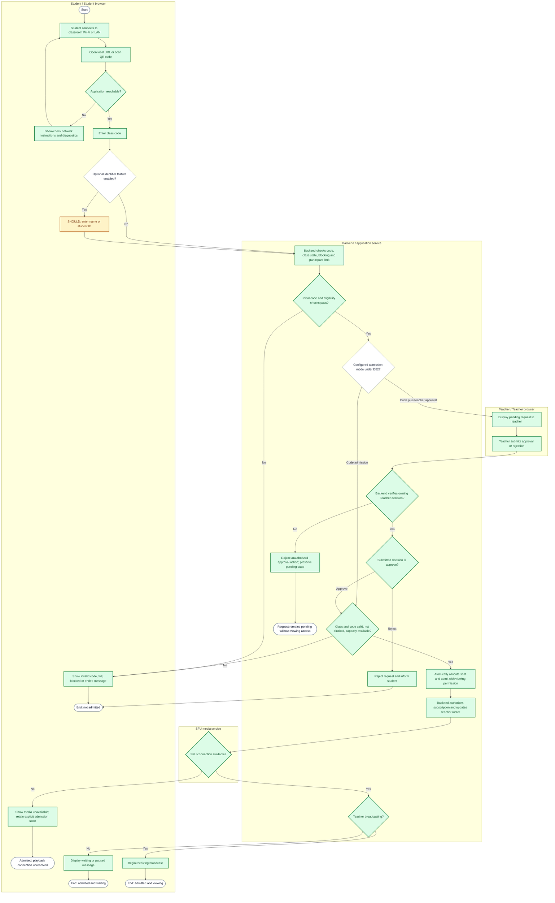

The diagram assumes the teacher makes a decision on a pending request; cancellation/timeouts require a final design. Names and class codes are not strong identity proof. Blocking persistence must be defined, particularly if students join anonymously.

## Flow 06 — Start screen and audio broadcasting

**Responsibility lanes:** user/operator actions and automatic application/media/network actions are grouped separately. Authorization checks are server-side; delegated class automation uses recorded scope approval.

**Workflow classification: MUST** (process steps support required capabilities).

**Covers T02–T04, T07, S03–S04.** WebRTC carries the real-time media. Signaling establishes the connection. The SFU receives teacher media and forwards it to students; the database stores application records, not the live video stream.

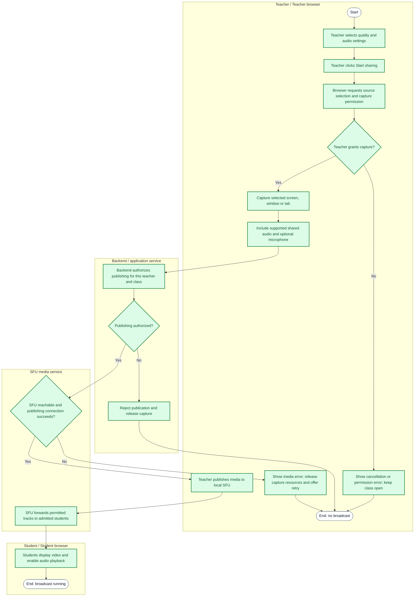

Capture requires the browser-supported secure context and user permission specified in the source. Audio support depends on operating system, browser and source selection. If audio is unavailable, show that limitation rather than claiming it is being shared. Agree which combinations satisfy the requirement.

## Flow 07 — View, pause, resume and stop sharing

**Responsibility lanes:** user/operator actions and automatic application/media/network actions are grouped separately. Authorization checks are server-side; delegated class automation uses recorded scope approval.

**Workflow classification: MUST** (process steps support required capabilities).

**Covers T02, T07, S03–S05, S07.** A student changes their own playback controls. A teacher changes the published stream. Stopping sharing is different from ending the classroom.

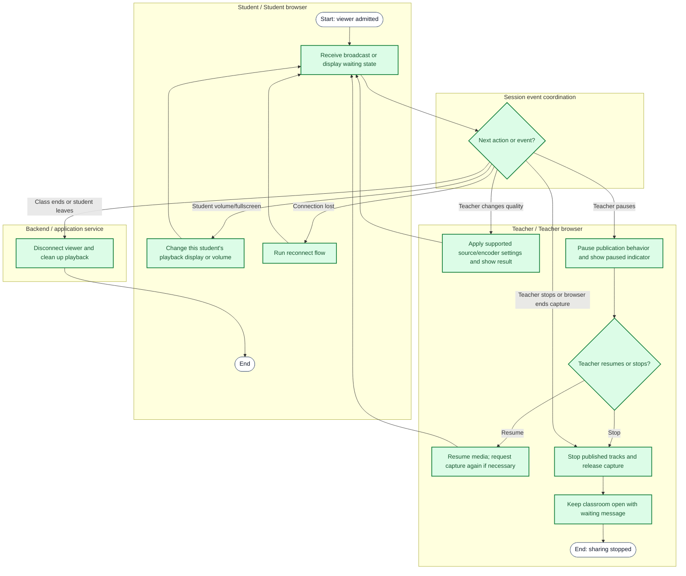

**Unresolved:** whether pause freezes the last frame or shows a placeholder, whether audio pauses, and whether changing resolution requires new capture. Proposed behavior: clear paused indicator and no continuing live audio. The stop branch does not automatically restore the class policy unless the class is ended or restrictions are separately disabled.

## Flow 08 — Teacher monitors, removes or blocks a participant

**Responsibility lanes:** user/operator actions and automatic application/media/network actions are grouped separately. Authorization checks are server-side; delegated class automation uses recorded scope approval.

**Workflow classification: MUST** (process steps support required capabilities).

**Covers T05–T06 and classroom access control.** Monitoring here means connected participants and connection status. Viewing student screens, remote control and monitoring all their activity are not specified.

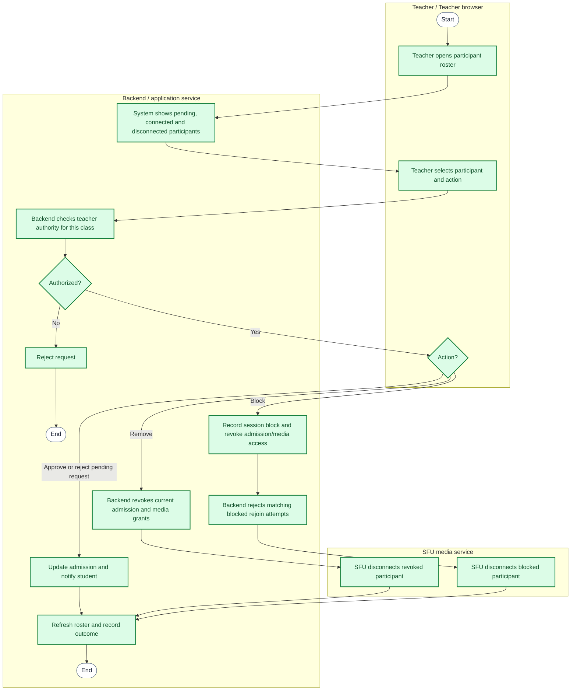

Proposed distinction: removal ends current participation; blocking also prevents rejoin for the agreed identity and duration. The source requires both actions, but identity and block lifetime need clarification. A browser-only anonymous application cannot guarantee recognition after all browser identity is cleared.

## Flow 09 — Administrator creates a policy profile

**Responsibility lanes:** user/operator actions and automatic application/media/network actions are grouped separately. Authorization checks are server-side; delegated class automation uses recorded scope approval.

**Workflow classification: MUST** (process steps support required capabilities).

**Covers NAC02–NAC04, NAC07–NAC08, NAC16–NAC18.** A profile is a reusable configuration, such as Normal Class, Programming Lab or Exam Mode. Saving one does not apply it to the network.

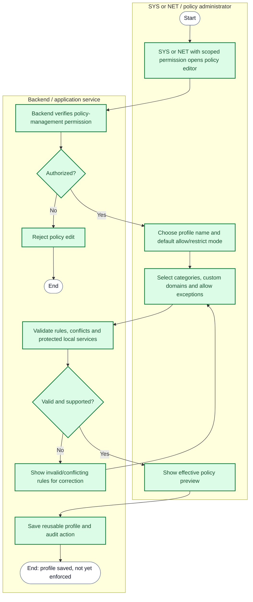

**Allow-by-default:** public destinations are permitted unless a rule restricts them. **Restricted-by-default:** only explicitly approved destinations are permitted within the adapter's supported scope. Specify exception precedence and domain/subdomain matching before implementation. Neither mode alone proves protection against VPNs or alternate DNS.

Categories are maintained domain collections, not an automatic guarantee of identifying every AI tool. The category checkbox preview in the pasted requirements is an illustration, not an active policy.

## Flow 10 — Apply and verify restrictions

**Responsibility lanes:** user/operator actions and automatic application/media/network actions are grouped separately. Authorization checks are server-side; delegated class automation uses recorded scope approval.

**Workflow classification: MUST** (process steps support required capabilities).

**Covers NAC01, NAC05, NAC10–NAC11, NAC16–NAC19; CN10/OR12.** Trigger: a class starts with an administrator-approved profile, or an authorized administrator requests application. The teacher's start event can trigger preapproved policy behavior without giving the teacher unrestricted policy-edit privileges.

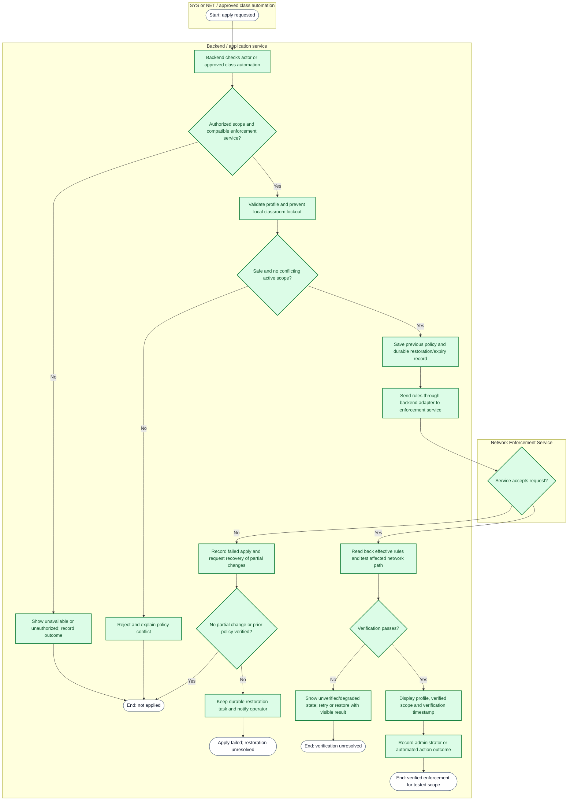

Saving a baseline durably and refusing conflicting scope operations are proposed implementation safeguards. The requirement is reliable apply/status/restore behavior; the storage mechanism is a design choice.

**Three different results:** profile saved; service accepted changes; restrictions verified on the tested path. Display them accurately. A backend DNS test alone does not establish that every student is using the configured resolver.

## Flow 11 — A student requests a public website

**Responsibility lanes:** user/operator actions and automatic application/media/network actions are grouped separately. Authorization checks are server-side; delegated class automation uses recorded scope approval.

**Workflow classification: MUST** (process steps support required capabilities).

This explains what the enforcement component does. It is separate from the student watching the local broadcast. It also explains the supplied DNS-filtering limitations.

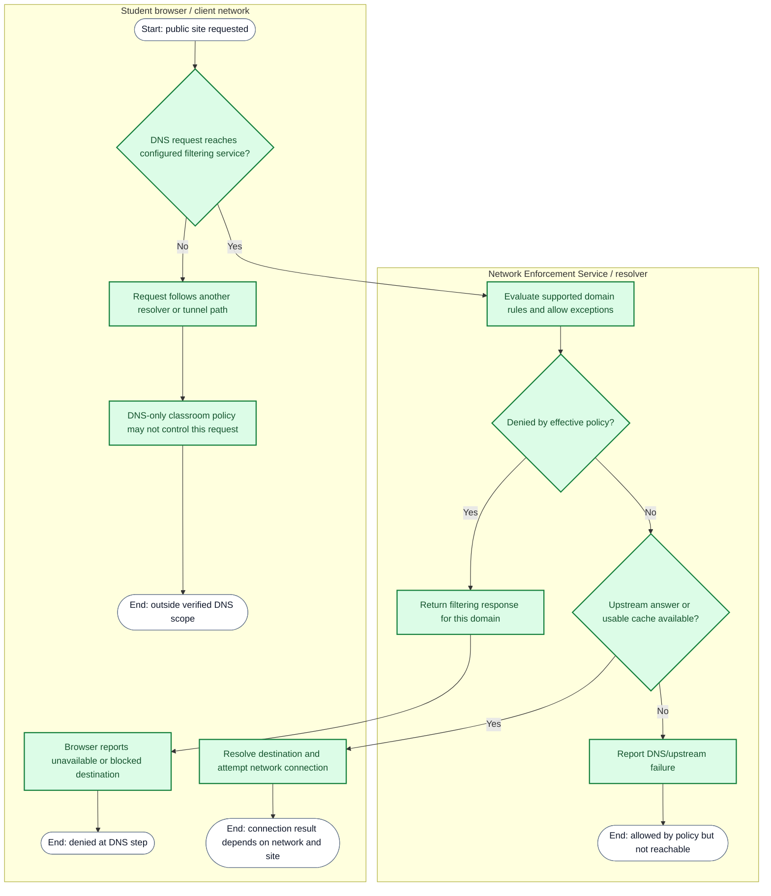

This diagram is scoped to DNS lookups. Cached addresses, existing connections, direct IP access and offline agents need separate treatment; policy changes may not instantly terminate existing website connections. A gateway can enforce additional restrictions only where supported and authorized. Do not promise a custom block page for every HTTPS website.

## Flow 12 — Connection loss and reconnection

**Responsibility lanes:** user/operator actions and automatic application/media/network actions are grouped separately. Authorization checks are server-side; delegated class automation uses recorded scope approval.

**Workflow classification: MUST** (process steps support required capabilities).

**Covers S06–S07 and teacher connection status.** The source requires reconnection but does not define timeout/retry limits or teacher-offline behavior.

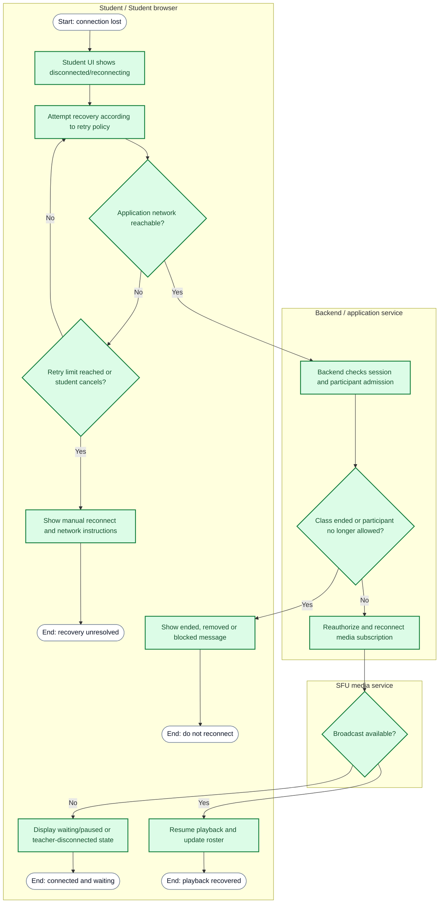

A temporary teacher connection failure should not silently mean that network restrictions are restored or left forever. Proposed behavior: keep explicit class state, use visible recovery status, and retain an independent policy expiry mechanism. Agree the teacher-disconnect grace period before implementation.

## Flow 13 — End a classroom and restore policy

**Responsibility lanes:** user/operator actions and automatic application/media/network actions are grouped separately. Authorization checks are server-side; delegated class automation uses recorded scope approval.

**Workflow classification: MUST** (process steps support required capabilities).

**Covers NAC06, NAC10–NAC11 and classroom end/disconnect requirements.** Closing student access and restoring network policy are separate outcomes; a failed restore must remain visible even after the class has ended.

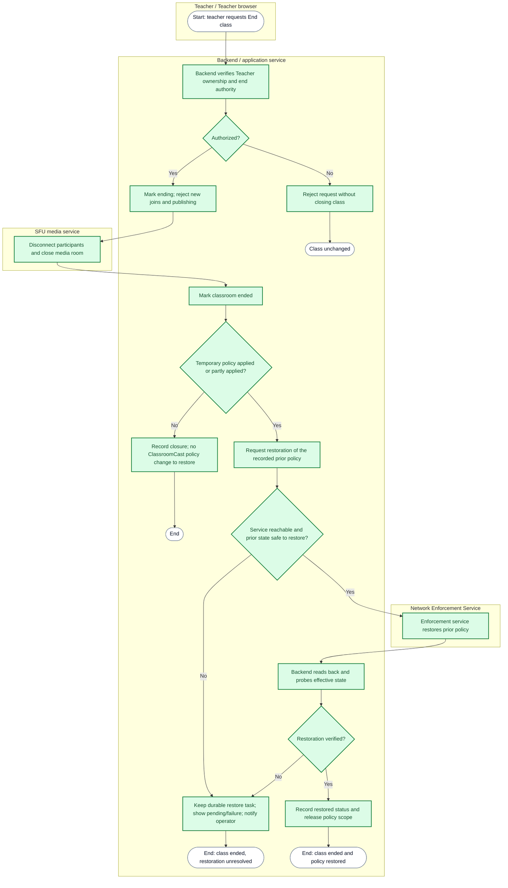

Proposed safeguard: detect unrelated configuration changes before overwriting a saved snapshot. A simple unrestricted “allow everything” operation is not necessarily correct restoration. Preserve protections that existed before ClassroomCast started the class.

## Flow 14 — Temporary expiry and emergency disable

**Responsibility lanes:** user/operator actions and automatic application/media/network actions are grouped separately. Authorization checks are server-side; delegated class automation uses recorded scope approval.

**Workflow classification: MUST** (process steps support required capabilities).

**Covers NAC12–NAC13 and recovery requirements.** Expiry should operate without a teacher browser remaining open. Proposed durable expiry records and a recovery worker support that requirement.

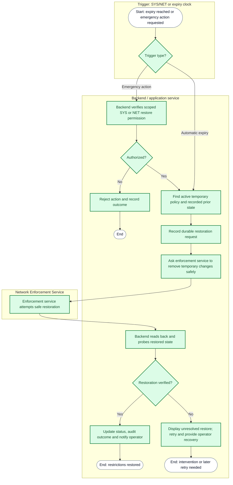

Restoration cannot be guaranteed while the enforcement service is unreachable. Independent service-side expiry may strengthen recovery where supported. Emergency disable should restore ClassroomCast's changes without disabling unrelated campus controls. Whether ending restrictions also ends the classroom is unspecified; proposed behavior is to keep these separate unless the operator ends the class.

## Flow 15 — Health, restart and diagnosis

**Responsibility lanes:** user/operator actions and automatic application/media/network actions are grouped separately. Authorization checks are server-side; delegated class automation uses recorded scope approval.

**Workflow classification: MUST** (process steps support required capabilities).

**Covers local diagnostic page, health checks, logs and recovery; T09 is Should for expanded streaming diagnostics.** Basic health/recovery obligations already exist in the architectural requirements.

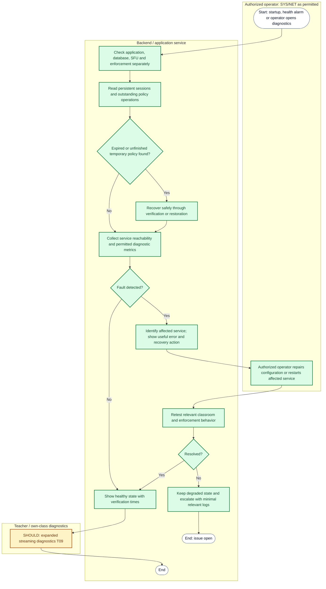

Avoid displaying global “Healthy” when only the web page is reachable. Media can fail while the API works; DNS filtering can fail while media works. Logs must avoid secrets and unnecessary browsing-history collection (NAC17/NAC19).

## Flow 16 — Share and download materials — Should

**Responsibility lanes:** user/operator actions and automatic application/media/network actions are grouped separately. Authorization checks are server-side; delegated class automation uses recorded scope approval.

**Workflow classification: SHOULD** (authorization and validation still required when implemented).

**Covers T10 and S09.** Displaying a PDF inside a shared screen is already possible through screen capture. Uploading a file and giving students download permission is an additional application workflow. The exact upload/transfer model is a proposed interpretation to confirm.

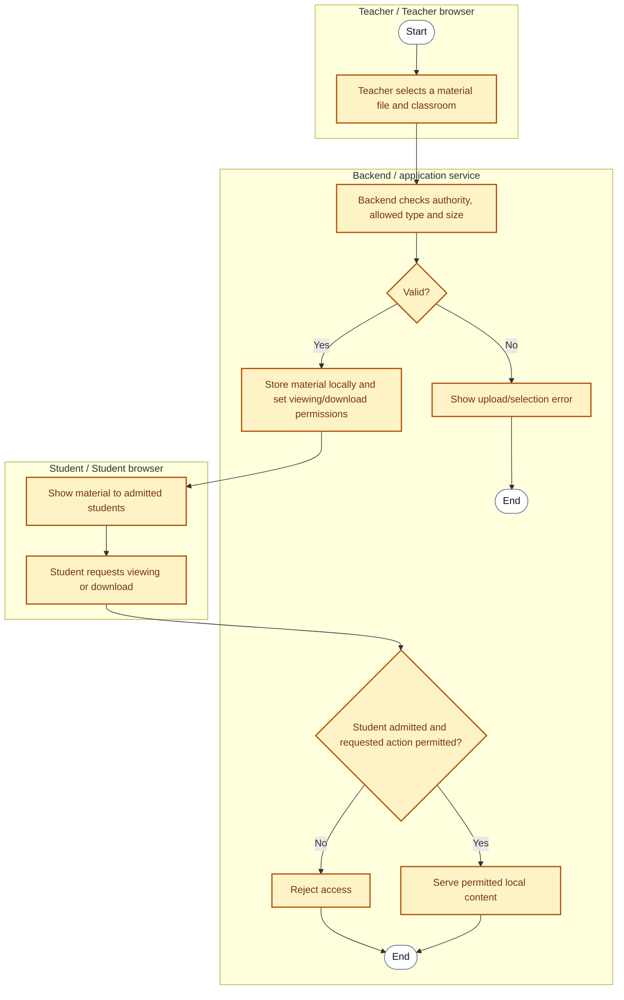

## Flow 17 — Policy schedules and configuration transfer — Should

**Responsibility lanes:** user/operator actions and automatic application/media/network actions are grouped separately. Authorization checks are server-side; delegated class automation uses recorded scope approval.

**Workflow classification: SHOULD** (authorization and validation still required when implemented).

**Covers NAC09, NAC14, NAC20.** Local rules are also necessary for the broader offline operation requirement; clarify that overlap rather than allowing the global requirement to disappear behind a Should label.

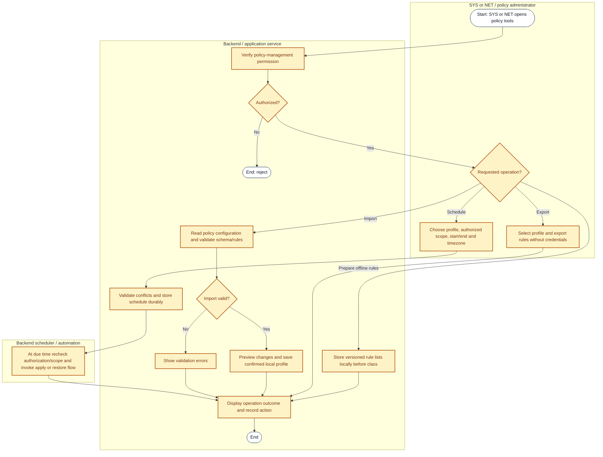

Importing or scheduling a profile does not itself prove enforcement. Scheduled operations must still verify outcomes. Timezone and clock behavior during offline operation need agreement.

## Flow 18 — Optional participation, history and group policies — Could

**Responsibility lanes:** user/operator actions and automatic application/media/network actions are grouped separately. Authorization checks are server-side; delegated class automation uses recorded scope approval.

**Workflow classification: COULD** (authorization and scope checks still required when implemented).

**Covers S10, T11, NAC15.** These are three distinct optional features, shown as separate branches so they do not become hidden Must work.

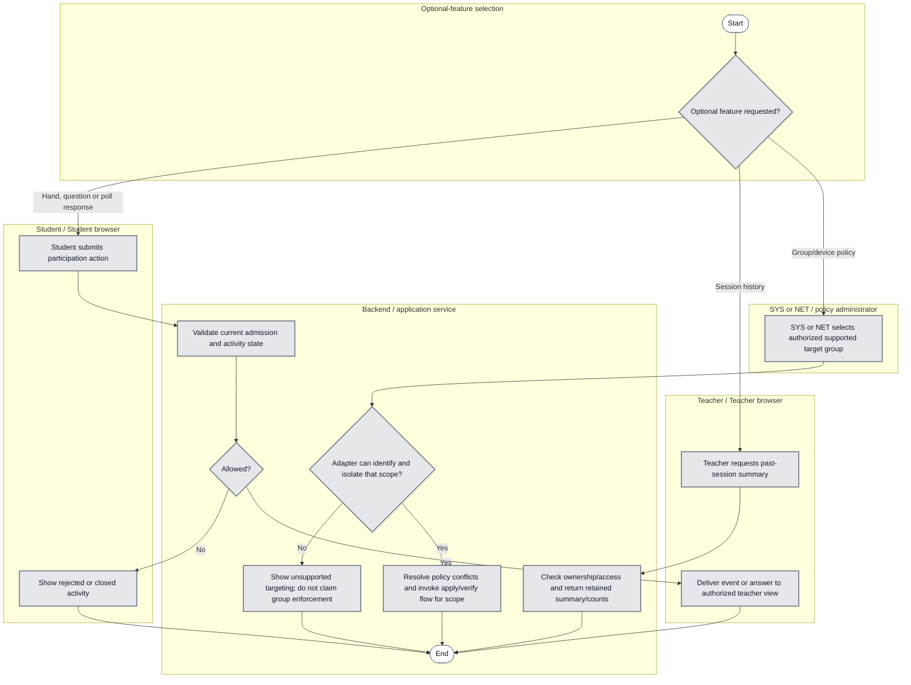

For polls, question creation/open/close/results behavior needs refinement; the source lists the feature but does not specify the complete poll product. Session history does not imply recording the teacher's screen. Per-device network identity cannot automatically be inferred from a browser nickname, especially behind shared network translation.

## 6. What belongs in each software layer?

| Layer | Stores or processes | Does not by itself establish |
|---|---|---|
| Frontend | Teacher/student/admin interaction and visible status | Actual restriction of other devices |
| Backend | Identity/authorization, session data, policy lifecycle, verified outcomes and audit | Media distribution or network enforcement without integrations |
| Database | Users, profiles, sessions, participant/admission records, policy restoration records | A live video transport |
| Signaling / SFU | Media connection negotiation, forwarding audio/video to authorized participants | Domain/category filtering |
| Enforcement service / adapter | Rules, supported network scope and read-back/probes | Prevention of all VPN/offline-tool bypass |
| Local infrastructure | Names, trusted HTTPS, DHCP, reachability, media traffic, resolver path and Wi-Fi capacity | Proven capacity until measured |

At 50–150 viewers, the required SFU design keeps the teacher from sending a separate full stream directly to every student. The server and Wi-Fi infrastructure still need enough capacity to forward all viewer traffic. This is why infrastructure testing is part of the project, not an installation detail to postpone until the demo.

## Acceptance criteria and test conditions

The following are **proposed pass/fail criteria**, not achieved results. Original requirement priorities remain unchanged. A Should/Could test applies when that feature is included in the agreed release. Negative authorization checks apply even to optional features once implemented.

### Common test conditions and proposed numeric targets

| Test basis | Proposed setup/target | Approval/evidence rule |
|---|---|---|
| AT01 — Local UI | Fresh browser reaches join page within 5 s on a reachable healthy test LAN; 10 trials per supported browser | Timing starts at navigation and ends when code input is interactive; record cold/cache conditions |
| AT02 — Playback quality | Agreed starting profile 720p/15 fps; source-to-display p95 ≤1 s; report received bitrate, freezes, packet loss and per-client results | Proposed threshold needs D12 approval; measure visible source timestamp at source/viewer in a common recording; separate screen content from encoder adaptation |
| AT03 — Capacity/stability | 50/100/150 concurrent subscribers, 30 min each; per-viewer playback active at ≥98% of declared one-minute checks; no open release-blocking defect | Record physical/simulated counts, AP/SSID/topology, OS/browser, source, bitrate, server CPU/RAM/NIC and samples; simulation does not prove 150-laptop Wi-Fi airtime |
| AT04 — Policy apply | Healthy reachable authorized adapter reports verified outcome within 30 s of class-start/apply event in 10 trials | Must include client-path denied/allowed controls and local app/media access; upstream conditions recorded |
| AT05 — Restoration | Prior policy verified within 30 s of end/emergency/expiry trigger in 10 healthy reachable trials | In unreachable/conflicting-state tests, class still closes; durable pending/failure shown within proposed 5 s of detecting failure; safe retry/operator recovery required |
| AT06 — Reconnect | After a 10 s interruption, same-class playback recovers within 15 s of reachability returning in ≥9/10 attempts | Also test class ended and participant revoked while offline; those clients must not regain access |
| AT07 — Offline | Preprovision runtime assets/images, names/cert trust and lists; disconnect WAN and open fresh browser | External public-site failure is not evidence of selective blocking; use controlled local domains for offline rule checks |

Until D09/D12 are agreed, evaluate feasibility and record measurements; do not sign off numeric targets as approved. Valid test data must name build/configuration, device identity or simulator, browser/OS, network mode, timestamp, tester, expected result, observed result and evidence path. A failing agreed criterion stays failed until retested; absence of equipment/integration is Blocked, not Passed.

### Separate failure and recovery scenarios

**Offline means WAN unavailable while the required local network, server/services, local naming and trusted access remain operational.** It does not promise uninterrupted broadcasting when Wi-Fi, the server or the SFU fails. Isolate each fault below on an authorized test setup; keep the other dependencies available where the topology permits. If services share a host/process/resolver, document the coupled failure rather than calling it an independent test.

Before every trial, record build/configuration, network mode, topology, physical/simulated client counts, browser/OS, capture source, active profile, current admission and enforcement states. Capture the healthy baseline, fault start, detected outcome, recovery action, retest and final policy state. Restore the test environment before the next case. Repeat applicable cases for both campus and portable modes; campus faults require the authorized operator/test scope.

| Scenario / test | Controlled fault and retained dependencies | Expected behavior during fault | Recovery and observable final state | Requirement / workflow references |
|---|---|---|---|---|
| **FS01 / TC-FAIL01 — WAN disconnected** | Disconnect upstream internet only; LAN, application/backend, SFU, local names/trust and required filtering service stay available | Fresh local joining and ongoing screen/supported-audio viewing work under AT07; public websites may fail independently of policy; no cloud runtime dependency is required | Restore WAN; local class remains usable. Use local controlled domains for offline rule checks; use upstream-connected controls separately to prove selective public-domain enforcement | CN09, OR11, NAC18/NAC20; F02/F03/F06/F10/F15 |
| **FS02 / TC-FAIL02 — One student loses Wi-Fi** | Disconnect one viewer for 10 s while teacher, other viewers and local services remain reachable | Affected viewer shows lost/reconnecting status; it receives no new media during the outage; other viewers continue. Network policy does not change merely because one viewer disconnects | Restore Wi-Fi and revalidate admission; AT06 recovery applies only to a still-authorized active class. Also revoke/end while offline and verify no readmission | S06/S07, T05/T06; F08/F12 |
| **FS03 / TC-FAIL03 — Classroom LAN/AP path fails** | Interrupt the class access-point/LAN path in the controlled scope; server may still be powered | Clients on that path cannot be promised broadcast, new joining or live backend status. No successful new policy verification is claimed from stale data; infrastructure recovery is required | Restore path; recheck names/trust, app, media, admission and current policy before reporting recovered. Restoration/verification stays pending until its required paths are reachable | CN02–CN04, OR07, S07; F02/F03/F12/F15 |
| **FS04 / TC-FAIL04 — Application/backend unavailable** | Stop only application/backend service where separable; leave LAN/SFU/enforcement running | New joins, class controls and fresh authorization fail visibly where a client is still loaded. Existing media may continue or stop according to tested SFU/token behavior; do not promise either. Previously applied rules may remain; unreachable control plane must not be described as restored | Authorized operator restores backend; recover durable sessions/leases, reconcile ended/revoked admission and expired policies, and retest. Document any access-revocation/expiry delay; D11 must settle it before release | NAC06/NAC10/NAC13, S07; F12–F15, TC-RECOVERY |
| **FS05 / TC-FAIL05 — SFU unavailable** | Stop/disconnect only media service; application/backend and network controls remain available | App can show class/participant state while media publication/subscription fails. Display media unavailable rather than global service success. Do not reset network rules solely because the SFU failed | Restore SFU, reauthorize/resubscribe current participants and republish only with valid Teacher permission/capture consent where needed. Retain class identity where safely recoverable; report any unsupported recovery | T02–T05, S03/S04/S07; F05/F06/F12/F15 |
| **FS06 / TC-FAIL06 — Local name resolution fails** | Make required local hostname resolution unavailable without bypassing security; note if DNS filtering shares the fault | Fresh clients may fail before the page loads; existing cached connections may behave differently. Operator instructions identify naming failure; do not assume the app can display its own error page when unreachable | Authorized operator repairs local DNS/name configuration; verify the original trusted hostname, signaling/media and enforcement paths. A raw IP is not a passing substitute unless its secure access was explicitly provisioned | CN01/CN02, OR05, secure-context obligation; F02/F03/F15 |
| **FS07 / TC-FAIL07 — HTTPS trust/certificate fails** | On an isolated test endpoint/client, present expired, untrusted or hostname-mismatched certificate; keep network reachable | Browser may block the app/WSS/capture. Do not tell users to bypass certificate checks and count that as success; use browser/endpoint evidence when app UI cannot load | Repair certificate, hostname, clock or trust provisioning as appropriate; fresh clients access original intended endpoints without warnings and can capture/connect. Do not rely on online renewal during an offline class | Secure-context obligation, CN01/CN09, OR05/OR11; F02/F03/F06/F15; D10 |
| **FS08 / TC-FAIL08 — Enforcement API or filtering service unavailable** | Test adapter management-API loss separately from resolver/gateway failure where possible; app/SFU retained | Report last verified time and current unverified/degraded/pending state. Management-API loss may leave old rules effective; resolver failure may also break naming/public access. Neither proves policy disabled/restored. Preserve local access according to tested topology; expose dependencies honestly | Restore service/path; read back rules, reconcile outstanding apply/expiry/restore tasks and verify affected-client controls. Ending the class still closes app/media access when those services are reachable; network restoration may remain unresolved | NAC01/NAC06/NAC10/NAC12/NAC13/NAC18, CN10/OR12; F10/F13/F14/F15 |

**Fault classification:** FS01 tests the required offline capability. FS02–FS08 test failure detection, truthful state and recovery; they do not introduce a guarantee of uninterrupted playback through failed infrastructure. Numeric detection/recovery limits remain proposed AT targets and D11/D12 decisions. All eight results = **Not run**; requirement approval and client acceptance remain separate.

**Additional cross-cutting acceptance:** AC-FAILURES / TC-FAIL01–TC-FAIL08 requires the isolated fault, expected visible/operational state, recovery evidence and final policy/admission state to be recorded. Use existing CC-002/CC-017 for setup, CC-009 for viewer recovery and CC-020 for integrated fault/recovery checks; add component evidence to CC-005/CC-008/CC-012/CC-015 as relevant. These tests supplement the 63 original requirement test specifications rather than replacing or renumbering them.

### Cross-cutting architectural acceptance

| Criterion/test | Proposed acceptance |
|---|---|
| AC-AUTH / TC-AUTH | Matrix allow/deny and cross-class/scope tests pass; stale/forged/revoked room grants fail; role removal affects new privileged requests; no permission is inferred only from visible UI |
| AC-LOCAL / TC-LOCAL | AT07 confirms local app, API, signaling, SFU, policy storage and required filtering service operation without cloud/CDN runtime dependence |
| AC-SFU / TC-SFU | Documented transport path shows teacher publication to local SFU and per-viewer subscriptions; actual negotiated streams/bitrates and load are recorded |
| AC-RECOVERY / TC-RECOVERY | Execute isolated scenarios TC-FAIL01–TC-FAIL08; health distinguishes network, application, media, trust/name and enforcement faults; unfinished temporary policy operations resume safely; backup/database/config restoration drill documented |
| AC-PRIVACY / TC-PRIVACY | Server secrets absent from clients/exports/logs; retained participant/audit data matches approved minimal collection and deletion rules |

### Individual requirement acceptance catalogue

Each TC-ID below is a **test specification**, not an implemented automated test. The RTM connects it to an existing backlog task and activity. All criteria approval = Pending confirmation; all results = Not run.

| Requirement | Test case | Proposed acceptance criterion |
|---|---|---|
| NAC01 | TC-NAC01 | In a controlled authorized scope, enable and disable a profile; status and client-path probes show the effective result. Disabled/unreachable integration is not reported as verified. |
| NAC02 | TC-NAC02 | For each configured category, predeclare representative denied domains and allowed controls; application produces the expected DNS/gateway results. Record list version and known coverage gaps. |
| NAC03 | TC-NAC03 | A custom blocked domain is denied and an allowed domain is permitted through the configured enforcement path; invalid domain syntax is rejected before a network change. |
| NAC04 | TC-NAC04 | Run allow-by-default and restricted-by-default profiles against the same declared test set; results match the agreed rule/exception precedence, including subdomain handling under D07. |
| NAC05 | TC-NAC05 | Starting an authorized class with an approved profile creates an apply operation and audit outcome; healthy-scope verification meets proposed AT04. Starting from another class/scope cannot apply it. |
| NAC06 | TC-NAC06 | After applying a temporary profile, end the class; prior effective rules and allowed/blocked client-path controls are restored within proposed AT05 when reachable. Restoration failures remain visible and retryable. |
| NAC07 | TC-NAC07 | Save two named profiles, reload the application/backend and retrieve equivalent rule versions; switching the selected profile does not itself falsely report network enforcement. |
| NAC08 | TC-NAC08 | Given a blocked category, add an approved domain exception; that control resolves/connects where upstream permits, while another category domain remains denied. Protect local app/media access throughout. |
| NAC09 | TC-NAC09 | Schedule a start/end against a declared timezone and test clock; each executes once per agreed idempotency semantics after restart, rechecks scope approval and records actual result. Missed-run policy awaits D11. |
| NAC10 | TC-NAC10 | Compare desired version, adapter read-back and affected-client probe results; UI accurately differentiates saved, applying, verified, degraded, failed and restoration-pending outcomes with timestamps. |
| NAC11 | TC-NAC11 | Perform a profile edit, apply, failed apply and restore; each audit record includes actor/service identity, action, scope, time and outcome, with no credentials. |
| NAC12 | TC-NAC12 | Apply restrictions then invoke authorized emergency restore; prior policy verifies under proposed AT05. Unauthorized request changes no rules; an unreachable adapter yields a visible unresolved result. |
| NAC13 | TC-NAC13 | Apply a rule with declared expiry; close the admin browser and restart the backend before expiry. Recovery executes restoration once safely and verifies it under AT05 or displays pending/failure if unreachable. |
| NAC14 | TC-NAC14 | Export and reimport a sample profile; normalized rule content matches, secrets are absent, malformed imports are rejected and applying requires its own authorized operation. |
| NAC15 | TC-NAC15 | Where the chosen adapter supports isolated identity/scope, apply a group rule to target A and demonstrate that control B retains its prior policy. Otherwise mark unsupported and record the scope decision. |
| NAC16 | TC-NAC16 | Execute the role-permission matrix’s representative allowed and denied operations; Student/Teacher roles alone cannot edit policies or infrastructure, and out-of-scope administrators cannot mutate that scope. |
| NAC17 | TC-NAC17 | Inspect built frontend, network responses, profile exports and logs for test secret markers; none appear. Adapter secrets/signing keys are accessible only through protected server configuration. |
| NAC18 | TC-NAC18 | Apply the most restrictive agreed profile; a fresh student join, teacher controls, live media, local names and restoration remain functional. Reject an explicit conflicting local-service rule. |
| NAC19 | TC-NAC19 | Review app/resolver logging and storage using synthetic browsing events; collect only agreed minimal data, mask/exclude unnecessary raw histories and demonstrate deletion according to D13. |
| NAC20 | TC-NAC20 | After provisioning local lists, disable WAN and restart services; profiles/rules remain retrievable and local test-domain policy operations work without remote list fetching. Baseline offline behavior remains required. |
| T01 | TC-T01 | Create 10 concurrent active classes with the same authorized teacher or test teachers; all session IDs and active join codes are distinct. Closed-code join is rejected. |
| T02 | TC-T02 | Run start → pause → resume → stop on the supported setup; both viewers see each agreed state and publication stops after stop. Stopping sharing leaves the class open; pause/audio semantics await D08. |
| T03 | TC-T03 | For every supported capture type (screen/window/tab), publish the teacher-selected source to two viewers; denial/cancellation creates no published capture. Record unsupported browser/source combinations under D09. |
| T04 | TC-T04 | On each agreed OS/browser/source combination, verify shared audio when supported, microphone audio when selected, and no microphone publication when not selected. Record unsupported sources explicitly. |
| T05 | TC-T05 | Join two viewers and disconnect one; roster shows the correct participant count and each current connection state within proposed 5 s after the server detects the event. |
| T06 | TC-T06 | Demonstrate approve, reject, remove and block separately. Removed access closes; blocked rejoin fails for the agreed identity/duration. Repeat cross-class control attempts and verify denial; D02/D03 define guarantees. |
| T07 | TC-T07 | Apply two supported quality profiles; record configured and observed resolution, frame rate and bitrate with adaptation limits. Unsupported input is rejected or reported; do not assert exact network bitrate from settings alone. |
| T08 | TC-T08 | From a second laptop, open the displayed URL and decoded QR destination; both point to the intended local class/join route and the displayed code joins that class. |
| T09 | TC-T09 | During a controlled media fault, diagnostics distinguish connection state, missing/stalled media and available WebRTC statistics; display measurement time and refresh within proposed 5 s. |
| T10 | TC-T10 | Exercise one approved presentation, PDF, image and video sample through the agreed sharing method; admitted viewers can access it and rejected formats show a useful error. D16 defines upload versus media presentation behavior. |
| T11 | TC-T11 | End two owned classes; retained history shows their correct IDs/times and participant counts. Another teacher cannot read them; summaries do not imply video recordings. |
| S01 | TC-S01 | From two test laptops on the selected network, the local URL and QR destination both reach the join page with trusted browser access. Record page-ready time against proposed AT01. |
| S02 | TC-S02 | In both proposed modes, missing, invalid, expired or closed codes are rejected. Code admission permits viewing only after final checks; code + approval keeps a valid request pending until owning-Teacher approval and fresh atomic admission/capacity checks. Wrong guesses follow the agreed rate-limit rule; execute TC-ADM01–TC-ADM07. |
| S03 | TC-S03 | Two admitted viewers receive the selected live screen via the local SFU; non-admitted clients cannot subscribe. Measure physical-viewer playback and target-scale conditions under AT02/AT03. |
| S04 | TC-S04 | On supported audio combinations, each viewer can start playback and adjust/mute its own audio independently; another viewer’s volume and teacher publication are unchanged. |
| S05 | TC-S05 | Enter/exit fullscreen on each supported browser using user interaction; playback continues or any unsupported behavior is explained and recorded. |
| S06 | TC-S06 | Interrupt one viewer’s network for 10 s; it reconnects to the same active class within proposed 15 s of reachability returning in at least 9/10 attempts. Removed/ended sessions never auto-readmit. |
| S07 | TC-S07 | Inject invalid code, full class, denied admission, ended session, network loss and media failure; each produces the correct actionable status without exposing secrets. |
| S08 | TC-S08 | With the feature enabled, enter a valid name/assigned ID; invalid input receives validation feedback and the allowed identifier is associated with the admitted participant. Identity strength and retention await D03/D13. |
| S09 | TC-S09 | An admitted student downloads an allowed sample matching its recorded checksum; download denied when permission is off or admission is revoked; direct URL requests enforce the same checks. |
| S10 | TC-S10 | For each selected interaction (hand/question/poll), an admitted student action reaches the owning teacher; unauthorized or closed-activity submissions are rejected. Specific interaction set awaits D17. |
| CN01 | TC-CN01 | Campus IT approves server name/address; two campus laptops reach the correct server with trusted access. Preserve approval and configuration evidence. |
| CN02 | TC-CN02 | From two representative student network locations, verify app/API and media-signaling connectivity; report each separate endpoint and any inaccessible segment. |
| CN03 | TC-CN03 | Establish real audio/video over the approved configured media path; record actual ports/transports and approved firewall evidence. Signaling-only success does not pass. |
| CN04 | TC-CN04 | Test the intended SSID/VLAN/isolation settings; students reach only the required server/enforcement paths, and guest restrictions affecting the flow are recorded. |
| CN05 | TC-CN05 | Record written campus IT authorization for hosting and any required firewall changes before making those changes; absence leaves this criterion pending, not passed. |
| CN06 | TC-CN06 | Execute staged 50/100/150 subscriber tests and AT02/AT03 on the documented campus setup; identify physical versus simulated clients and whether 150-device Wi-Fi capacity is actually demonstrated. |
| CN07 | TC-CN07 | Join from a campus laptop by both manual URL and QR destination; network instructions identify the correct campus network and server. |
| CN08 | TC-CN08 | Campus IT checks reserved/static server addressing against DHCP/IP allocations; conflict checks show no duplicate address before the pilot. |
| CN09 | TC-CN09 | With images/assets/certificates provisioned, disconnect WAN and use a fresh browser session; class creation, joining and local media work without CDN/cloud requests. |
| CN10 | TC-CN10 | Within written approved scope, apply an approved profile through the campus DNS/gateway adapter, verify client-path effects, and restore previous rules. Missing integration remains an acceptance gap. |
| OR01 | TC-OR01 | Record Wi-Fi 6-or-better equipment model/capabilities and staged load results for the intended client density; brochure client count alone is insufficient. |
| OR02 | TC-OR02 | Configure the intended classroom SSID/password; two student laptops associate and obtain local connectivity without changing per-class infrastructure rules. |
| OR03 | TC-OR03 | Inspect negotiated Wi-Fi security on the supported clients: WPA2-AES or compatible WPA3 as agreed; record any incompatible devices and resolution. |
| OR04 | TC-OR04 | DHCP pool/lease configuration supports at least 150 students plus inventoried support devices; test lease assignment and no duplicate allocations using declared physical/simulated conditions. |
| OR05 | TC-OR05 | Reboot router/server; the configured stable server address/local name still leads students to the intended application and media endpoint. |
| OR06 | TC-OR06 | Use and record a negotiated Gigabit-or-faster wired server link where possible; if unavailable, record the exception and measured capacity impact for acceptance. |
| OR07 | TC-OR07 | With intended isolation enabled/configured, two student clients still reach the server, media and approved enforcement paths; document permitted connectivity. |
| OR08 | TC-OR08 | Test increasing client loads, measure bottlenecks and choose AP count/placement that meets agreed AT02/AT03; repeat after relevant configuration changes. |
| OR09 | TC-OR09 | Demonstrate adding the supported AP/switch arrangement without address conflicts or loss of class reachability; preserve a topology/configuration record. |
| OR10 | TC-OR10 | Inventory required power supplies, cables/adapters and transport protection; perform one full setup and power/restart recovery using the portable kit. |
| OR11 | TC-OR11 | With WAN physically disconnected and local dependencies provisioned, start a fresh class and receive screen/supported audio on two laptops; apply/restore rules against controlled local test domains. |
| OR12 | TC-OR12 | Apply and restore two class profiles through the supported software adapter with no manual router rule edits between classes; unsupported automation is visibly reported as a gap. |

## Use-case catalogue

A use case describes a user goal; F numbers describe its activity process. The catalogue supports the RTM without claiming that formal UML use-case diagrams have been authored. System boundary: ClassroomCast application and its local service integrations; campus authorization and browser capture consent remain external constraints.

| Use case | Primary actor | Goal / activities |
|---|---|---|
| UC01 | Teacher | Create class and publish joining information — F04 |
| UC02 | Student, Teacher for approval | Request and obtain admission — F05 |
| UC03 | Teacher, admitted Student | Publish/receive media and playback controls — F06/F07 |
| UC04 | Teacher | Manage roster and participant access — F08 |
| UC05 | SYS/NET with policy permission | Create/maintain profiles and exceptions — F09 |
| UC06 | SYS/NET or authorized class automation | Apply and verify supported restrictions — F10/F11 |
| UC07 | Student | Recover class connection — F12 |
| UC08 | Teacher and backend automation | End class, revoke access and restore policy — F13 |
| UC09 | SYS/NET or expiry automation | Emergency/expiry recovery — F14 |
| UC10 | Authorized operator | Diagnose/recover local services — F15 |
| UC11 | Teacher, admitted Student | Share/access permitted materials — F16 |
| UC12 | SYS/NET with policy permission | Schedule/import/export/local lists — F17 |
| UC13 | Teacher, Student, scoped policy administrator | Optional participation, history or group policy — F18 |
| UC14 | Authorized campus installer/NET | Prepare and verify campus deployment — F02 |
| UC15 | Authorized portable installer/NET | Prepare and verify portable deployment — F03 |

## Requirement-to-flow index

All **63 original requirement IDs** have their own colored tree leaf above. The table below maps each ID to the detailed activities. Priority is scope priority, not approval/implementation/test status.

| Requirement IDs | Supplied priority | Detailed activities |
|---|---|---|
| T01, T08 | Must | F04, F05 |
| T02, T03, T04, T07 | Must | F06, F07 |
| T05, T06 | Must | F05, F08 |
| T09 | Should | F15 |
| T10 | Should | F16 |
| T11 | Could | F18 |
| S01, S02 | Must | F05 |
| S03, S04, S05 | Must | F06, F07 |
| S06, S07 | Must | F05, F07, F12, F15 |
| S08 | Should | F05 |
| S09 | Should | F16 |
| S10 | Could | F18 |
| NAC01, NAC05 | Must | F01, F10 |
| NAC02, NAC03, NAC04, NAC07, NAC08 | Must | F09, F10, F11 |
| NAC06 | Must | F13, F14 |
| NAC09 | Should | F17 |
| NAC10, NAC11 | Must | F10, F13, F14, F15 |
| NAC12, NAC13 | Must | F14, F15 |
| NAC14 | Should | F17 |
| NAC15 | Could | F18 |
| NAC16, NAC17, NAC18, NAC19 | Must | F09, F10, F13, F14, F15 |
| NAC20 | Should; overlaps overall offline requirement | F03, F17 |
| CN01–CN10 | Not individually labeled; proposed Must* | F02 |
| OR01–OR12 | Not individually labeled; proposed Must* | F03 |

The original explicitly prioritized requirements total **31 Must, 7 Should and 3 Could**. Add **22 unlabeled campus/router obligations** for 63 original IDs. The five red exclusions and ARCH/F navigation labels are additional planning labels, not original requirements.

## Full requirement traceability matrix

**CC-001–CC-026 reference actual rows in [BACKLOG.csv](BACKLOG.csv)**; these are planned development/verification tasks, not new invented task IDs. Each original requirement maps to at least one existing task, a use case, an activity and a unique TC specification in the acceptance catalogue. Broad backlog items must be split before sprint commitment while retaining these links.

Per-row status is represented by the shared baseline: **approval Pending confirmation; implementation Not assessed; test Not run; acceptance Pending**. Record future results with evidence and reviewer in a dated test record; do not infer completion from a mapped task or green MoSCoW node. These status values apply to every row until individually updated.

| Requirement ID | Requirement | Source priority | Activity flows | Use cases | Existing development/verification tasks | Test case |
|---|---|---|---|---|---|---|
| NAC01 | Enable or disable network restrictions for a class | Must | F01 F10 | UC06 | CC-012, CC-013, CC-016, CC-018 | TC-NAC01 |
| NAC02 | Block website categories, including AI and coding agents | Must | F09 F10 F11 | UC05 UC06 | CC-011, CC-013, CC-016, CC-018 | TC-NAC02 |
| NAC03 | Block or allow individual domains | Must | F09 F10 F11 | UC05 UC06 | CC-011, CC-013, CC-016, CC-018 | TC-NAC03 |
| NAC04 | Support allow-by-default and restricted-by-default policies | Must | F09 F10 F11 | UC05 UC06 | CC-011, CC-013, CC-016, CC-018 | TC-NAC04 |
| NAC05 | Automatically apply policies when a class starts | Must | F01 F10 | UC06 | CC-014, CC-016, CC-018 | TC-NAC05 |
| NAC06 | Restore the previous policy when a class ends | Must | F13 F14 | UC08 UC09 | CC-014, CC-015, CC-016, CC-018, CC-020 | TC-NAC06 |
| NAC07 | Save reusable policy profiles | Must | F09 F10 F11 | UC05 UC06 | CC-011, CC-013, CC-018 | TC-NAC07 |
| NAC08 | Add allowlist exceptions for approved websites | Must | F09 F10 F11 | UC05 UC06 | CC-011, CC-013, CC-016, CC-018 | TC-NAC08 |
| NAC09 | Schedule restrictions by date and time | Should | F17 | UC12 | CC-024 | TC-NAC09 |
| NAC10 | Display active policy and actual enforcement status | Must | F10 F13 F14 F15 | UC06 UC08 UC09 UC10 | CC-012, CC-013, CC-016, CC-018, CC-020 | TC-NAC10 |
| NAC11 | Record administrator actions and timestamps | Must | F10 F13 F14 F15 | UC06 UC08 UC09 UC10 | CC-014, CC-016, CC-018 | TC-NAC11 |
| NAC12 | Provide an emergency disable and rollback function | Must | F14 F15 | UC09 UC10 | CC-015, CC-016, CC-018, CC-020 | TC-NAC12 |
| NAC13 | Support temporary rules with automatic expiry | Must | F14 F15 | UC09 UC10 | CC-015, CC-016, CC-018, CC-020 | TC-NAC13 |
| NAC14 | Import and export policy configurations | Should | F17 | UC12 | CC-024 | TC-NAC14 |
| NAC15 | Apply different policies to student groups or devices where supported | Could | F18 | UC13 | CC-026 | TC-NAC15 |
| NAC16 | Restrict policy management to authorized administrators | Must | F09 F10 F13 F14 F15 | UC05 UC06 UC08 UC09 UC10 | CC-007, CC-014, CC-016, CC-018, CC-020 | TC-NAC16 |
| NAC17 | Keep router credentials and API secrets on the server | Must | F09 F10 F13 F14 F15 | UC05 UC06 UC08 UC09 UC10 | CC-012, CC-016, CC-018, CC-020 | TC-NAC17 |
| NAC18 | Prevent restrictions from breaking ClassroomCast itself | Must | F09 F10 F13 F14 F15 | UC05 UC06 UC08 UC09 UC10 | CC-011, CC-015, CC-016, CC-018, CC-020 | TC-NAC18 |
| NAC19 | Minimize student browsing-history collection | Must | F09 F10 F13 F14 F15 | UC05 UC06 UC08 UC09 UC10 | CC-014, CC-016, CC-018, CC-020 | TC-NAC19 |
| NAC20 | Support locally stored rules for offline operation | Should | F03 F17 | UC12 UC15 | CC-023 | TC-NAC20 |
| T01 | Create a classroom with a unique session ID and join code | Must | F04 F05 | UC01 UC02 | CC-003, CC-004, CC-018 | TC-T01 |
| T02 | Start, stop, pause, and resume broadcasting | Must | F06 F07 | UC03 | CC-008, CC-010, CC-018 | TC-T02 |
| T03 | Share an entire screen, window, or browser tab where supported | Must | F06 F07 | UC03 | CC-005, CC-008, CC-018 | TC-T03 |
| T04 | Share supported system audio and optional microphone audio | Must | F06 F07 | UC03 | CC-008, CC-018 | TC-T04 |
| T05 | View connected students and their connection status | Must | F05 F08 | UC02 UC04 | CC-007, CC-010, CC-018 | TC-T05 |
| T06 | Approve, reject, remove, and block participants | Must | F05 F08 | UC02 UC04 | CC-007, CC-010, CC-018 | TC-T06 |
| T07 | Configure resolution, frame rate, and bitrate | Must | F06 F07 | UC03 | CC-008, CC-010, CC-018 | TC-T07 |
| T08 | Display the classroom URL, join code, and QR code | Must | F04 F05 | UC01 UC02 | CC-003, CC-004, CC-018 | TC-T08 |
| T09 | Display streaming health and connection diagnostics | Should | F15 | UC10 | CC-023 | TC-T09 |
| T10 | Share presentation files, PDFs, images, and videos | Should | F16 | UC11 | CC-025 | TC-T10 |
| T11 | Display session history and participant counts | Could | F18 | UC13 | CC-026 | TC-T11 |
| S01 | Join through a local URL or QR code | Must | F05 | UC02 | CC-003, CC-006, CC-018 | TC-S01 |
| S02 | Enter a classroom join code | Must | F05 | UC02 | CC-003, CC-006, CC-018 | TC-S02 |
| S03 | Watch the teacher's screen in real time | Must | F06 F07 | UC03 | CC-005, CC-006, CC-018 | TC-S03 |
| S04 | Play supported shared audio with volume control | Must | F06 F07 | UC03 | CC-009, CC-018 | TC-S04 |
| S05 | View the broadcast in fullscreen | Must | F06 F07 | UC03 | CC-009, CC-018 | TC-S05 |
| S06 | Reconnect after temporary network interruptions | Must | F12 | UC07 | CC-009, CC-018 | TC-S06 |
| S07 | Show connection status and useful errors | Must | F05 F07 F12 F15 | UC02 UC03 UC07 UC10 | CC-006, CC-009, CC-018 | TC-S07 |
| S08 | Enter a student name or assigned student ID | Should | F05 | UC02 | CC-025 | TC-S08 |
| S09 | Download teacher-provided materials when permitted | Should | F16 | UC11 | CC-025 | TC-S09 |
| S10 | Raise a hand, submit questions, or answer polls | Could | F18 | UC13 | CC-026 | TC-S10 |
| CN01 | Use an approved local server address or hostname | Unlabeled / proposed Must* | F02 | UC14 | CC-002, CC-017 | TC-CN01 |
| CN02 | Verify student devices can reach the application and signaling services | Unlabeled / proposed Must* | F02 | UC14 | CC-002, CC-017 | TC-CN02 |
| CN03 | Confirm required WebRTC media traffic is permitted | Unlabeled / proposed Must* | F02 | UC14 | CC-002, CC-017 | TC-CN03 |
| CN04 | Verify Wi-Fi client isolation and guest-network restrictions | Unlabeled / proposed Must* | F02 | UC14 | CC-002, CC-017 | TC-CN04 |
| CN05 | Obtain campus IT approval for hosting and firewall changes | Unlabeled / proposed Must* | F02 | UC14 | CC-002, CC-017 | TC-CN05 |
| CN06 | Validate Wi-Fi capacity and network throughput for 150 students | Unlabeled / proposed Must* | F02 | UC14 | CC-019 | TC-CN06 |
| CN07 | Provide QR-code and manual URL discovery | Unlabeled / proposed Must* | F02 | UC14 | CC-002, CC-017 | TC-CN07 |
| CN08 | Avoid IP address conflicts with existing campus services | Unlabeled / proposed Must* | F02 | UC14 | CC-002, CC-017 | TC-CN08 |
| CN09 | Host required application components locally for offline operation | Unlabeled / proposed Must* | F02 | UC14 | CC-002, CC-017, CC-020 | TC-CN09 |
| CN10 | Integrate network restrictions with campus-approved DNS or gateway controls | Unlabeled / proposed Must* | F02 | UC14 | CC-012, CC-017 | TC-CN10 |
| OR01 | Business-class Wi-Fi 6 or better equipment suitable for high client density | Unlabeled / proposed Must* | F03 | UC15 | CC-019 | TC-OR01 |
| OR02 | Configurable classroom SSID and Wi-Fi password | Unlabeled / proposed Must* | F03 | UC15 | CC-002, CC-017 | TC-OR02 |
| OR03 | WPA2-AES or WPA3 security where compatible | Unlabeled / proposed Must* | F03 | UC15 | CC-002, CC-017 | TC-OR03 |
| OR04 | DHCP capacity for all students and support devices | Unlabeled / proposed Must* | F03 | UC15 | CC-002, CC-017 | TC-OR04 |
| OR05 | Stable server IP address or local hostname | Unlabeled / proposed Must* | F03 | UC15 | CC-002, CC-017 | TC-OR05 |
| OR06 | Wired Gigabit Ethernet or faster connection to the server where possible | Unlabeled / proposed Must* | F03 | UC15 | CC-002, CC-017 | TC-OR06 |
| OR07 | Appropriate client isolation settings that permit access to the server and approved enforcement services | Unlabeled / proposed Must* | F03 | UC15 | CC-002, CC-017 | TC-OR07 |
| OR08 | One or more access points based on classroom capacity testing | Unlabeled / proposed Must* | F03 | UC15 | CC-019 | TC-OR08 |
| OR09 | Support for additional access points and a wired switch | Unlabeled / proposed Must* | F03 | UC15 | CC-019 | TC-OR09 |
| OR10 | Portable power, cables, and carrying equipment | Unlabeled / proposed Must* | F03 | UC15 | CC-002, CC-017 | TC-OR10 |
| OR11 | Fully functional local services without WAN or internet access | Unlabeled / proposed Must* | F03 | UC15 | CC-002, CC-017, CC-020 | TC-OR11 |
| OR12 | Local software-based policy management without requiring manual rule changes for each class | Unlabeled / proposed Must* | F03 | UC15 | CC-012, CC-017 | TC-OR12 |

Architectural tests TC-AUTH, TC-LOCAL, TC-SFU, TC-RECOVERY and TC-PRIVACY, admission tests TC-ADM01–TC-ADM07 and isolated fault tests TC-FAIL01–TC-FAIL08 supplement these 63 requirement tests. Source architectural obligations do not acquire invented T/S/NAC priorities. W01–W05 are exclusion proposals, so they have decision/approval records rather than implementation tests.

### Test execution record template

| Test / requirement | Build and configuration | Mode/devices and conditions | Observed result and evidence path | Result | Tester / reviewer / date |
|---|---|---|---|---|---|
| TC-ID / requirement ID | To fill when testing | To fill when testing | No evidence recorded | Not run | Unassigned |

Results may be Not run, Blocked, Passed or Failed. Approval and client acceptance remain separate fields in the review record; passing a technical test does not itself establish client approval.

## Formal decision register

All rows are **Pending**. Named owners below are **accountable roles to confirm**, not evidence that a specific person accepted ownership. Relative due points avoid fabricating approvals or completed meetings. Proposals guide discussion; the client/network authority can accept, revise, reject or defer them.

| ID | Decision | Proposed position / question to resolve | Accountable decision owner | Due point | Status | Affected behavior |
|---|---|---|---|---|---|---|
| D01 | Account provisioning and multiple roles | SYS + Teacher/Student/NET roles combine only when explicitly assigned; no inherited network scope | Client/supervisor + System Administrator | Before RBAC implementation | Pending | Four-role allocation and account provisioning |
| D02 | Which code-required admission modes are supported/default? | Propose Code admission and Code + teacher approval; both require S02 code entry. Agree default, timeout/cancellation, code expiry and seat reservation. Approval-only without a code requires an explicit scope decision | Client/supervisor + pilot teacher | Before admission implementation | Pending | F05, TC-S02 and TC-ADM01–TC-ADM07 |
| D03 | Student identity and block duration | Choose session identity strength, name/ID use, blocking persistence and honest limitations | Client/supervisor + pilot teacher | Before join/removal implementation | Pending | S08, T06 and reconnect guarantees |
| D04 | What event starts the class policy? | Explicit class Start event, distinct from Create class and Start sharing | Client/supervisor + NET | Before class/policy integration | Pending | NAC05 automation trigger |
| D05 | Continue if enforcement fails? | Normal lesson may allow explicit authorized override; exam may require stopping; choose who decides | Client/supervisor + NET + pilot teacher | Before enforcement demo | Pending | F01 and exam failure behavior |
| D06 | Network scope and simultaneous classes | One active policy lease per approved scope initially; reject conflicts | NET / campus IT + client | Before adapter implementation | Pending | Scope isolation and safe rollback |
| D07 | Default modes, exceptions and subdomains | Specify precedence and adapter-supported domain matching using a declared test set | NET + backend team; client confirms intent | Before policy evaluator tests | Pending | NAC03, NAC04 and NAC08 results |
| D08 | Pause and media-quality semantics | Explicit paused indicator; pause audio too; disclose capture restart/adaptation limitations | Pilot teacher + media team | Before broadcast-control acceptance | Pending | T02/T07 and microphone expectations |
| D09 | Supported OS/browser/source combinations | Publish screen, tab/system audio and microphone compatibility matrix after spike | Media team + client/supervisor | Before media release criteria approved | Pending | T03/T04/S04 tests |
| D10 | Local names, HTTPS trust and renewal | Preprovision trusted endpoints and document offline operation and renewal owner | NET / campus IT + deployment team | Before two-laptop feasibility test | Pending | Secure capture and local connectivity |
| D11 | Disconnect, expiry, retries and missed schedules | Durable expiry/recovery; decide teacher-offline grace period, retry limits and missed-run policy | NET + backend team + client | Before recovery implementation | Pending | NAC06/NAC09/NAC13 and pending states |
| D12 | Capacity and measurable acceptance conditions | Keep supplied 50–150 target; agree physical/simulated evidence and AT01–AT06 numeric proposals | Client/supervisor + NET + test team | Before load-test/acceptance baseline | Pending | CN06/OR capacity, performance and recovery thresholds |
| D13 | Minimal logging, identifiers and retention | Agree fields, access and deletion; minimize raw browsing history | Client/data owner + SYS + NET | Before pilot data collection | Pending | NAC19 and audit/privacy tests |
| D14 | System-administrator recovery and role assignment | Audit role grants, protect last recoverable SYS account, define out-of-band recovery | Client/supervisor + SYS + NET | Before account administration release | Pending | Operational access and privilege governance |
| D15 | Who may approve/apply/restore policy scopes? | SYS edits assigned profiles; NET approves scope; manual apply/restore only with explicit scoped permission | Client/supervisor + network authority | Before policy permissions baseline | Pending | Role-permission matrix and NAC16 |
| D16 | Materials sharing behavior and limits | Define supported presentation/file formats, size, local storage and download controls | Pilot teacher + frontend/backend team | Before T10/S09 commitment | Pending | F16 Should acceptance |
| D17 | Optional participation, history and targeting scope | Choose actual S10 interactions, retained T11 summaries and supported NAC15 scope; confirm W01–W05 | Client/supervisor + pilot teacher + NET | Before extended-scope commitment | Pending | F18 and proposed exclusions |

### Decision record and change rules

For each decision, record: ID, chosen option, alternatives considered, reason, approver/authority, date, evidence link, affected requirements/flows/tasks/tests and baseline version. Allowed statuses: Pending, Accepted, Rejected or Deferred. Keep prior decisions in history; a changed decision receives a dated superseding record. An accepted design choice is not automatically approval of a requirement or proof of implementation.

A capacity change below 50–150, removal of a Must feature or removal of a deployment mode requires an explicit client/supervisor scope decision. A proposed Won't becomes agreed only when the responsible client approves it. Update RTM/acceptance references when decisions change, and record a test blocker if an unresolved decision prevents an objective result.

## Revision checks and review status

- This revision keeps all 18 workflows and all 63 original requirement IDs. Acceptance criteria and RTM reference existing CC backlog tasks and proposed TC test specifications.
- Approval = Pending confirmation; implementation = Not assessed; test result = Not run; acceptance = Pending until updated with actual dated evidence.
- Numeric targets and role allocations must be agreed through the decision register before being treated as approved acceptance commitments.
- Use a Mermaid-enabled Markdown preview for colored diagrams and lanes. Structural checks do not establish runtime behavior or measured capacity.
- For scope/budget/risk planning see [PROJECT-PLAN.md](PROJECT-PLAN.md); for later assignment and sprint discussion see [TEAM-AND-SCRUM.md](TEAM-AND-SCRUM.md).

### Revision 0.3 review summary

Both proposed admission modes retain S02 join-code entry. Approval cannot bypass current class/code/block/capacity checks, and denied non-owner approval does not mutate a pending request. Eight fault scenarios separate offline WAN operation from failed local infrastructure or services. Both final-release functions—broadcasting and supported network restrictions—remain in scope; development can be phased. All new criteria/mode choices remain proposed and all new tests remain Not run.
