# Master prompt — recreate corrected ClassroomCast F01

Copy everything below the separator into ChatGPT. The complete corrected Mermaid source is included, so no old screenshot or assumed file access is needed. You can optionally attach the latest requirements guide for supporting context. These instructions concern diagram presentation; they do not approve requirements or run network changes.

---

Act as a software requirements analyst and diagram designer. Recreate my corrected ClassroomCast F01 activity diagram for a FigJam planning board using the authoritative Mermaid source included below.

## Source of truth and output

Treat the included source as the current workflow specification. Use screenshots only as layout references. Do not copy obsolete branches, change requirement priorities, approve D05, add roles or replace existing workflow IDs.

Produce:
1. Complete renderable Mermaid for F01 with explicit responsibility backgrounds and individual MoSCoW classes.
2. If the combined graph is crowded, also provide three readable views titled **F01 — Startup**, **F01 — Active classroom**, and **F01 — End and recovery**. These are panels of the same F01, not new requirement/use-case/workflow IDs. Cross-panel connector labels must be explicit and preserve actual status/context. Each panel must include its own used lane styles and node classes.
3. A table of referenced F04/F05/F06/F08/F10/F13/F15 processes and pending D05.
4. A final-state → next operational action table.

Draw the diagrams and provide their code. Do not return only a plan or suggest the user should rebuild the logic. Do not promise fixed parallel lanes: Mermaid subgraphs can be rearranged. Use clear labels even if the renderer changes placement.

## Responsibility and appearance

Use labeled lanes for Operator, Teacher/browser, Student/browser, Backend, SFU and Network Enforcement Service. Put user actions in the user lane and authorization/state/verification in Backend. Keep the lanes used by each panel clearly visible.

Lane style: fill #F1F5F9, border #94A3B8, text #0F172A. This neutral background identifies responsibility, not priority.

Use rectangles for actions, diamonds for defined conditions, rounded nodes for start/final states and double-bordered boxes for referenced subprocesses. Put Fxx/Dxx references at the beginning of visible labels; internal identifiers and comments alone are not visible references.

Show this legend:

| Background | Label | Meaning |
|---|---|---|
| Green | MUST / M | Required capability in the supplied specification |
| Yellow | SHOULD / S | Important, lower-priority capability |
| Gray | COULD / C | Optional capability |
| Red | WON'T / W | Proposed exclusion from this release, pending agreement |
| White | Context / Decision | Organizational heading, start/end or unresolved choice; no assigned MoSCoW priority |

Required validation diamonds and failure-handling actions stay green. D05 is white because its continuation rule remains Pending. Do not color errors red or color all diamonds yellow. This F01 has no excluded feature action, so no red node is needed merely to display every legend color.

## Logic that must remain correct

- Prepared infrastructure may be campus or portable; authorization still applies.
- F04 creation, Start class, F06 capture/publication and F13 End class are distinct operations.
- Backend checks Teacher authority/ownership before accepting start. Unauthorized start ends as Class not started with no policy mutation.
- No selected policy is different from selected-but-unauthorized/unavailable or failed/unverified enforcement.
- F10 validates the approved scope and local-service safety before network changes. Its labeled node plus service/read-back actions are parts of one operation, not a command to apply twice.
- Only client-agreed D05 can permit continuation without verified restrictions. It is currently Pending; never imply default exam override permission.
- A rejected start after partial/uncertain policy changes uses a separate startup rollback path. It must never reach a normal Class ended state.
- Teacher publication can start before any student joins. A successful publication with zero viewers is valid.
- Students can join before or during publication. Both proposed admission modes still require code entry. F05 controls approval, atomic capacity/eligibility checks and media permission.
- A pending/rejected/invalid/full/blocked join affects that request, not the whole class. Admission and publication can occur asynchronously; represent recurring classroom events without implying all students and the teacher must act serially.
- F06 cancellation, denied capture/publication and service failure keep the class open with truthful status; do not forward nonexistent media.
- SFU forwards available tracks only to currently authorized admitted viewers. Ordinary student permission is subscribe-only.
- F08 participant actions enforce ownership and current permissions; later approval/media updates can return to the current admission/media-state handling.
- F13 verifies end authority before closing access. Denied end request leaves the class unchanged.
- Do not claim Class ended if access/media cleanup itself remains incomplete or unverified. Show Class ending — cleanup unresolved and describe F15 recovery.
- After actual closure, separate restoration not required, prior policy verified and restoration pending/failed.
- Record actual outcomes before the final nodes. Final nodes have no outgoing process arrows. Explain later recovery in a table, not by routing a terminal node back into the diagram.
- Startup and normal-end rollback may reuse safe recovery helpers, but must retain separate operation context and outcome records. Never restore unrelated campus policy changes blindly.
- No new success claims, runtime tests, client approval or reduced 50–150 target are implied by this diagram.

## Authoritative corrected Mermaid source

```mermaid
flowchart TD
    subgraph OP["1. OPERATOR / AUTHORIZED OPERATOR"]
        direction TB
        START([Start: campus or portable infrastructure prepared]):::context
        CHECK[Check local service readiness]:::must
        READY{Required classroom services ready?}:::must
        REPAIR[Diagnose and repair setup]:::must
        CONTINUE{"D05 — PENDING<br/>May this class continue without verified restrictions?"}:::context
    end

    subgraph TE["2. TEACHER / TEACHER BROWSER"]
        direction TB
        CREATE[["F04 — CREATE CLASSROOM<br/>Create class and publish URL, QR and join code"]]:::must
        REQUEST_START[Request Start class]:::must
        PUBLISH[["F06 — START BROADCASTING<br/>Select source and grant browser capture consent"]]:::must
        MANAGE[["F08 — MANAGE PARTICIPANTS<br/>Monitor, approve, reject, remove or block"]]:::must
        REQUEST_END[Request End class]:::must
    end

    subgraph ST["3. STUDENT / STUDENT BROWSER"]
        direction TB
        JOIN[["F05 — JOINING AND ADMISSION<br/>Enter required code and request admission"]]:::must
        JOIN_STATUS[Show pending, rejected or invalid admission result]:::must
        WAIT[Show admitted status; waiting for media or media recovery]:::must
        WATCH[Any admitted viewers watch and use personal playback controls]:::must
    end

    subgraph BE["4. BACKEND / APPLICATION SERVICE"]
        direction TB
        AUTH{Teacher authorized and owns this class?}:::must
        DENY_START[Reject start and record denied outcome]:::must
        NOT_STARTED([Class not started]):::context
        PROFILE{Approved profile assigned to authorized scope?}:::must
        NO_POLICY[Record no class restriction applied]:::must
        APPLY[["F10 — APPLY AND VERIFY POLICY<br/>Validate permission, scope and protected local services"]]:::must
        VERIFY[Read back effective rules and probe affected-client path]:::must
        VERIFIED{F10 enforcement verified?}:::must
        FAILURE[Show unavailable or unverified enforcement and known partial changes]:::must
        ACTIVE[Record class active and actual restriction state]:::must
        EVENT{Next classroom event while class remains open?}:::must
        ADMISSION{F05 result under current admission and media state?}:::must
        PUB_RESULT{F06 publication successfully running?}:::must
        NO_BROADCAST[Keep class open; report waiting, denied capture or media failure]:::must

        ABORT[Mark startup aborted; prevent new admission and publication]:::must
        ABORT_CHANGES{Temporary policy changes exist or cannot be ruled out?}:::must
        ABORT_VERIFY[Read back and probe prior policy after rollback attempt]:::must
        ABORT_OK{Prior policy verified?}:::must
        ABORT_RECORD_NONE[Record startup aborted; no temporary change to restore]:::must
        ABORT_RECORD_OK[Record startup aborted and prior policy restored]:::must
        ABORT_RECORD_PENDING[Persist recovery task; record unresolved rollback and notify operator]:::must
        ABORT_END_NONE([Startup aborted — restoration not required]):::context
        ABORT_END_OK([Startup aborted — prior policy restored]):::context
        ABORT_END_PENDING([Startup aborted — rollback unresolved; background recovery continues]):::context

        END_CLASS[["F13 — AUTHORIZED END CLASS<br/>Check ownership before changes; close admission/media; restore if needed"]]:::must
        END_RESULT{F13 closure and restoration result?}:::must
        END_DENIED[Record denied end request; leave class unchanged]:::must
        END_RECORD_NONE[Record class closed, participants disconnected and no policy change to restore]:::must
        END_RECORD_OK[Record class closed, participants disconnected and verified restoration]:::must
        END_RECORD_PENDING[Record class closed and participants disconnected; persist unresolved restoration and notify operator]:::must
        CLOSE_PENDING[Keep explicit ending state; deny new admissions and report unverified cleanup through F15 recovery]:::must
        CLOSE_UNRESOLVED([Class ending — access or media cleanup unresolved; background recovery continues]):::context
        END_NONE([Class ended — restoration not required]):::context
        END_OK([Class ended — prior policy restored]):::context
        END_PENDING([Class ended — restoration pending/failed; background recovery continues]):::context
    end

    subgraph SF["5. SFU MEDIA SERVICE"]
        direction TB
        FORWARD[Forward available published tracks only to currently authorized admitted viewers]:::must
    end

    subgraph NE["6. NETWORK ENFORCEMENT SERVICE"]
        direction TB
        EN_APPLY[Apply supported rules only after F10 validation permits the change]:::must
        EN_ABORT[Attempt safe restoration of recorded prior policy for aborted startup]:::must
    end

    START --> CHECK --> READY
    READY -->|No| REPAIR --> CHECK
    READY -->|Yes| CREATE --> REQUEST_START --> AUTH
    AUTH -->|No| DENY_START --> NOT_STARTED
    AUTH -->|Yes| PROFILE
    PROFILE -->|No profile selected| NO_POLICY --> ACTIVE
    PROFILE -->|Selected but approval or scope unavailable| FAILURE
    PROFILE -->|Yes| APPLY
    APPLY -->|F10 preflight accepted| EN_APPLY
    APPLY -->|F10 denied or service unavailable| FAILURE
    EN_APPLY --> VERIFY --> VERIFIED
    VERIFIED -->|Yes| ACTIVE
    VERIFIED -->|No or service unavailable| FAILURE
    FAILURE --> CONTINUE
    CONTINUE -->|Yes: authorized continuation under D05| ACTIVE
    CONTINUE -->|No: abort startup| ABORT

    ABORT --> ABORT_CHANGES
    ABORT_CHANGES -->|No| ABORT_RECORD_NONE --> ABORT_END_NONE
    ABORT_CHANGES -->|Yes or uncertain| EN_ABORT --> ABORT_VERIFY --> ABORT_OK
    ABORT_OK -->|Yes| ABORT_RECORD_OK --> ABORT_END_OK
    ABORT_OK -->|No, conflict or service unavailable| ABORT_RECORD_PENDING --> ABORT_END_PENDING

    ACTIVE --> EVENT
    EVENT -->|Student join request| JOIN --> ADMISSION
    EVENT -->|Validated admission or media-state update| ADMISSION
    ADMISSION -->|Pending, rejected, invalid, blocked or full| JOIN_STATUS --> EVENT
    ADMISSION -->|Admitted; media unavailable| WAIT --> EVENT
    ADMISSION -->|Admitted; media available| FORWARD
    EVENT -->|Teacher starts or retries publication| PUBLISH --> PUB_RESULT
    PUB_RESULT -->|No| NO_BROADCAST --> EVENT
    PUB_RESULT -->|Yes| FORWARD
    FORWARD --> WATCH --> EVENT
    EVENT -->|Teacher manages participants| MANAGE --> EVENT
    EVENT -->|Teacher ends classroom| REQUEST_END --> END_CLASS --> END_RESULT
    END_RESULT -->|End request denied; class unchanged| END_DENIED --> EVENT
    END_RESULT -->|Closure incomplete or unverified| CLOSE_PENDING --> CLOSE_UNRESOLVED
    END_RESULT -->|Class closed; no temporary changes| END_RECORD_NONE --> END_NONE
    END_RESULT -->|Class closed; prior policy verified| END_RECORD_OK --> END_OK
    END_RESULT -->|Class closed; restoration pending or failed| END_RECORD_PENDING --> END_PENDING

    style OP fill:#F1F5F9,stroke:#94A3B8,color:#0F172A,stroke-width:2px
    style TE fill:#F1F5F9,stroke:#94A3B8,color:#0F172A,stroke-width:2px
    style ST fill:#F1F5F9,stroke:#94A3B8,color:#0F172A,stroke-width:2px
    style BE fill:#F1F5F9,stroke:#94A3B8,color:#0F172A,stroke-width:2px
    style SF fill:#F1F5F9,stroke:#94A3B8,color:#0F172A,stroke-width:2px
    style NE fill:#F1F5F9,stroke:#94A3B8,color:#0F172A,stroke-width:2px

    classDef must fill:#DCFCE7,stroke:#15803D,color:#14532D,stroke-width:2px;
    classDef should fill:#FEF3C7,stroke:#B45309,color:#78350F,stroke-width:2px;
    classDef could fill:#E5E7EB,stroke:#6B7280,color:#111827,stroke-width:2px;
    classDef wont fill:#FEE2E2,stroke:#B91C1C,color:#7F1D1D,stroke-width:2px;
    classDef context fill:#FFFFFF,stroke:#64748B,color:#0F172A,stroke-width:1px;
```

## Presentation check before responding

Verify every node/edge is declared, decision branches are labeled, final nodes are terminal, all subprocess/decision IDs are visible, lane backgrounds are styled, colors retain their meanings, and startup-aborted paths cannot reach class-ended endpoints. Preserve event-loop behavior when splitting panels. State clearly that diagram rendering is not evidence of successful implementation/testing.
